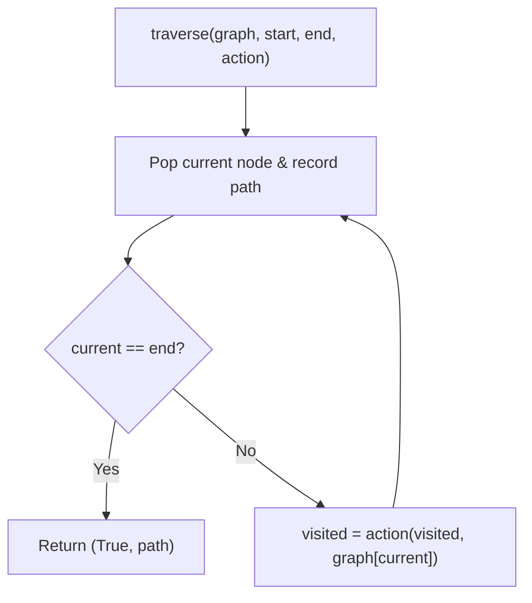

# Template Method (Behavioral)

## 1. Clear Definition
**Template** is a behavioral design pattern that extracts the **shared skeleton** of structurally similar algorithms into a single template function/method, deferring only the differing steps to **hook functions** or subclass overrides.

> **30-Second Interview Summary:**  
> *"Template eliminates duplicated control flow across algorithms that share 90% of the same steps—like BFS and DFS graph traversal—by keeping the loop in one template and parameterizing only the differing step via a hook function or subclass method."*

**Key Participants:**
* **Template (`traverse`):** Defines the invariant algorithm skeleton.
* **Hook / Action (`extend_bfs_path`, `extend_dfs_path`):** Customizes the variable step without duplicating the loop.

---

## 2. Real-Time & Real-World Examples
* **Real-Life Analogy (*Mastering Python Design Patterns*):** **A worker's daily routine** (wake up → commute → work → commute → sleep)—the skeleton is identical while the *work* step varies by job.
* **Real-Time Software Example:** **`unittest.TestCase`** (`setUp()` → `test_*()` → `tearDown()`), **`cmd.Cmd`**, and **ETL pipelines** (`extract → transform → load`).

---

## 3. Mental Model



---

## 4. Python Implementation

```python
from typing import Callable

Graph = dict[str, list[str]]
ExtendAction = Callable[[list[str], list[str]], list[str]]


def extend_bfs_path(visited: list[str], neighbors: list[str]) -> list[str]:
    """BFS hook: append neighbors to the end (FIFO queue behavior)."""
    return visited + neighbors


def extend_dfs_path(visited: list[str], neighbors: list[str]) -> list[str]:
    """DFS hook: prepend neighbors to the front (LIFO stack behavior)."""
    return neighbors + visited


def traverse(
    graph: Graph, start: str, end: str, action: ExtendAction
) -> tuple[bool, list[str]]:
    """
    Template function unifying BFS and DFS graph traversal.
    Only `action` varies between breadth-first and depth-first ordering.
    """
    path: list[str] = []
    visited = [start]

    while visited:
        current = visited.pop(0)
        if current not in path:
            path.append(current)
            if current == end:
                return True, path
            if current not in graph:
                continue  # Skip leaf nodes with no outgoing edges
            visited = action(visited, graph[current])

    return False, path


if __name__ == "__main__":
    cities: Graph = {
        "Frankfurt": ["Mannheim", "Wurzburg", "Kassel"],
        "Mannheim": ["Karlsruhe"],
        "Karlsruhe": ["Augsburg"],
        "Augsburg": ["Munchen"],
        "Wurzburg": ["Erfurt", "Nurnberg"],
    }

    print("BFS:", traverse(cities, "Frankfurt", "Nurnberg", extend_bfs_path))
    print("DFS:", traverse(cities, "Frankfurt", "Nurnberg", extend_dfs_path))
```

**Sample Output:**
```text
BFS: (True, ['Frankfurt', 'Mannheim', 'Wurzburg', 'Kassel', 'Karlsruhe', 'Erfurt', 'Nurnberg'])
DFS: (True, ['Frankfurt', 'Mannheim', 'Karlsruhe', 'Augsburg', 'Munchen', 'Wurzburg', 'Erfurt', 'Nurnberg'])
```

---

## 5. Use Cases & When to Skip
* **When to Use:**
  * Two or more algorithms share identical outer control flow (BFS/DFS, ETL jobs, report generators) and differ in 1–2 steps.
* **When to Skip:**
  * If *every* step varies, use **[Strategy](strategy.md)** instead of Template.

---

## 6. Don't Confuse With

| Pattern | Key Difference |
| :--- | :--- |
| **[Strategy](strategy.md)** | Swaps the **entire** algorithm; Template keeps one skeleton and swaps **specific steps**. |
| **[Factory Method](../creational/factory-method.md)** | Special case of Template focused strictly on **object creation** hooks. |

---

## 7. Rapid Interview Q&As
* **Q: Function hooks vs. Inheritance in Python Template Method?**  
  **A:** Passing a hook function (`action: ExtendAction`) avoids creating extra subclasses when only 1–2 steps differ; use `abc.ABC` inheritance when subclasses need multiple coordinated hooks and shared state.
