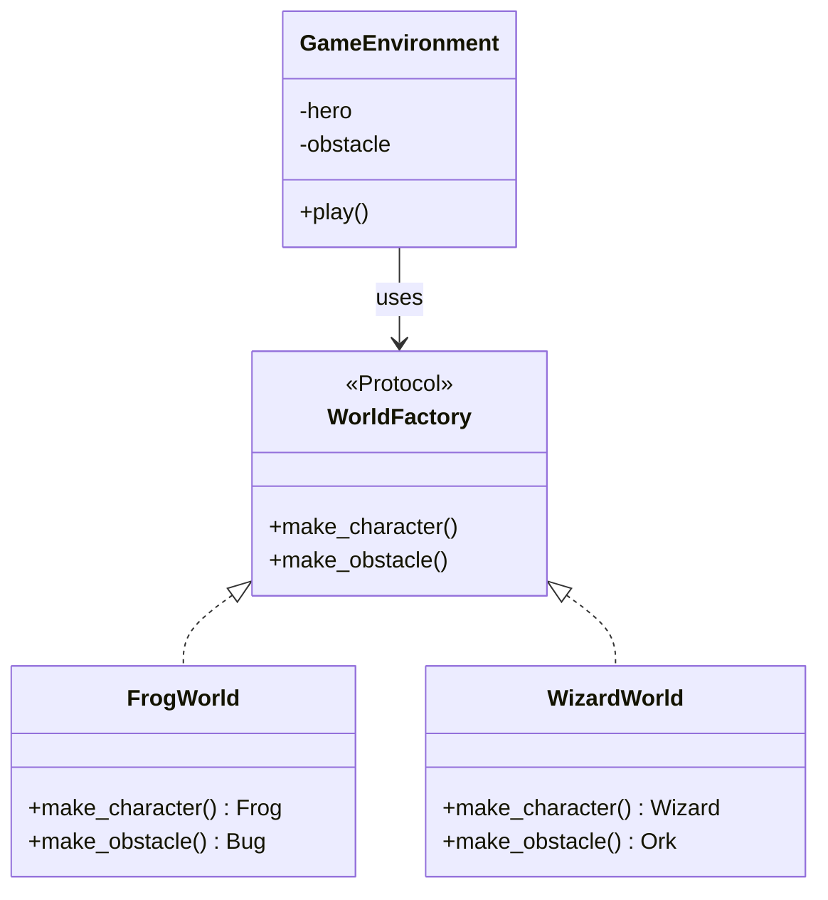

# Abstract Factory (Creational)

## 1. 30-Second Interview Answer
> **Abstract Factory** is a generalization of Factory Method: it groups multiple factory methods into a single factory object to create a **family of related products** (e.g., a game's hero + obstacle, or a UI theme's button + checkbox) without specifying their concrete classes. You can swap the entire product family **dynamically at runtime** just by passing a different factory.

---

## 2. Real-Life & Software Examples *(Mastering Python Design Patterns)*
- **Real-Life Analogy:** **Car manufacturing**—the same configurable stamping machinery produces matching doors, hoods, fenders, and mirrors for whichever car model is selected.
- **Python Software Example:** **`django_factory`** creates coordinated families of Django models for clean, readable tests; GUI toolkits swap look-and-feel themes at runtime.

---

## 3. Mental Model



---

## 4. Python Implementation *(Book Example: `FrogWorld` vs `WizardWorld`)*

Thanks to Python's duck typing, `GameEnvironment` only expects any factory with `make_character()` and `make_obstacle()` (typed cleanly with `Protocol`):

```python
from typing import Protocol


class Obstacle(Protocol):
    def action(self) -> str: ...
    def __str__(self) -> str: ...


class Character(Protocol):
    def interact_with(self, obstacle: Obstacle) -> None: ...


class WorldFactory(Protocol):
    def make_character(self) -> Character: ...
    def make_obstacle(self) -> Obstacle: ...


# --- Family 1: Kids Game ---
class Bug:
    def __str__(self) -> str:
        return "a bug"

    def action(self) -> str:
        return "eats it"


class Frog:
    def __init__(self, name: str) -> None:
        self.name = name

    def interact_with(self, obstacle: Obstacle) -> None:
        print(f"{self.name} the Frog encounters {obstacle} and {obstacle.action()}!")


class FrogWorld:
    def __init__(self, player_name: str) -> None:
        self.player_name = player_name

    def make_character(self) -> Character:
        return Frog(self.player_name)

    def make_obstacle(self) -> Obstacle:
        return Bug()


# --- Family 2: Adult Game ---
class Ork:
    def __str__(self) -> str:
        return "an evil ork"

    def action(self) -> str:
        return "kills it"


class Wizard:
    def __init__(self, name: str) -> None:
        self.name = name

    def interact_with(self, obstacle: Obstacle) -> None:
        print(f"{self.name} the Wizard battles {obstacle} and {obstacle.action()}!")


class WizardWorld:
    def __init__(self, player_name: str) -> None:
        self.player_name = player_name

    def make_character(self) -> Character:
        return Wizard(self.player_name)

    def make_obstacle(self) -> Obstacle:
        return Ork()


# --- Client ---
class GameEnvironment:
    def __init__(self, factory: WorldFactory) -> None:
        self.hero = factory.make_character()
        self.obstacle = factory.make_obstacle()

    def play(self) -> None:
        self.hero.interact_with(self.obstacle)


# Runtime selection based on user age
age = 17
factory: WorldFactory = FrogWorld("Nick") if age < 18 else WizardWorld("Nick")
GameEnvironment(factory).play()
```

---

## 5. Use Cases & When to Skip
- **Use when:**
  - You already have several [Factory Methods](factory-method.md) that naturally belong together as a **coordinated family**.
  - You want to switch an entire theme, environment, or cloud provider (`AWSFactory` vs `GCPFactory`) **dynamically at runtime**.
- **When to Skip:** Start with a simpler [Factory Method](factory-method.md) first; only graduate to Abstract Factory when you genuinely have multiple related product types that must match.

---

## 6. Rapid Follow-Up Q&As
- **Q: When do you choose Factory Method vs. Abstract Factory?**  
  **A:** Start with **Factory Method** for a single product. Upgrade to **Abstract Factory** when you need to combine multiple factory methods to guarantee a compatible family of objects.
- **Q: What is the main trade-off of Abstract Factory?**  
  **A:** Adding a new *family variant* (e.g., `SciFiWorld`) is trivial, but adding a new *product type* (`make_weapon()`) requires updating the `WorldFactory` protocol and every concrete factory.
