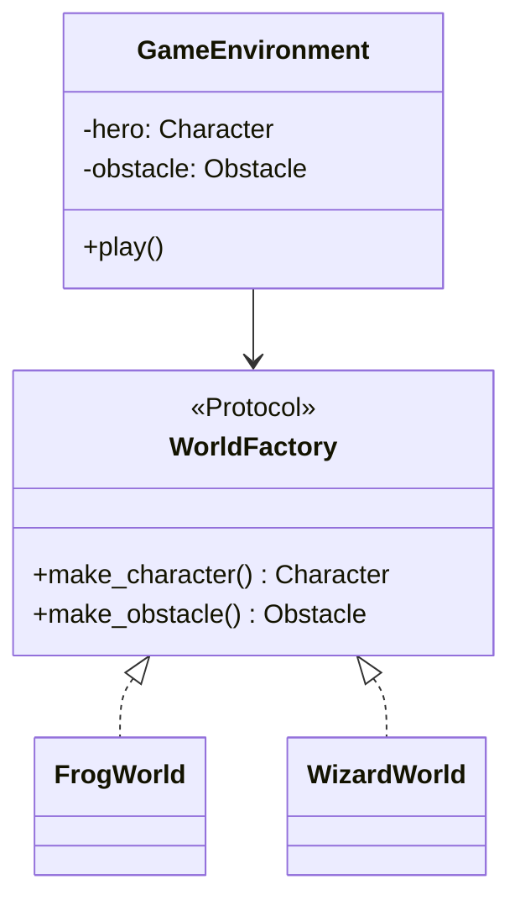

# Abstract Factory (Creational)

## 1. Clear Definition
**Abstract Factory** is a creational design pattern that groups multiple factory methods into a single factory object to create a **family of related or dependent objects** without specifying their concrete classes.

> **30-Second Interview Summary:**  
> *"Abstract Factory is a group of Factory Methods producing a matching family of products (like a game's Hero + Obstacle, or a UI theme's Button + Checkbox). You can swap the entire family dynamically at runtime just by injecting a different factory."*

**Key Participants:**
* **Abstract Factory (`WorldFactory`):** `Protocol` declaring creation methods for each product in the family.
* **Concrete Factories (`FrogWorld`, `WizardWorld`):** Produce compatible products for one variant.
* **Client (`GameEnvironment`):** Uses only the abstract factory and product protocols.

---

## 2. Real-Time & Real-World Examples
* **Real-Life Analogy (*Mastering Python Design Patterns*):** **Car manufacturing**—configurable stamping machinery produces matching doors, hoods, fenders, and mirrors for whichever car model is selected.
* **Real-Time Software Example:** **`django_factory`** generates coordinated Django model families in tests; multi-cloud services swap `AWSFactory` (`S3 + SQS`) vs `GCPFactory` (`GCS + PubSub`) via config.

---

## 3. Mental Model



---

## 4. Python Implementation

```python
from typing import Protocol


class Obstacle(Protocol):
    """Common contract for any world obstacle."""

    def action(self) -> str: ...
    def __str__(self) -> str: ...


class Character(Protocol):
    """Common contract for any playable hero."""

    def interact_with(self, obstacle: Obstacle) -> None: ...


class WorldFactory(Protocol):
    """Abstract Factory creating a matching hero + obstacle pair."""

    def make_character(self) -> Character: ...
    def make_obstacle(self) -> Obstacle: ...


class Bug:
    """Obstacle for the kids' FrogWorld."""

    def __str__(self) -> str:
        return "a bug"

    def action(self) -> str:
        return "eats it"


class Frog:
    """Hero for the kids' FrogWorld."""

    def __init__(self, name: str) -> None:
        self.name = name

    def interact_with(self, obstacle: Obstacle) -> None:
        print(f"{self.name} the Frog encounters {obstacle} and {obstacle.action()}!")


class FrogWorld:
    """Concrete Factory producing Frog + Bug."""

    def __init__(self, player_name: str) -> None:
        self.player_name = player_name

    def make_character(self) -> Character:
        return Frog(self.player_name)

    def make_obstacle(self) -> Obstacle:
        return Bug()


class Ork:
    """Obstacle for the adult WizardWorld."""

    def __str__(self) -> str:
        return "an evil ork"

    def action(self) -> str:
        return "kills it"


class Wizard:
    """Hero for the adult WizardWorld."""

    def __init__(self, name: str) -> None:
        self.name = name

    def interact_with(self, obstacle: Obstacle) -> None:
        print(f"{self.name} the Wizard battles {obstacle} and {obstacle.action()}!")


class WizardWorld:
    """Concrete Factory producing Wizard + Ork."""

    def __init__(self, player_name: str) -> None:
        self.player_name = player_name

    def make_character(self) -> Character:
        return Wizard(self.player_name)

    def make_obstacle(self) -> Obstacle:
        return Ork()


class GameEnvironment:
    """Client decoupled from concrete characters and obstacles."""

    def __init__(self, factory: WorldFactory) -> None:
        self.hero = factory.make_character()
        self.obstacle = factory.make_obstacle()

    def play(self) -> None:
        """Run the hero-vs-obstacle interaction."""
        self.hero.interact_with(self.obstacle)


if __name__ == "__main__":
    # Select the entire product family dynamically at runtime
    age = 17
    factory: WorldFactory = FrogWorld("Nick") if age < 18 else WizardWorld("Nick")
    GameEnvironment(factory).play()
```

**Sample Output:**
```text
Nick the Frog encounters a bug and eats it!
```

---

## 5. Use Cases & When to Skip
* **When to Use:**
  * Products belong together in **variants/themes/cloud providers** and mixing them would cause bugs.
  * You need to swap an entire product suite at runtime.
* **When to Skip:**
  * You only create **one** product type—use **[Factory Method](factory-method.md)** instead.

---

## 6. Don't Confuse With

| Pattern | Key Difference |
| :--- | :--- |
| **[Factory Method](factory-method.md)** | Creates **one** product; Abstract Factory creates a **family** of related products. |
| **[Builder](builder.md)** | Focuses on **step-by-step assembly** of one complex object rather than product families. |

---

## 7. Rapid Interview Q&As
* **Q: What is the hardest part of extending an Abstract Factory?**  
  **A:** Adding a new *product type* (e.g., `make_weapon()`) requires updating `WorldFactory` and **every** concrete factory, whereas adding a new *family* (`SciFiWorld`) is effortless.
* **Q: How do you decide between Factory Method and Abstract Factory?**  
  **A:** Start with Factory Method; upgrade to Abstract Factory only when multiple factory methods naturally group into a family.
