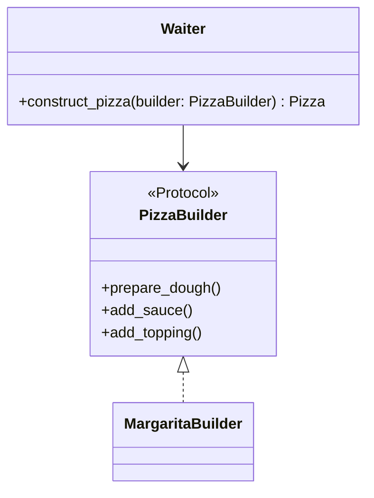

# Builder (Creational)

## 1. Clear Definition
**Builder** is a creational design pattern that separates the **step-by-step construction** of a complex object from its **final representation**, so the same assembly sequence can produce different outputs.

> **30-Second Interview Summary:**  
> *"Builder constructs complex objects incrementally in ordered steps before finalizing them. In Python, don't use Builder just for optional parameters (`@dataclass` + defaults handles that); use it when assembly requires ordered steps, validation, or different representations from the same build process."*

**Key Participants:**
* **Product (`Pizza`):** The complex object being assembled.
* **Builder (`PizzaBuilder`):** Interface defining each construction step.
* **Concrete Builder (`MargaritaBuilder`):** Implements steps for one specific representation.
* **Director (`Waiter`):** Orchestrates the exact order of construction steps.

---

## 2. Real-Time & Real-World Examples
* **Real-Life Analogy (*Mastering Python Design Patterns*):** **Fast-food restaurant**—the cashier (**Director**) sends the order to the crew (**Builder**), who follow the same assembly sequence for different burgers and box sizes.
* **Real-Time Software Example:** **`django-query-builder`** & **SQLAlchemy `select()`** (step-by-step SQL query assembly) and **`django-widgy`** (HTML page tree builder).

---

## 3. Mental Model



---

## 4. Python Implementation

```python
from dataclasses import dataclass, field
from typing import Protocol


@dataclass
class Pizza:
    """Product assembled incrementally across multiple preparation steps."""

    name: str
    dough: str = ""
    sauce: str = ""
    toppings: list[str] = field(default_factory=list)


class PizzaBuilder(Protocol):
    """Builder contract defining ordered steps to assemble a Pizza."""

    pizza: Pizza

    def prepare_dough(self) -> None: ...
    def add_sauce(self) -> None: ...
    def add_topping(self) -> None: ...


class MargaritaBuilder:
    """Concrete Builder for a classic Margarita pizza."""

    def __init__(self) -> None:
        self.pizza = Pizza(name="Margarita")

    def prepare_dough(self) -> None:
        self.pizza.dough = "thin"

    def add_sauce(self) -> None:
        self.pizza.sauce = "tomato"

    def add_topping(self) -> None:
        self.pizza.toppings.extend(["mozzarella", "oregano"])


class Waiter:
    """Director that enforces the exact order of preparation steps."""

    def construct_pizza(self, builder: PizzaBuilder) -> Pizza:
        """Execute all build steps in order and return the finished Pizza."""
        builder.prepare_dough()
        builder.add_sauce()
        builder.add_topping()
        return builder.pizza


if __name__ == "__main__":
    pizza = Waiter().construct_pizza(MargaritaBuilder())
    print(pizza)
```

**Sample Output:**
```text
Pizza(name='Margarita', dough='thin', sauce='tomato', toppings=['mozzarella', 'oregano'])
```

---

## 5. Use Cases & When to Skip
* **When to Use:**
  * Complex objects require **ordered construction steps** (SQL queries, HTTP requests, HTML documents).
  * You need to **construct an object now and finalize/render it later**, or build immutable (`frozen=True`) objects cleanly.
* **When to Skip:**
  * Plain data containers with optional fields—Python's **`@dataclass` with keyword defaults** replaces Java-style "telescoping constructor" builders.

---

## 6. Don't Confuse With

| Pattern | Key Difference |
| :--- | :--- |
| **[Factory Method](factory-method.md)** | Creates an object in **one call**; Builder constructs **step by step**. |
| **[Prototype](prototype.md)** | Clones an existing configured object instead of assembling one from scratch. |

---

## 7. Rapid Interview Q&As
* **Q: What is a Fluent Builder?**  
  **A:** A Builder where every step method returns `self` (`builder.dough("thin").sauce("tomato").build()`), removing the need for a separate Director class.
* **Q: Why does `@dataclass` eliminate most Java-style Builders in Python?**  
  **A:** Python supports named keyword arguments and default values natively, so you don't need a Builder just to avoid a 10-argument positional constructor.
