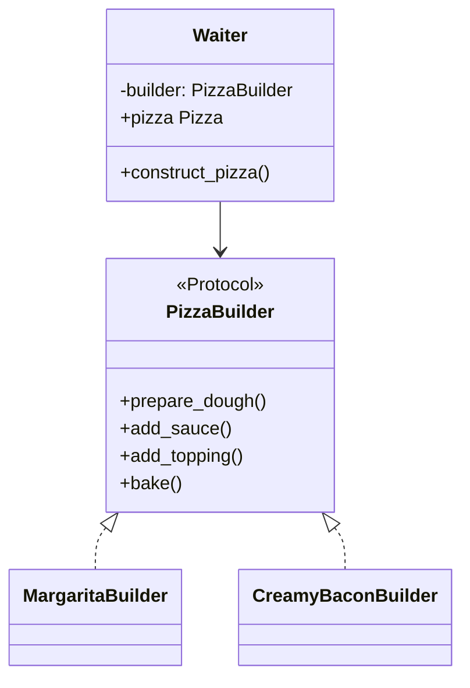

# Builder (Creational)

## 1. 30-Second Interview Answer
> **Builder** separates the **step-by-step construction** of a complex object from its **final representation**, so the same assembly steps can produce different products. In Python, use Builder when an object has ordered preparation steps or multiple representations—not just to replace keyword arguments (where `@dataclass` is simpler).

---

## 2. Real-Life & Software Examples *(Mastering Python Design Patterns)*
- **Real-Life Analogy:** **Fast-food restaurant**—the cashier (**Director**) gives instructions to the crew (**Builder**), who follow the same assembly procedure to pack different burgers and box sizes. Also: ordering a **preconfigured** computer (Factory) vs. a **custom-built** computer (Builder).
- **Python Software Example:** **`django-widgy`** (tree/HTML page builder) and **`django-query-builder`** (dynamic SQL query assembly).

---

## 3. Mental Model



---

## 4. Python Implementation *(Book Example: Pizza Ordering)*

```python
from dataclasses import dataclass, field
from typing import Protocol


@dataclass
class Pizza:
    name: str
    dough: str = ""
    sauce: str = ""
    toppings: list[str] = field(default_factory=list)


class PizzaBuilder(Protocol):
    pizza: Pizza
    def prepare_dough(self) -> None: ...
    def add_sauce(self) -> None: ...
    def add_topping(self) -> None: ...


class MargaritaBuilder:
    def __init__(self) -> None:
        self.pizza = Pizza("Margarita")

    def prepare_dough(self) -> None:
        self.pizza.dough = "thin"

    def add_sauce(self) -> None:
        self.pizza.sauce = "tomato"

    def add_topping(self) -> None:
        self.pizza.toppings.extend(["mozzarella", "oregano"])


class Waiter:  # Director
    def __init__(self) -> None:
        self._builder: PizzaBuilder | None = None

    def construct_pizza(self, builder: PizzaBuilder) -> Pizza:
        self._builder = builder
        builder.prepare_dough()
        builder.add_sauce()
        builder.add_topping()
        return builder.pizza


pizza = Waiter().construct_pizza(MargaritaBuilder())
assert pizza.sauce == "tomato"
```

---

## 5. Use Cases & When to Skip (Pythonic Alternatives)
- **Use when:**
  - An object must be built in **ordered steps** (e.g., HTML page, SQL query, custom pizza).
  - You want to **create an object now and finalize/render it later**, or decouple construction from representation.
- **When to Skip:** For plain data containers with optional fields, use `@dataclass` with keyword defaults instead of Builder boilerplate.

---

## 6. Rapid Follow-Up Q&As
- **Q: Builder vs. Factory Method?**  
  **A:** [Factory Method](factory-method.md) creates a preconfigured object in **one call**; **Builder** constructs an object **step by step** under a Director's control (or via fluent chaining).
- **Q: What is a Fluent Builder?**  
  **A:** A Builder where each setter returns `self` (`builder.dough("thin").sauce("tomato").build()`), eliminating the need for a separate Director class.
