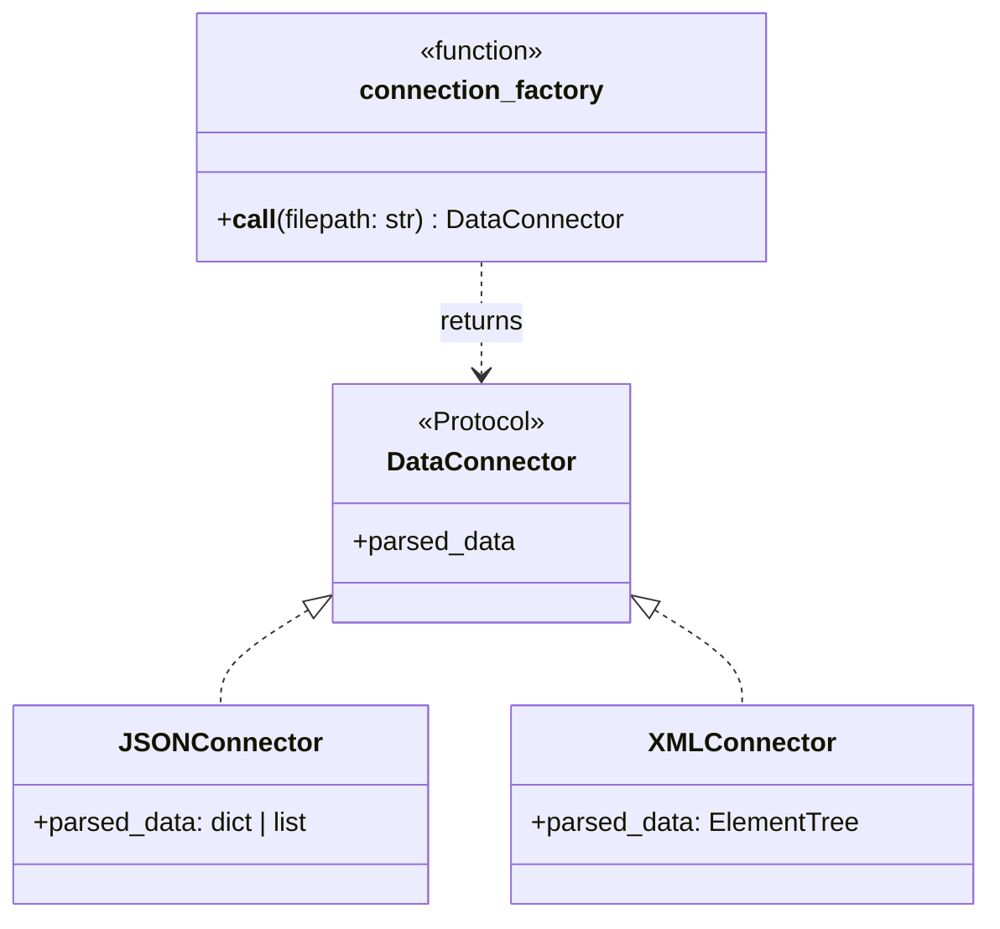

# Factory Method (Creational)

## 1. 30-Second Interview Answer
> **Factory Method** centralizes object creation in a single function or method instead of scattering direct class instantiations (`ClassName()`) across the codebase. The caller passes a parameter describing *what* it wants (`connection_factory("data.json")`), decoupling **object creation** from **object usage** and making it easy to track, cache, or swap concrete implementations.

---

## 2. Real-Life & Software Examples *(Mastering Python Design Patterns)*
- **Real-Life Analogy:** **Plastic toy molding**—the same molding powder is used, and different molds produce a duck or a car based on the requested figure name.
- **Python Software Example:** **Django `forms`** uses factory-style creation to instantiate different field types (`CharField`, `EmailField`) with customizations (`max_length`, `required`).

---

## 3. Mental Model



---

## 4. Python Implementation *(Book Example, Modernized)*

In Python, a Factory Method doesn't need a heavy creator class hierarchy—a **factory function** is idiomatic:

```python
import json
import xml.etree.ElementTree as etree
from typing import Any, Protocol


class DataConnector(Protocol):
    @property
    def parsed_data(self) -> Any: ...


class JSONConnector:
    def __init__(self, filepath: str) -> None:
        with open(filepath, mode="r", encoding="utf-8") as f:
            self._data = json.load(f)

    @property
    def parsed_data(self) -> Any:
        return self._data


class XMLConnector:
    def __init__(self, filepath: str) -> None:
        self._tree = etree.parse(filepath)

    @property
    def parsed_data(self) -> etree.ElementTree:
        return self._tree


def connection_factory(filepath: str) -> DataConnector:
    if filepath.endswith(".json"):
        return JSONConnector(filepath)
    if filepath.endswith(".xml"):
        return XMLConnector(filepath)
    raise ValueError(f"Cannot connect to {filepath}")


def connect_to(filepath: str) -> DataConnector | None:
    try:
        return connection_factory(filepath)
    except ValueError as err:
        print(err)
        return None
```

---

## 5. Use Cases & When to Skip (Pythonic Alternatives)
- **Use when:**
  - Object creation is scattered in many places and needs to be **centralized and tracked**.
  - You want to **decouple** callers from concrete classes (`MySQL` vs `SQLite`, `JSON` vs `XML`).
  - You want to **reuse/cache** instances to save memory instead of allocating a new object on every `__init__()` call.
- **When to Skip:** If there is only one concrete class that never varies, direct instantiation (`User(...)`) is simpler—don't wrap everything in a factory prematurely.

---

## 6. Rapid Follow-Up Q&As
- **Q: Why does Python often implement Factory Method as a function instead of a class hierarchy?**  
  **A:** Functions are first-class objects in Python; `connection_factory(filepath)` achieves full decoupling without Java-style boilerplate creator subclasses.
- **Q: Factory Method vs. Abstract Factory?**  
  **A:** **Factory Method** is a single function/method creating **one** kind of object (`JSONConnector` or `XMLConnector`); [Abstract Factory](abstract-factory.md) groups multiple Factory Methods to create a **family of related objects**.
- **Q: How could you forbid direct instantiation of `JSONConnector` / `XMLConnector`?**  
  **A:** Define the classes nested inside the factory function (or prefix them as private `_JSONConnector` module internals).
