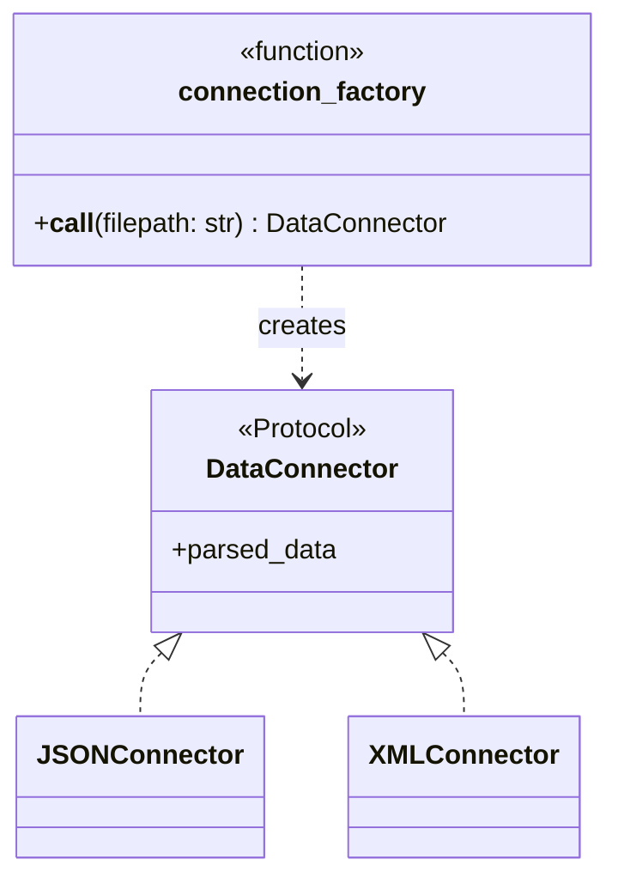

# Factory Method (Creational)

## 1. Clear Definition
**Factory Method** is a creational design pattern that centralizes object creation in a single function or method instead of scattering direct class instantiations (`ClassName()`) throughout client code. Callers pass a parameter describing *what* they need, decoupling **object creation** from **object usage**.

> **30-Second Interview Summary:**  
> *"Factory Method hides which concrete class gets instantiated behind a single factory function or hook. In Python, a standalone function like `connection_factory(filepath)` is idiomatic—giving you centralized tracking, caching, and easy extension without Java-style creator class hierarchies."*

**Key Participants:**
* **Product Interface (`DataConnector`):** Common `Protocol` / `ABC` shared by all created objects.
* **Concrete Products (`JSONConnector`, `XMLConnector`):** Specific implementations returned by the factory.
* **Factory (`connection_factory`):** Decides which concrete class to instantiate and return.

---

## 2. Real-Time & Real-World Examples
* **Real-Life Analogy (*Mastering Python Design Patterns*):** **Plastic toy molding**—the same molding powder is poured into different molds (`duck`, `car`) selected by the requested figure name.
* **Real-Time Software Example:** **Django `forms`** instantiates field types (`CharField`, `EmailField`) via factory helpers; backend ingestion services select `JSONConnector`, `XMLConnector`, or `CSVConnector` by file extension or MIME type.

---

## 3. Mental Model



---

## 4. Python Implementation

```python
import json
import xml.etree.ElementTree as etree
from typing import Any, Protocol


class DataConnector(Protocol):
    """Common contract that every file connector must expose."""

    @property
    def parsed_data(self) -> Any:
        """Return parsed contents of the underlying data source."""
        ...


class JSONConnector:
    """Loads and exposes data from a JSON file."""

    def __init__(self, filepath: str) -> None:
        with open(filepath, mode="r", encoding="utf-8") as f:
            self._data = json.load(f)

    @property
    def parsed_data(self) -> Any:
        return self._data


class XMLConnector:
    """Loads and exposes an ElementTree from an XML file."""

    def __init__(self, filepath: str) -> None:
        self._tree = etree.parse(filepath)

    @property
    def parsed_data(self) -> etree.ElementTree:
        return self._tree


def connection_factory(filepath: str) -> DataConnector:
    """
    Factory Method: selects and instantiates the right connector
    based on the file extension, decoupling callers from concrete classes.
    """
    connectors: dict[str, type[DataConnector]] = {
        ".json": JSONConnector,
        ".xml": XMLConnector,
    }
    for ext, connector_cls in connectors.items():
        if filepath.endswith(ext):
            return connector_cls(filepath)

    raise ValueError(f"Unsupported file format: {filepath}")


def connect_to(filepath: str) -> DataConnector | None:
    """Safe wrapper that handles unsupported formats gracefully."""
    try:
        return connection_factory(filepath)
    except ValueError as err:
        print(f"[ERROR] {err}")
        return None


if __name__ == "__main__":
    # Unsupported format is caught cleanly without crashing callers
    conn = connect_to("data/person.sq3")
    print("Connector:", conn)
```

**Sample Output:**
```text
[ERROR] Unsupported file format: data/person.sq3
Connector: None
```

---

## 5. Use Cases & When to Skip
* **When to Use:**
  * Object creation is scattered in multiple modules and needs to be **centralized, tracked, or cached**.
  * You want callers decoupled from concrete backends (`Postgres` vs `SQLite`, `JSON` vs `XML`).
* **When to Skip:**
  * There is only **one** concrete class that never varies—calling `User(...)` directly is simpler.

---

## 6. Don't Confuse With

| Pattern | Key Difference |
| :--- | :--- |
| **[Abstract Factory](abstract-factory.md)** | Factory Method creates **1 product**; Abstract Factory creates a **family of related products**. |
| **[Builder](builder.md)** | Factory Method builds in **1 call**; Builder assembles a complex object **step by step**. |

---

## 7. Rapid Interview Q&As
* **Q: Why use a function instead of a Creator class hierarchy in Python?**  
  **A:** Functions are first-class objects in Python—`connection_factory()` achieves full decoupling without unnecessary subclass boilerplate.
* **Q: How can you prevent callers from instantiating `JSONConnector` directly?**  
  **A:** Prefix the concrete classes with `_` as module-private (`_JSONConnector`) or nest them inside the factory function.
