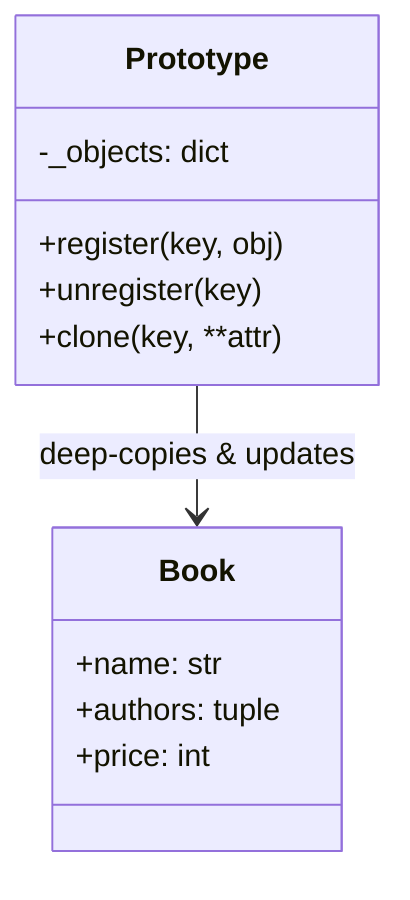

# Prototype (Creational)

## 1. 30-Second Interview Answer
> **Prototype** creates new objects by **cloning an existing instance** at a specific point in time rather than instantiating from scratch. In Python, it's powered by `copy.deepcopy()` combined with a `Prototype` registry—letting you modify a cloned object independently without mutating the original.

---

## 2. Real-Life & Software Examples *(Mastering Python Design Patterns)*
- **Real-Life Analogy:** **Mitosis** (biological cell division producing two identical cells) and **sharing a culinary recipe** (Bob clones his cake recipe for Alice so his later experiments don't overwrite Alice's copy).
- **Python Software Example:** Python's built-in `copy` module (`copy.copy()` and `copy.deepcopy()`) and `dataclasses.replace()`.

---

## 3. Mental Model



---

## 4. Python Implementation *(Book Example: `Prototype` Registry + `Book`)*

```python
import copy
from typing import Any


class Book:
    def __init__(self, name: str, authors: tuple[str, ...], price: int, **rest: Any) -> None:
        self.name = name
        self.authors = authors
        self.price = price
        self.__dict__.update(rest)


class Prototype:
    def __init__(self) -> None:
        self._objects: dict[str, Any] = {}

    def register(self, identifier: str, obj: Any) -> None:
        self._objects[identifier] = obj

    def unregister(self, identifier: str) -> None:
        del self._objects[identifier]

    def clone(self, identifier: str, **attrs: Any) -> Any:
        found = self._objects.get(identifier)
        if not found:
            raise ValueError(f"Incorrect object identifier: {identifier}")
        obj = copy.deepcopy(found)
        obj.__dict__.update(attrs)
        return obj


b1 = Book("The C Programming Language", ("Brian W. Kernighan", "Dennis M. Ritchie"), price=118)
proto = Prototype()
proto.register("k&r", b1)
b2 = proto.clone("k&r", price=125, edition=2)
assert b1.price == 118 and b2.price == 125
```

---

## 5. Use Cases & When to Skip (Pythonic Alternatives)
- **Use when:** You need independent snapshots of a complex object at a point in time, or initialization is expensive and cloning + tweaking attributes is cheaper.
- **Pythonic Alternative:** For simple `@dataclass` objects, `dataclasses.replace(obj, price=125)` is faster and cleaner than a registry.

---

## 6. Rapid Follow-Up Q&As
- **Q: `copy.copy()` vs `copy.deepcopy()`?**  
  **A:** `copy.copy()` (shallow) copies the outer object but **shares nested mutable objects** (lists/dicts). `copy.deepcopy()` recursively clones all nested objects so mutations never leak.
- **Q: Copy vs. Reference?**  
  **A:** Two references (`a = b`) point to the **same memory address** (`id(a) == id(b)`); a clone creates a **separate object** at a new memory address.
