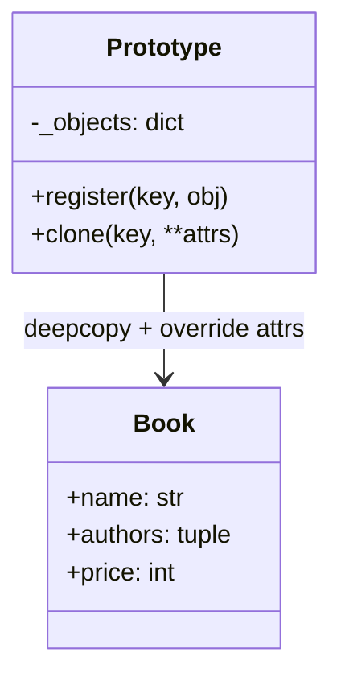

# Prototype (Creational)

## 1. Clear Definition
**Prototype** is a creational design pattern that creates new objects by **cloning an existing instance** (at a specific point in time) rather than constructing one from scratch.

> **30-Second Interview Summary:**  
> *"Prototype copies an existing object cleanly—useful when initialization is expensive or when you want independent snapshots without mutating the original. In Python, it's implemented with `copy.deepcopy()` and an optional registry."*

**Key Participants:**
* **Prototype Registry (`Prototype`):** Stores named template objects and clones them on demand.
* **Cloned Object (`Book`):** Any object duplicated via `copy.deepcopy()` with optional attribute overrides.

---

## 2. Real-Time & Real-World Examples
* **Real-Life Analogy (*Mastering Python Design Patterns*):** **Mitosis** (cell division producing identical independent cells) and **sharing a recipe** (cloning a cake recipe so later edits don't overwrite your friend's copy).
* **Real-Time Software Example:** **Document/config templates** loaded once from a database and deep-copied per request, or Python's **`copy.deepcopy()`** / **`dataclasses.replace()`**.

---

## 3. Mental Model



---

## 4. Python Implementation

```python
import copy
from typing import Any


class Book:
    """Domain object representing a book with flexible metadata."""

    def __init__(self, name: str, authors: tuple[str, ...], price: int, **rest: Any) -> None:
        self.name = name
        self.authors = authors
        self.price = price
        self.__dict__.update(rest)

    def __repr__(self) -> str:
        return f"Book(name={self.name!r}, price={self.price}, edition={getattr(self, 'edition', 1)})"


class Prototype:
    """Registry that stores prototype objects and produces independent deep clones."""

    def __init__(self) -> None:
        self._objects: dict[str, Any] = {}

    def register(self, identifier: str, obj: Any) -> None:
        """Register a prototype instance under a lookup key."""
        self._objects[identifier] = obj

    def unregister(self, identifier: str) -> None:
        """Remove a registered prototype."""
        del self._objects[identifier]

    def clone(self, identifier: str, **attrs: Any) -> Any:
        """
        Deep-copy the registered prototype so nested mutable fields are isolated,
        then apply any caller-provided attribute overrides.
        """
        found = self._objects.get(identifier)
        if found is None:
            raise ValueError(f"Unknown prototype identifier: {identifier}")

        cloned = copy.deepcopy(found)
        cloned.__dict__.update(attrs)
        return cloned


if __name__ == "__main__":
    first_ed = Book("The C Programming Language", ("Kernighan", "Ritchie"), price=118, edition=1)
    registry = Prototype()
    registry.register("k&r", first_ed)

    second_ed = registry.clone("k&r", price=125, edition=2)
    print("Original:", first_ed)
    print("Clone:   ", second_ed)
```

**Sample Output:**
```text
Original: Book(name='The C Programming Language', price=118, edition=1)
Clone:    Book(name='The C Programming Language', price=125, edition=2)
```

---

## 5. Use Cases & When to Skip
* **When to Use:**
  * Creating an object from scratch is expensive (DB/file I/O) and cloning + tweaking a template is faster.
  * You need **independent point-in-time copies** where edits to one copy must not leak into others.
* **When to Skip:**
  * Simple `@dataclass` objects—`dataclasses.replace(obj, price=125)` is faster and cleaner.

---

## 6. Don't Confuse With

| Pattern | Key Difference |
| :--- | :--- |
| **[Factory Method](factory-method.md)** | Instantiates a fresh object via `__init__`; Prototype duplicates an **existing** instance. |
| **[Builder](builder.md)** | Assembles a new complex object step by step from scratch rather than cloning. |

---

## 7. Rapid Interview Q&As
* **Q: `copy.copy()` vs `copy.deepcopy()`?**  
  **A:** `copy.copy()` (shallow) copies the outer container but **shares nested mutable lists/dicts**. `copy.deepcopy()` recursively clones nested objects so mutations never leak.
* **Q: When does `copy.deepcopy()` fail in Python?**  
  **A:** On open file handles, network sockets, or `threading.Lock`s—implement `__deepcopy__(self, memo)` to skip or re-open those resources.
