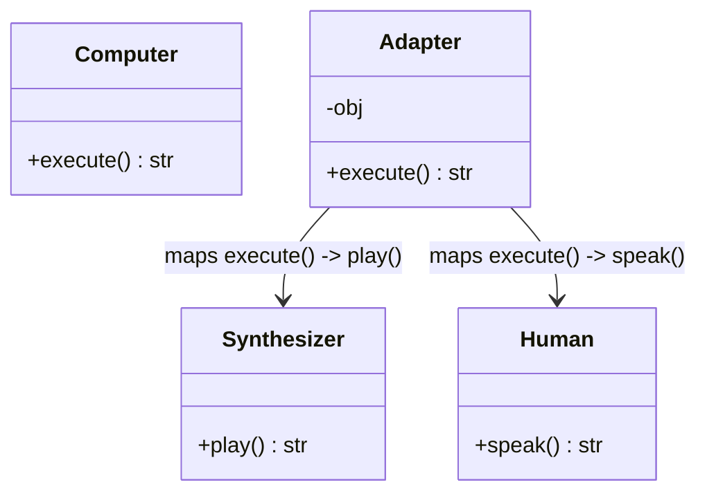

# Adapter (Structural)

## 1. 30-Second Interview Answer
> **Adapter** makes two incompatible interfaces work together after they've already been built—without modifying the original source code (respecting the Open/Closed Principle). In Python, instead of Java-style inheritance, a clean **generic `Adapter` class** can map method names dynamically (`self.__dict__.update(adapted_methods)` or `__getattr__`).

---

## 2. Real-Life & Software Examples *(Mastering Python Design Patterns)*
- **Real-Life Analogy:** **Power plug & cable adapters** (EU-to-UK travel plug adapter, Lightning-to-USB adapter)—connecting hardware that wasn't built to fit directly.
- **Python Software Example:** **Grok** (Zope 3 framework) uses adapters to make existing objects conform to APIs; **Python Traits** adapts objects to target interfaces.

---

## 3. Mental Model



---

## 4. Python Implementation *(Book Example: `Computer` / `Synthesizer` / `Human`)*

```python
from typing import Any, Callable


class Computer:
    def __init__(self, name: str) -> None:
        self.name = name

    def execute(self) -> str:
        return "executes a program"


class Synthesizer:
    def __init__(self, name: str) -> None:
        self.name = name

    def play(self) -> str:
        return "is playing an electronic song"


class Human:
    def __init__(self, name: str) -> None:
        self.name = name

    def speak(self) -> str:
        return "says hello"


class Adapter:
    def __init__(self, obj: Any, adapted_methods: dict[str, Callable[[], str]]) -> None:
        self.obj = obj
        self.__dict__.update(adapted_methods)

    def __getattr__(self, attr: str) -> Any:
        return getattr(self.obj, attr)


objects: list[Any] = [Computer("Asus")]
synth = Synthesizer("Moog")
human = Human("Bob")
objects.append(Adapter(synth, {"execute": synth.play}))
objects.append(Adapter(human, {"execute": human.speak}))

for item in objects:
    print(f"{item.name} {item.execute()}")
```

---

## 5. Use Cases & When to Skip
- **Use when:** You need an old component in a new system (or a third-party library whose source you can't edit) to conform to an expected interface—e.g., adapting a DKK-only e-commerce `calculate_total()` to USD/EUR.
- **When to Skip:** If you own both sides and can refactor cleanly, align the interfaces directly instead of adding an adapter layer.

---

## 6. Rapid Follow-Up Q&As
- **Q: How does `Adapter.__getattr__` help here?**  
  **A:** Any attribute not explicitly adapted (like `item.name`) is automatically forwarded to `self.obj`, so the caller doesn't lose access to the wrapped object's properties.
- **Q: Adapter vs. Facade?**  
  **A:** Adapter makes an **existing** interface compatible (1-to-1); [Facade](facade.md) builds a **new simplified interface** over a complex subsystem.
