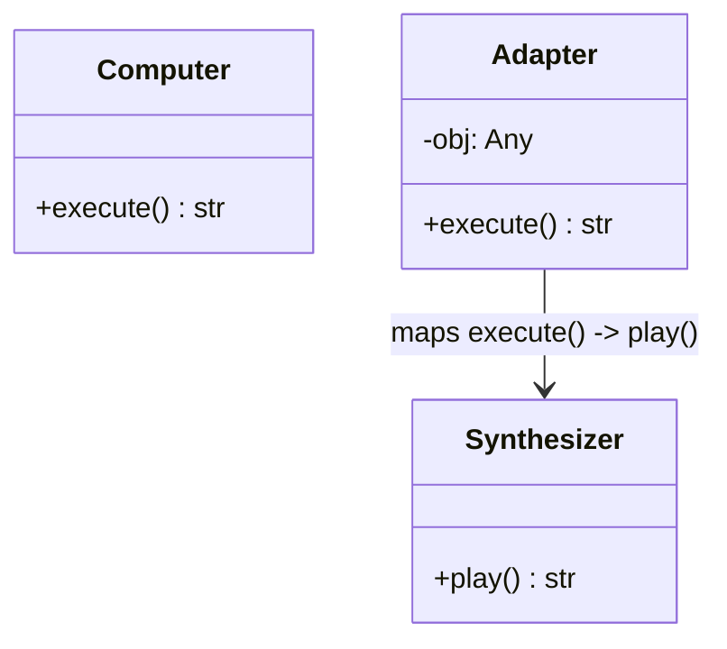

# Adapter (Structural)

## 1. Clear Definition
**Adapter** is a structural design pattern that lets two **incompatible interfaces** collaborate without modifying either class's source code. It wraps an existing object and translates calls into the interface expected by the client.

> **30-Second Interview Summary:**  
> *"Adapter is a translator layer between two incompatible APIs—like wrapping a third-party SDK so it matches your internal `Protocol`. In Python, a generic `Adapter` class can dynamically map method names via `__dict__` and forward attributes with `__getattr__`."*

**Key Participants:**
* **Target Interface (`execute()`):** The interface client code expects.
* **Adaptee (`Synthesizer`, `Human`):** Existing class with an incompatible method (`play()`, `speak()`).
* **Adapter (`Adapter`):** Wraps the adaptee and exposes the target interface.

---

## 2. Real-Time & Real-World Examples
* **Real-Life Analogy (*Mastering Python Design Patterns*):** **Power plug & cable adapters** (EU-to-UK travel plug, Lightning-to-USB adapter).
* **Real-Time Software Example:** **Grok** (Zope 3 framework) and **Python Traits** use adapters for API conformance; backend services wrap third-party payment SDKs behind a unified `PaymentGateway` protocol.

---

## 3. Mental Model



---

## 4. Python Implementation

```python
from typing import Any, Callable


class Computer:
    """Native class that already conforms to the expected `execute()` interface."""

    def __init__(self, name: str) -> None:
        self.name = name

    def execute(self) -> str:
        return "executes a program"


class Synthesizer:
    """Third-party class with an incompatible `play()` method."""

    def __init__(self, name: str) -> None:
        self.name = name

    def play(self) -> str:
        return "is playing an electronic song"


class Human:
    """External class with an incompatible `speak()` method."""

    def __init__(self, name: str) -> None:
        self.name = name

    def speak(self) -> str:
        return "says hello"


class Adapter:
    """
    Generic Python Adapter that binds target method names (e.g., `execute`)
    to adaptee callables while forwarding all other attribute lookups.
    """

    def __init__(self, obj: Any, adapted_methods: dict[str, Callable[[], str]]) -> None:
        self.obj = obj
        # Inject target method names directly onto this Adapter instance
        self.__dict__.update(adapted_methods)

    def __getattr__(self, attr: str) -> Any:
        """Delegate unadapted attributes (like `.name`) to the wrapped object."""
        return getattr(self.obj, attr)


if __name__ == "__main__":
    synth = Synthesizer("Moog")
    human = Human("Bob")
    objects: list[Any] = [
        Computer("Asus"),
        Adapter(synth, {"execute": synth.play}),
        Adapter(human, {"execute": human.speak}),
    ]

    for item in objects:
        print(f"{item.name} {item.execute()}")
```

**Sample Output:**
```text
Asus executes a program
Moog is playing an electronic song
Bob says hello
```

---

## 5. Use Cases & When to Skip
* **When to Use:**
  * Integrating a third-party library or legacy component whose source code you cannot modify (Open/Closed Principle).
  * Normalizing multiple external APIs (e.g., DKK/USD/EUR converters) behind one internal `Protocol`.
* **When to Skip:**
  * If you own both classes and can refactor them directly, align the interfaces without an extra wrapper.

---

## 6. Don't Confuse With

| Pattern | Key Difference |
| :--- | :--- |
| **[Facade](facade.md)** | Creates a **new simplified** API over many classes; Adapter translates **1 existing** interface. |
| **[Decorator](decorator.md)** | Keeps the **exact same** interface and adds behavior; Adapter **changes** the interface. |

---

## 7. Rapid Interview Q&As
* **Q: Why does `Adapter.__getattr__` exist in the Python example?**  
  **A:** Python calls `__getattr__` only when an attribute isn't found on `self`, so `item.name` seamlessly resolves to `self.obj.name`.
* **Q: Object Adapter (composition) vs. Class Adapter (multiple inheritance)?**  
  **A:** Always prefer **Object Adapter** (wrapping `self.obj`)—it works with any subclass and avoids fragile multiple-inheritance hierarchies.
