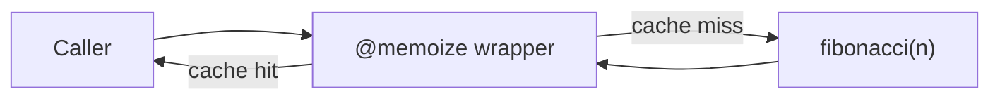

# Decorator (Structural)

## 1. 30-Second Interview Answer
> **Decorator** extends an object or callable's behavior **dynamically at runtime** without using inheritance or affecting other instances. In Python, instead of GoF-style wrapper subclasses, we use **Python's built-in `@decorator` syntax** (`fin -> fout`) with `@functools.wraps` to cleanly layer cross-cutting concerns like memoization, caching, auth, and logging.

---

## 2. Real-Life & Software Examples *(Mastering Python Design Patterns)*
- **Real-Life Analogy:** Adding a **silencer** to a firearm or swapping **removable lenses** on a camera—extending capability dynamically without rebuilding the core device.
- **Python Software Example:** **Django** (`@gzip_page`, `@cache_page`) and **Grok** use decorators for HTTP compression, caching, and access control.

---

## 3. Mental Model



---

## 4. Python Implementation *(Book Example: Fibonacci Memoization)*

```python
from functools import wraps
from typing import Callable, ParamSpec, TypeVar

P = ParamSpec("P")
R = TypeVar("R")


def memoize(fn: Callable[P, R]) -> Callable[P, R]:
    known: dict[tuple[object, ...], R] = {}

    @wraps(fn)  # Preserves fn.__name__ and fn.__doc__
    def memoizer(*args: P.args, **kwargs: P.kwargs) -> R:
        key = args
        if key not in known:
            known[key] = fn(*args, **kwargs)
        return known[key]

    return memoizer


@memoize
def fibonacci(n: int) -> int:
    """Return the nth Fibonacci number."""
    assert n >= 0
    return n if n in (0, 1) else fibonacci(n - 1) + fibonacci(n - 2)


assert fibonacci(30) == 832040
assert fibonacci.__name__ == "fibonacci"
```

---

## 5. Use Cases & When to Skip (Pythonic Alternatives)
- **Use when:** Adding **cross-cutting concerns** (memoization, logging, validation, compression, retries, auth) without polluting core business logic.
- **Pythonic Built-in:** For memoization in production, use `@functools.lru_cache(maxsize=None)` or `@functools.cache` directly from the stdlib.

---

## 6. Rapid Follow-Up Q&As
- **Q: Why is `@functools.wraps(fn)` essential in Python decorators?**  
  **A:** Without `@wraps(fn)`, the decorated function loses its original `__name__`, `__doc__`, and signature (it becomes `"memoizer"`), breaking debugging, Sphinx docs, and frameworks like FastAPI/pytest.
- **Q: Python `@decorator` vs. GoF Object Decorator?**  
  **A:** `@decorator` wraps a function/class at **definition time**; GoF object wrappers wrap **individual instances at runtime** (useful when two instances of the same class need different wrappers).
