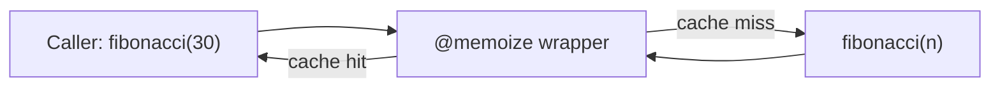

# Decorator (Structural)

## 1. Clear Definition
**Decorator** is a structural design pattern that adds new responsibilities to a function or object **dynamically and transparently** without modifying its source code or creating subclasses.

> **30-Second Interview Summary:**  
> *"Decorator wraps a callable or object to layer cross-cutting concerns—like caching, logging, auth, or retries—without touching core business logic. In Python, we use `@decorator` syntax with `@functools.wraps` instead of Java-style wrapper subclasses."*

**Key Participants:**
* **Wrapped Callable (`fibonacci`):** The core function or object being enhanced.
* **Decorator (`memoize`):** A higher-order callable taking `fn` and returning a wrapped `memoizer` function.

---

## 2. Real-Time & Real-World Examples
* **Real-Life Analogy (*Mastering Python Design Patterns*):** Adding a **silencer** to a firearm or swapping **removable lenses** on a camera—extending capabilities without rebuilding the core item.
* **Real-Time Software Example:** **Django** (`@cache_page`, `@gzip_page`), **FastAPI** (`@app.get`), and **`@functools.lru_cache`** for memoization.

---

## 3. Mental Model



---

## 4. Python Implementation

```python
from functools import wraps
from typing import Callable, ParamSpec, TypeVar

P = ParamSpec("P")
R = TypeVar("R")


def memoize(fn: Callable[P, R]) -> Callable[P, R]:
    """
    Decorator that caches return values by positional arguments
    so repeated recursive calls run in O(1) time.
    """
    known: dict[tuple[object, ...], R] = {}

    @wraps(fn)  # Preserves fn.__name__, __doc__, and type metadata
    def memoizer(*args: P.args, **kwargs: P.kwargs) -> R:
        if args not in known:
            known[args] = fn(*args, **kwargs)
        return known[args]

    return memoizer


@memoize
def fibonacci(n: int) -> int:
    """Return the nth Fibonacci number using memoized recursion."""
    if n < 0:
        raise ValueError("n must be non-negative")
    return n if n in (0, 1) else fibonacci(n - 1) + fibonacci(n - 2)


if __name__ == "__main__":
    print(f"fib(30) = {fibonacci(30)}")
    print(f"Function name preserved: {fibonacci.__name__}")
```

**Sample Output:**
```text
fib(30) = 832040
Function name preserved: fibonacci
```

---

## 5. Use Cases & When to Skip
* **When to Use:**
  * Cross-cutting concerns: **memoization, logging, auth checks, rate limiting, retries, timing**.
* **When to Skip (Pythonic Built-in):**
  * For memoization in production, use **`@functools.cache`** / **`@functools.lru_cache`** directly instead of writing your own `known` dict.

---

## 6. Don't Confuse With

| Pattern | Key Difference |
| :--- | :--- |
| **[Proxy](proxy.md)** | Controls **access/lifecycle** transparently; Decorator **adds new behavior** chosen by the caller. |
| **[Chain of Responsibility](../behavioral/chain-of-responsibility.md)** | CoR handlers can **short-circuit** early; Decorators forward calls through every layer. |

---

## 7. Rapid Interview Q&As
* **Q: Why is `@functools.wraps(fn)` critical?**  
  **A:** Without `@wraps(fn)`, the wrapped function loses its `__name__`, `__doc__`, and signature (becoming `"memoizer"`), which breaks debuggers, Sphinx docs, and FastAPI/pytest introspection.
* **Q: Python `@decorator` vs. GoF Object Decorator?**  
  **A:** `@decorator` wraps a function/class at **definition time**; GoF object wrappers wrap **individual instances at runtime**.
