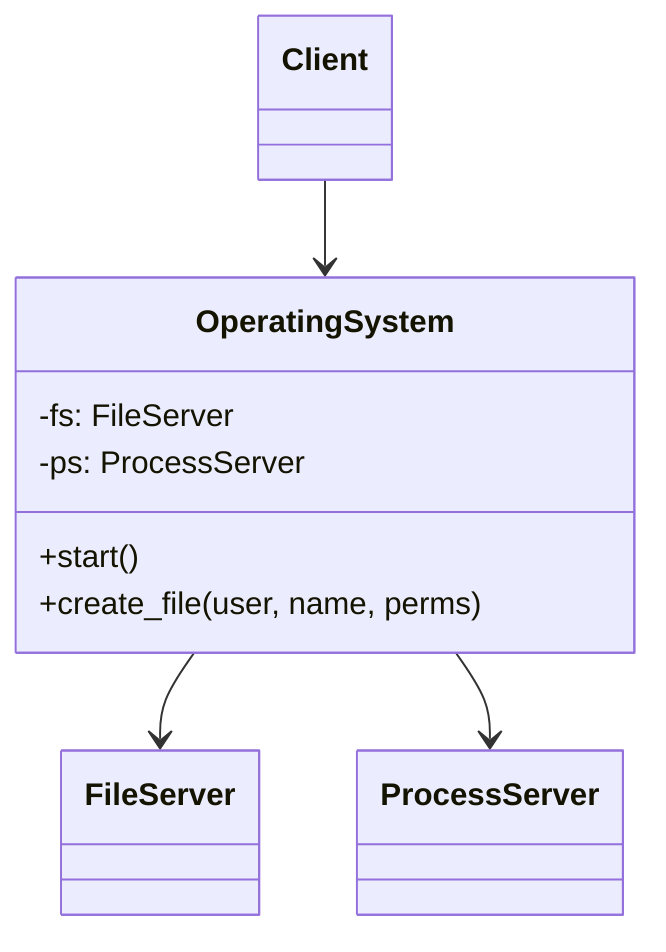

# Facade (Structural)

## 1. Clear Definition
**Facade** is a structural design pattern that provides a **single, simplified high-level interface** over a complex subsystem of multiple classes, libraries, or ordered startup steps.

> **30-Second Interview Summary:**  
> *"Facade hides internal subsystem complexity behind one clean entry point (like `os_facade.start()`). Callers don't need to know which internal servers exist or in what order to boot them—keeping client code loosely coupled."*

**Key Participants:**
* **Facade (`OperatingSystem`):** Exposes simple high-level methods and delegates to subsystem classes.
* **Subsystem Classes (`FileServer`, `ProcessServer`):** Perform the actual low-level work.
* **Client:** Calls only the Facade (though advanced callers can still access subsystem classes directly).

---

## 2. Real-Time & Real-World Examples
* **Real-Life Analogy (*Mastering Python Design Patterns*):** **Car ignition key / computer power button** (one press boots BIOS, bootloader, and OS kernel) and a **bank customer service desk** routing you to billing or tech support.
* **Real-Time Software Example:** **`django-oscar-datacash`** (simple Facade over granular DataCash payment APIs), **`requests.get()`** (facade over `urllib3` pooling, SSL, headers, redirects).

---

## 3. Mental Model



---

## 4. Python Implementation

```python
from abc import ABC, abstractmethod
from enum import Enum


class State(Enum):
    """Lifecycle states shared by microkernel servers."""

    NEW = 0
    RUNNING = 1
    RESTART = 2
    ZOMBIE = 3


class Server(ABC):
    """Abstract subsystem server interface."""

    @abstractmethod
    def boot(self) -> None:
        """Start the server."""

    @abstractmethod
    def kill(self, restart: bool = True) -> None:
        """Stop or restart the server."""


class FileServer(Server):
    """Subsystem responsible for filesystem operations."""

    def __init__(self) -> None:
        self.state = State.NEW

    def boot(self) -> None:
        self.state = State.RUNNING
        print("Booting FileServer...")

    def kill(self, restart: bool = True) -> None:
        self.state = State.RESTART if restart else State.ZOMBIE

    def create_file(self, user: str, name: str, permissions: str) -> None:
        """Low-level file creation delegated by the OS facade."""
        print(f"Created file '{name}' for {user} ({permissions})")


class ProcessServer(Server):
    """Subsystem responsible for OS process scheduling."""

    def __init__(self) -> None:
        self.state = State.NEW

    def boot(self) -> None:
        self.state = State.RUNNING
        print("Booting ProcessServer...")

    def kill(self, restart: bool = True) -> None:
        self.state = State.RESTART if restart else State.ZOMBIE

    def create_process(self, user: str, name: str) -> None:
        """Low-level process creation delegated by the OS facade."""
        print(f"Created process '{name}' for {user}")


class OperatingSystem:
    """Facade hiding multi-server orchestration behind a simple API."""

    def __init__(self) -> None:
        self.fs = FileServer()
        self.ps = ProcessServer()

    def start(self) -> None:
        """Boot all required subsystem servers in the correct order."""
        for server in (self.fs, self.ps):
            server.boot()

    def create_file(self, user: str, name: str, permissions: str) -> None:
        """Delegate file creation to the FileServer."""
        self.fs.create_file(user, name, permissions)

    def create_process(self, user: str, name: str) -> None:
        """Delegate process creation to the ProcessServer."""
        self.ps.create_process(user, name)


if __name__ == "__main__":
    os_facade = OperatingSystem()
    os_facade.start()
    os_facade.create_file("alice", "notes.md", "-rw-r--r--")
```

**Sample Output:**
```text
Booting FileServer...
Booting ProcessServer...
Created file 'notes.md' for alice (-rw-r--r--)
```

---

## 5. Use Cases & When to Skip
* **When to Use:**
  * Simplifying noisy multi-step subsystems (checkout flows, cloud SDKs, media pipelines).
  * Enforcing clean architectural boundaries between service layers.
* **When to Skip:**
  * Avoid turning a Facade into a **God Object** that re-implements business logic—keep it a thin orchestrator.

---

## 6. Don't Confuse With

| Pattern | Key Difference |
| :--- | :--- |
| **[Adapter](adapter.md)** | Translates **1 existing** incompatible interface; Facade creates a **new simplified** API over a subsystem. |
| **[Proxy](proxy.md)** | Keeps the **same** interface as 1 target object; Facade defines a simpler interface over **many** objects. |

---

## 7. Rapid Interview Q&As
* **Q: Does a Facade block callers from using subsystem classes directly?**  
  **A:** No—advanced users can still call `FileServer` directly when fine-grained control is needed.
