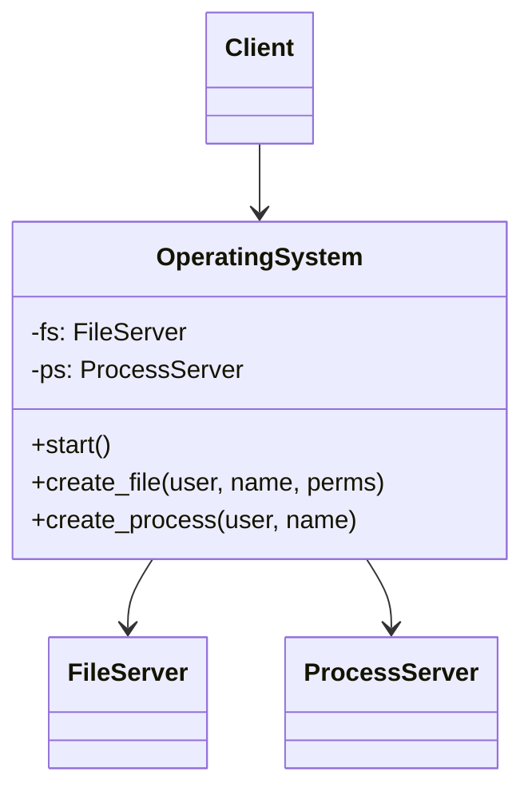

# Facade (Structural)

## 1. 30-Second Interview Answer
> **Facade** hides a complex, multi-class subsystem behind a **single simplified interface** so clients only call high-level operations without knowing internal boot order, server coordination, or low-level APIs.

---

## 2. Real-Life & Software Examples *(Mastering Python Design Patterns)*
- **Real-Life Analogy:** **Customer service desk** at a bank (one contact routing you to billing, tech support, or accounts) and a **car ignition key** / **computer power button** (one press triggers BIOS, bootloader, OS kernel).
- **Python Software Example:** **`django-oscar-datacash`** (simplified Facade over granular DataCash payment APIs + transaction auditing) and **`Caliendo`** (API mocking facade with caching).

---

## 3. Mental Model



---

## 4. Python Implementation *(Book Example: Multi-Server `OperatingSystem`)*

```python
from abc import ABC, abstractmethod
from enum import Enum


class State(Enum):
    NEW = 0
    RUNNING = 1
    SLEEPING = 2
    RESTART = 3
    ZOMBIE = 4


class Server(ABC):
    @abstractmethod
    def boot(self) -> None: ...

    @abstractmethod
    def kill(self, restart: bool = True) -> None: ...


class FileServer(Server):
    def __init__(self) -> None:
        self.name = "FileServer"
        self.state = State.NEW

    def boot(self) -> None:
        self.state = State.RUNNING

    def kill(self, restart: bool = True) -> None:
        self.state = State.RESTART if restart else State.ZOMBIE

    def create_file(self, user: str, name: str, permissions: str) -> None:
        print(f"Creating file '{name}' for {user} with permissions {permissions}")


class ProcessServer(Server):
    def __init__(self) -> None:
        self.name = "ProcessServer"
        self.state = State.NEW

    def boot(self) -> None:
        self.state = State.RUNNING

    def kill(self, restart: bool = True) -> None:
        self.state = State.RESTART if restart else State.ZOMBIE

    def create_process(self, user: str, name: str) -> None:
        print(f"Creating process '{name}' for {user}")


class OperatingSystem:  # Facade
    def __init__(self) -> None:
        self.fs = FileServer()
        self.ps = ProcessServer()

    def start(self) -> None:
        for srv in (self.fs, self.ps):
            srv.boot()

    def create_file(self, user: str, name: str, permissions: str) -> None:
        self.fs.create_file(user, name, permissions)

    def create_process(self, user: str, name: str) -> None:
        self.ps.create_process(user, name)


os_facade = OperatingSystem()
os_facade.start()
os_facade.create_file("foo", "hello", "-rw-r-r")
```

---

## 5. Use Cases & When to Skip
- **Use when:** You want a clean boundary over a complex subsystem (OS services, payment gateways, video pipelines) so clients don't couple to internal classes.
- **When to Skip:** Don't let the Facade become a **God Object** that re-implements business logic—keep it a thin delegation layer.

---

## 6. Rapid Follow-Up Q&As
- **Q: Facade vs. Adapter?**  
  **A:** [Adapter](adapter.md) translates an existing interface into another (1-to-1); **Facade** simplifies a whole subsystem into a new high-level API (1-to-many).
