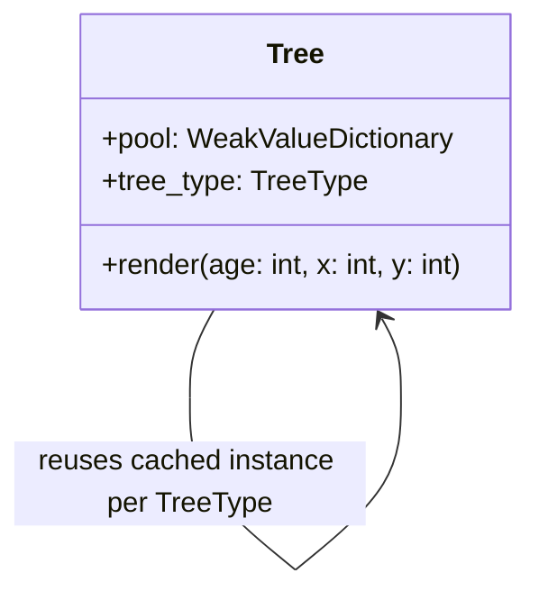

# Flyweight (Structural)

## 1. Clear Definition
**Flyweight** is a structural optimization pattern that reduces RAM usage when an application creates thousands or millions of similar objects. It shares immutable **intrinsic state** across instances via a pool, while unique **extrinsic state** is passed in by the caller at method-call time.

> **30-Second Interview Summary:**  
> *"Flyweight avoids duplicating identical heavy data in memory by splitting shared immutable state (intrinsic) from per-instance coordinates/state (extrinsic). In Python, `weakref.WeakValueDictionary` caches flyweights while allowing unused ones to be garbage-collected."*

**Key Participants:**
* **Flyweight (`Tree`):** Stores shared intrinsic state (`tree_type`) and accepts extrinsic state (`age, x, y`) in `render()`.
* **Flyweight Pool (`WeakValueDictionary`):** Returns an existing flyweight instance instead of allocating a duplicate.

---

## 2. Real-Time & Real-World Examples
* **Real-Life Analogy (*Mastering Python Design Patterns*):** **Bookstore popular-picks shelf** (fast shared cache) and **FPS game soldiers** sharing team 3D models/actions while keeping per-soldier health and coordinates.
* **Real-Time Software Example:** **Exaile music player** (reuses track objects by URL), **Peppy editor** (shares status-bar properties), and CPython's **small-int cache (`-5..256`)** / **`sys.intern()`**.

---

## 3. Mental Model



---

## 4. Python Implementation

```python
from enum import Enum
from weakref import WeakValueDictionary


class TreeType(Enum):
    """Shared, immutable intrinsic tree categories."""

    APPLE_TREE = 1
    CHERRY_TREE = 2
    PEACH_TREE = 3


class Tree:
    """
    Flyweight that shares one instance per TreeType using WeakValueDictionary
    so unused flyweights are automatically garbage-collected.
    """

    pool: WeakValueDictionary[TreeType, "Tree"] = WeakValueDictionary()

    def __new__(cls, tree_type: TreeType) -> "Tree":
        """Return an existing flyweight from the pool or create and cache a new one."""
        obj = cls.pool.get(tree_type)
        if obj is None:
            obj = super().__new__(cls)
            cls.pool[tree_type] = obj
            obj.tree_type = tree_type
        return obj

    def render(self, age: int, x: int, y: int) -> None:
        """Render using shared intrinsic `tree_type` + caller-supplied extrinsic state."""
        print(f"Render {self.tree_type.name} (age={age}) at ({x}, {y})")


if __name__ == "__main__":
    t1 = Tree(TreeType.APPLE_TREE)
    t2 = Tree(TreeType.APPLE_TREE)
    t3 = Tree(TreeType.CHERRY_TREE)

    print("t1 is t2:", t1 is t2)  # Same shared flyweight object
    print("t1 is t3:", t1 is t3)  # Different type -> different flyweight
    t1.render(age=5, x=10, y=20)
```

**Sample Output:**
```text
t1 is t2: True
t1 is t3: False
Render APPLE_TREE (age=5) at (10, 20)
```

---

## 5. Use Cases & When to Skip
* **When to Use:**
  * Profiling proves massive object counts are exhausting RAM (games, map renderers, text editors, embedded systems).
* **When to Skip:**
  * Don't prematurely optimize with Flyweight when object counts are small—consider `__slots__` first for simple per-instance memory savings.

---

## 6. Don't Confuse With

| Pattern | Key Difference |
| :--- | :--- |
| **[Prototype](../creational/prototype.md)** | Clones objects so each copy can mutate **independently**; Flyweight **shares** one immutable object. |
| **[Proxy](proxy.md)** | Controls access to a single target; Flyweight pools many shared immutable objects. |

---

## 7. Rapid Interview Q&As
* **Q: Why use `WeakValueDictionary` instead of a normal `dict`?**  
  **A:** A normal `dict` holds strong references forever, causing a memory leak if flyweight keys grow unboundedly; `WeakValueDictionary` lets Python's GC reclaim unused instances.
* **Q: Why must intrinsic state be immutable?**  
  **A:** Because hundreds of callers share the same flyweight instance—mutating it would corrupt every caller.
