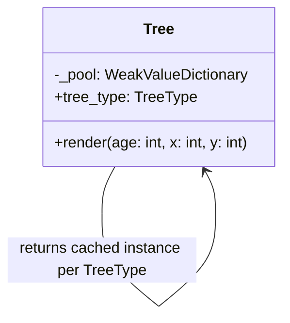

# Flyweight (Structural)

## 1. 30-Second Interview Answer
> **Flyweight** reduces memory consumption when an application must create thousands or millions of similar objects. It separates **intrinsic state** (shared, immutable, cached in a pool) from **extrinsic state** (unique, mutable, passed into `render(x, y)` by the caller). In Python, `weakref.WeakValueDictionary` lets unused flyweights be garbage-collected automatically.

---

## 2. Real-Life & Software Examples *(Mastering Python Design Patterns)*
- **Real-Life Analogy:** **Bookstore popular-picks shelf** (acting as a fast shared cache before asking the librarian) and **FPS game soldiers** sharing team appearance/actions while keeping health/location per soldier.
- **Python Software Example:** **Exaile music player** (reuses track objects by URL) and **Peppy editor** (shares major-mode status bar properties).

---

## 3. Mental Model



---

## 4. Python Implementation *(Book Example: `Tree` Renderer with `WeakValueDictionary`)*

```python
from enum import Enum
from weakref import WeakValueDictionary


class TreeType(Enum):
    APPLE_TREE = 1
    CHERRY_TREE = 2
    PEACH_TREE = 3


class Tree:
    pool: WeakValueDictionary[TreeType, "Tree"] = WeakValueDictionary()

    def __new__(cls, tree_type: TreeType) -> "Tree":
        obj = cls.pool.get(tree_type)
        if not obj:
            obj = super().__new__(cls)
            cls.pool[tree_type] = obj
            obj.tree_type = tree_type
        return obj

    def render(self, age: int, x: int, y: int) -> None:
        print(f"Render {self.tree_type.name} (age={age}) at ({x}, {y})")


t1 = Tree(TreeType.APPLE_TREE)
t2 = Tree(TreeType.APPLE_TREE)
assert t1 is t2  # Same shared flyweight object
t1.render(age=5, x=10, y=20)
```

---

## 5. Use Cases & When to Skip
- **Use when:** Creating a huge number of expensive objects that share identical immutable properties (games, graphics, text editors, embedded systems).
- **When to Skip:** Don't prematurely optimize with Flyweight unless profiling shows object memory is an actual bottleneck. Combine with `__slots__` for extra savings.

---

## 6. Rapid Follow-Up Q&As
- **Q: Why use `WeakValueDictionary` instead of a plain `dict`?**  
  **A:** A plain `dict` keeps strong references forever (memory leak). `WeakValueDictionary` allows Python's GC to reclaim a flyweight once no external references remain.
- **Q: Intrinsic vs. Extrinsic state?**  
  **A:** **Intrinsic** = shared & immutable (`tree_type`); **Extrinsic** = unique & mutable (`age`, `x`, `y`), passed by the caller.
