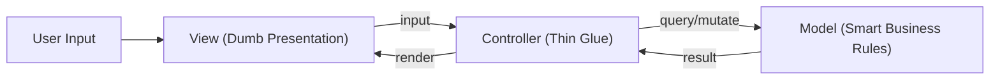

# Model-View-Controller — MVC (Chapter 8)

## 1. Clear Definition
**MVC** is an architectural pattern that applies **Separation of Concerns (SoC)** by dividing an application into three roles: **Model** (data, state, business rules), **View** (presentation—HTML, CLI, GUI), and **Controller** (routes user input between View and Model).

> **30-Second Interview Summary:**  
> *"MVC separates business logic (Model) from presentation (View) via a Coordinator (Controller). Follow the golden rule: **Smart Models, Thin Controllers, Dumb Views**—so you can swap or add multiple views (CLI, Web, JSON API) without touching business rules."*

**Key Participants:**
* **Model (`QuoteModel`):** Owns data, validation, and core business logic.
* **View (`QuoteTerminalView`):** Displays output and errors with minimal logic.
* **Controller (`QuoteTerminalController`):** Parses user input, calls the Model, and updates the View.

---

## 2. Real-Time & Real-World Examples
* **Real-Life Analogy (*Mastering Python Design Patterns*):** **Restaurant**—waiters (**Controllers**) take orders and serve dishes (**Views**), while chefs (**Models**) cook using kitchen rules.
* **Real-Time Software Example:** **`web2py`** (classic MVC) and **Django** (**MTV — Model-Template-View**, where Django's *View* is the Controller and *Template* is the View).

---

## 3. Mental Model



---

## 4. Python Implementation

```python
QUOTES = (
    "A man is not complete until he is married. Then he is finished.",
    "As I said before, I never repeat myself.",
    "Behind a successful man is an exhausted woman.",
)


class QuoteModel:
    """Model: owns the data source and lookup rules."""

    def get_quote(self, index: int) -> str:
        """Return a quote by index, or a fallback message if out of range."""
        try:
            return QUOTES[index]
        except IndexError:
            return "Not found!"


class QuoteTerminalView:
    """View: handles terminal formatting only (no business logic)."""

    def show(self, quote: str) -> None:
        print(f'And the quote is: "{quote}"')

    def error(self, message: str) -> None:
        print(f"Error: {message}")


class QuoteTerminalController:
    """Controller: validates input, calls the Model, and passes results to the View."""

    def __init__(self) -> None:
        self.model = QuoteModel()
        self.view = QuoteTerminalView()

    def run(self, raw_index: str) -> None:
        """Parse user input and coordinate Model -> View flow."""
        try:
            idx = int(raw_index)
        except ValueError:
            self.view.error(f"Incorrect index '{raw_index}'")
            return

        quote = self.model.get_quote(idx)
        self.view.show(quote)


if __name__ == "__main__":
    controller = QuoteTerminalController()
    controller.run("1")
    controller.run("abc")
```

**Sample Output:**
```text
And the quote is: "As I said before, I never repeat myself."
Error: Incorrect index 'abc'
```

---

## 5. Use Cases & When to Skip
* **When to Use:**
  * Any interactive web/CLI/desktop app where UI and business logic evolve independently or multiple views share one Model.
* **When to Skip:**
  * Tiny one-off scripts where splitting 30 lines into 3 classes adds unnecessary ceremony.

---

## 6. Don't Confuse With

| Pattern | Key Difference |
| :--- | :--- |
| **[Observer](../behavioral/observer.md)** | Often used *inside* MVC so the Model notifies multiple Views automatically when state changes. |
| **[Facade](facade.md)** | Simplifies a backend subsystem; MVC structures an entire user-facing application into 3 layers. |

---

## 7. Rapid Interview Q&As
* **Q: How does Django's MTV map to MVC?**  
  **A:** Django **Model** = MVC Model, Django **Template** = MVC View (presentation), Django **View** = MVC Controller (request handler).
* **Q: What does "Smart Models, Thin Controllers, Dumb Views" mean?**  
  **A:** Keep business rules in Models, keep Controllers strictly for request/response coordination, and keep Views free of business logic.
