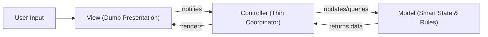

# Model-View-Controller — MVC (Chapter 8)

## 1. 30-Second Interview Answer
> **MVC** applies **Separation of Concerns (SoC)** to object-oriented systems by splitting an app into three roles: **Model** (data, state, business rules), **View** (presentation—GUI, HTML, or CLI), and **Controller** (routes user input between View and Model). Keeping the Model decoupled from Views lets you attach multiple Views (web, CLI, mobile) without touching business logic.

---

## 2. Real-Life & Software Examples *(Mastering Python Design Patterns)*
- **Real-Life Analogy:** **Restaurant**—waiters (**Controllers**) take orders and serve dishes (**Views**), while chefs (**Models**) cook the food using business rules. Also: hiring separate specialists (plumbing, electrical, painting) when building a house.
- **Python Software Example:** **`web2py`** (classic MVC) and **Django** (uses **MTV — Model-Template-View**, where Django's *View* is the Controller and *Template* is the View).

---

## 3. Mental Model



---

## 4. Python Implementation *(Book Example: Quote Printer)*

```python
quotes = (
    "A man is not complete until he is married. Then he is finished.",
    "As I said before, I never repeat myself.",
    "Behind a successful man is an exhausted woman.",
)


class QuoteModel:
    def get_quote(self, index: int) -> str:
        try:
            return quotes[index]
        except IndexError:
            return "Not found!"


class QuoteTerminalView:
    def show(self, quote: str) -> None:
        print(f'And the quote is: "{quote}"')

    def error(self, msg: str) -> None:
        print(f"Error: {msg}")


class QuoteTerminalController:
    def __init__(self) -> None:
        self.model = QuoteModel()
        self.view = QuoteTerminalView()

    def run(self, raw_index: str) -> None:
        try:
            idx = int(raw_index)
            quote = self.model.get_quote(idx)
            self.view.show(quote)
        except ValueError:
            self.view.error(f"Incorrect index '{raw_index}'")


QuoteTerminalController().run("1")
```

---

## 5. Golden Rule & Use Cases
- **Golden Rule (from the book):** **Smart Models** (core rules), **Thin Controllers** (glue/validation), **Dumb Views** (display only, minimal logic).
- **Use when:** You want UI/API changes to never break business rules, or need multiple views (CLI + JSON API + HTML) over the same domain model.

---

## 6. Rapid Follow-Up Q&As
- **Q: How does Django's MTV map to MVC?**  
  **A:** Django **Model** = MVC Model, Django **Template** = MVC View (presentation), Django **View** = MVC Controller (handles request and selects data/template).
- **Q: Why not let the Model talk directly to the View?**  
  **A:** Direct coupling prevents reusing the Model with multiple Views (e.g., terminal + web + REST API) cleanly.
