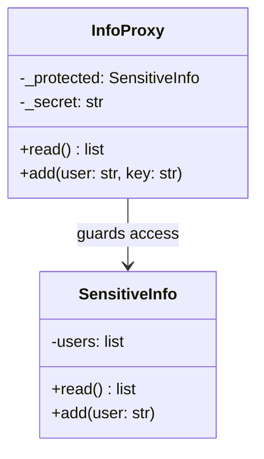

# Proxy (Structural)

## 1. Clear Definition
**Proxy** is a structural design pattern that provides a **surrogate (stand-in) object** implementing the same interface as a real service so it can run checks—like **authorization, lazy initialization, caching, or logging**—before forwarding calls to the real object.

> **30-Second Interview Summary:**  
> *"Proxy controls access to a real object transparently. The four classic types are **Virtual** (lazy loading), **Protection** (permission checks), **Remote** (RPC stub), and **Smart** (reference counting/logging)."*

**Key Participants:**
* **Real Subject (`SensitiveInfo`):** The underlying protected or expensive object.
* **Proxy (`InfoProxy`):** Guards access and delegates valid calls to `_protected`.

---

## 2. Real-Time & Real-World Examples
* **Real-Life Analogy (*Mastering Python Design Patterns*):** **OS `sudo` / admin privileges** required before installing software (Protection Proxy), or a **debit card** acting as a proxy for your bank account.
* **Real-Time Software Example:** **Python Descriptors (`__get__`)** / **`@functools.cached_property`** for lazy loading (Virtual Proxy), **SQLAlchemy lazy relationships**, and **`unittest.mock.Mock`**.

---

## 3. Mental Model



---

## 4. Python Implementation

```python
class SensitiveInfo:
    """Real subject holding sensitive user records."""

    def __init__(self) -> None:
        self.users = ["nick", "tom", "ben"]

    def read(self) -> list[str]:
        return list(self.users)

    def add(self, user: str) -> None:
        self.users.append(user)


class InfoProxy:
    """Protection Proxy that verifies a secret key before allowing mutations."""

    def __init__(self, secret: str = "0xdeadbeef") -> None:
        self._protected = SensitiveInfo()
        self._secret = secret

    def read(self) -> list[str]:
        """Allow read access without extra credentials."""
        return self._protected.read()

    def add(self, user: str, key: str) -> None:
        """Enforce authorization check before delegating write to SensitiveInfo."""
        if key != self._secret:
            raise PermissionError("Invalid secret key: access denied")
        self._protected.add(user)
        print(f"Added user: {user}")


if __name__ == "__main__":
    proxy = InfoProxy()
    print("Users:", proxy.read())
    proxy.add("alice", key="0xdeadbeef")
    try:
        proxy.add("eve", key="wrong")
    except PermissionError as err:
        print("Blocked:", err)
```

> **Pythonic Virtual Proxy Tip (*Mastering Python Design Patterns*):** For lazy-loaded attributes, use `@functools.cached_property` (or a `__get__` descriptor) so expensive values are computed only on first access.

**Sample Output:**
```text
Users: ['nick', 'tom', 'ben']
Added user: alice
Blocked: Invalid secret key: access denied
```

---

## 5. Use Cases & When to Skip
* **When to Use:**
  * Deferring expensive object creation (**Virtual Proxy**), enforcing RBAC (**Protection Proxy**), caching API responses, or representing remote services (**Remote Proxy**).
* **When to Skip:**
  * If you only need lazy attribute evaluation on a single class, `@functools.cached_property` is simpler than a separate Proxy class.

---

## 6. Don't Confuse With

| Pattern | Key Difference |
| :--- | :--- |
| **[Decorator](decorator.md)** | **Adds behaviors** explicitly stacked by the caller; Proxy **controls access/lifecycle** transparently. |
| **[Adapter](adapter.md)** | **Changes** the interface; Proxy preserves the **same** interface. |

---

## 7. Rapid Interview Q&As
* **Q: Name the 4 types of Proxy.**  
  **A:** **Remote** (network stub), **Virtual** (lazy init), **Protection** (auth/permissions), and **Smart** (extra bookkeeping like locking or ref-counting).
