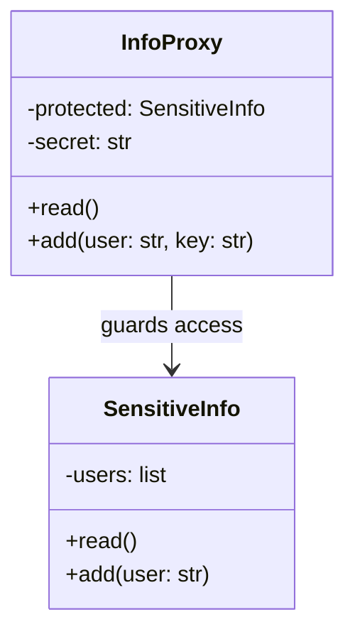

# Proxy (Structural)

## 1. 30-Second Interview Answer
> **Proxy** provides a surrogate object that controls access to a real object—letting you run checks **before** forwarding the call. The four classic types are **Virtual** (lazy initialization), **Protection** (permission checks), **Remote** (network/RPC stub), and **Smart** (logging/reference counting).

---

## 2. Real-Life & Software Examples *(Mastering Python Design Patterns)*
- **Real-Life Analogy:** **OS `sudo` / admin privileges** before installing software (Protection Proxy) or a **debit card** acting as a proxy for your bank account.
- **Python Software Example:** **Python Descriptors (`__get__`)** for lazy properties (`@functools.cached_property`) and **`weakref.proxy()`** / `unittest.mock.Mock`.

---

## 3. Mental Model



---

## 4. Python Implementation *(Book Example: `LazyProperty` Descriptor + Protection Proxy)*

```python
from typing import Any


# 1. Virtual Proxy via Python Descriptor (Lazy Initialization)
class LazyProperty:
    def __init__(self, method: Any) -> None:
        self.method = method
        self.method_name = method.__name__

    def __get__(self, obj: Any, cls: Any) -> Any:
        if obj is None:
            return self
        value = self.method(obj)
        setattr(obj, self.method_name, value)  # Cache on instance
        return value


# 2. Protection Proxy
class SensitiveInfo:
    def __init__(self) -> None:
        self.users = ["nick", "tom", "ben"]

    def read(self) -> list[str]:
        return self.users

    def add(self, user: str) -> None:
        self.users.append(user)


class InfoProxy:
    def __init__(self, secret: str = "0xdeadbeef") -> None:
        self._protected = SensitiveInfo()
        self._secret = secret

    def read(self) -> list[str]:
        return self._protected.read()

    def add(self, user: str, key: str) -> None:
        if key != self._secret:
            raise PermissionError("Invalid secret key!")
        self._protected.add(user)
```

---

## 5. Use Cases & When to Skip (Pythonic Alternatives)
- **Use when:** Deferring expensive resource loading (DB/network), enforcing authorization, or adding transparent caching/logging.
- **Pythonic Built-in:** Use `@functools.cached_property` instead of writing a custom `LazyProperty` descriptor.

---

## 6. Rapid Follow-Up Q&As
- **Q: What are the 4 types of Proxy?**  
  **A:** **Remote**, **Virtual** (lazy init), **Protection** (auth), and **Smart** (extra bookkeeping/locking).
- **Q: Proxy vs. Decorator?**  
  **A:** [Decorator](decorator.md) **adds behaviors** explicitly chosen by the caller; **Proxy** **controls access/lifecycle** transparently.
