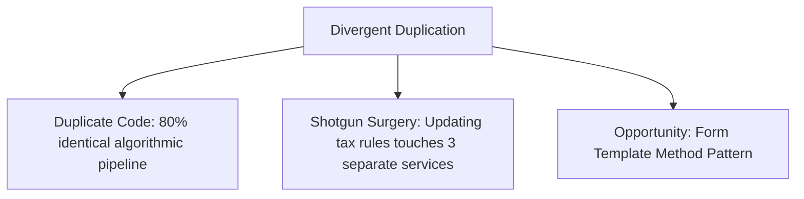

# Case Study: Eliminating Duplicate Business Logic 👥

## Source Reference
* **Book:** *Dive Into Refactoring* (Alexander Shvets), Chapters: *Duplicate Code*, *Form Template Method*, *Strategy Pattern*, *Extract Method*
* **Target Language:** Modern Python 3 (Python 3.10+) with `pytest`.

---

## 1. The Scenario: Divergent Logic Drift

Over 3 years, three different development teams built export and auditing pipelines for an enterprise billing platform:
1. `BillingReportExporter` (produces internal auditor CSVs).
2. `CustomerStatementExporter` (produces client PDF/HTML statements).
3. `PartnerCommissionExporter` (produces affiliate partner payout summaries).

All three classes execute the exact same financial lifecycle:
* Filtering valid non-refunded transactions.
* Calculating line items and applying currency rounding rules.
* Computing tiered commission brackets.
* Generating header, row, and summary sections.

Because of copy-paste development, **the commission rounding rules drifted**: one class used `round(x, 2)`, another used `decimal.Decimal` with `ROUND_HALF_UP`, and the third had an unpatched bug where tax was subtracted twice.

---

## 2. Diagnosis: Code Smells Identified



---

## 3. Step-by-Step Refactoring Plan

1. **Step 1: Write Cross-Checking Parametrized Pytest Suite** — Run identical transaction datasets through all 3 exporters to record their exact outputs.
2. **Step 2: Unify Core Calculations** — Extract shared financial calculations (tax, tiering, rounding) into a single authoritative `FinancialCalculator`.
3. **Step 3: Extract Base Pipeline with Template Method** — Create `BaseReportPipeline` defining the unalterable sequence of pipeline steps.
4. **Step 4: Specialize Formatters** — Implement formatting overrides for CSV, HTML, and Partner statements.

---

## 4. Code Evolution

### A. Smelly Legacy Code (Duplicate Implementations with Drift)
```python
# exporters_smelly.py
class CustomerStatementExporter:

  def generate(self, transactions: list[dict]) -> str:
    # 1. Filter
    valid = [t for t in transactions if not t.get("is_refunded")]
    # 2. Math
    total = sum(t["amount"] for t in valid)
    fee = total * 0.029 + 0.30  # Processing fee
    net = total - fee
    # 3. Format
    rows = [f"Item: ${t['amount']:.2f}" for t in valid]
    return f"STATEMENT\n" + "\n".join(rows) + f"\nTOTAL NET: ${net:.2f}"


class PartnerCommissionExporter:

  def generate(self, transactions: list[dict]) -> str:
    # 1. Filter (Duplicated)
    valid = [t for t in transactions if not t.get("is_refunded")]
    # 2. Math (Duplicated & slightly drifted fee math!)
    total = sum(t["amount"] for t in valid)
    fee = total * 0.029  # BUG: forgot + $0.30 fixed fee!
    net = total - fee
    # 3. Format
    rows = [f"Partner Line: ${t['amount']:.2f}" for t in valid]
    return (
        f"COMMISSION REPORT\n" + "\n".join(rows) + f"\nPAYOUT: ${net:.2f}"
    )
```

### B. Pytest Baseline Contract
```python
# test_exporters.py
from exporters_smelly import (
    CustomerStatementExporter,
    PartnerCommissionExporter,
)


def test_exporters():
  txs = [
      {"amount": 100.0, "is_refunded": False},
      {"amount": 50.0, "is_refunded": True},  # Ignored
  ]
  cust_out = CustomerStatementExporter().generate(txs)
  part_out = PartnerCommissionExporter().generate(txs)

  assert "TOTAL NET: $96.80" in cust_out  # 100 - (2.90 + 0.30)
  assert "PAYOUT: $97.10" in part_out  # Drift bug visible!
```

### C. Refactored Clean Code (Template Method + Shared Policy)
```python
# exporters_clean.py
from abc import ABC, abstractmethod
from dataclasses import dataclass


@dataclass(frozen=True)
class Transaction:
  amount: float
  is_refunded: bool = False


@dataclass(frozen=True)
class FinancialSummary:
  total_gross: float
  processing_fee: float
  net_amount: float


class FeePolicy:
  """Single Authoritative Source of Truth for processing fees."""

  @staticmethod
  def calculate(gross: float) -> FinancialSummary:
    fee = round(gross * 0.029 + 0.30, 2)
    net = round(gross - fee, 2)
    return FinancialSummary(
        total_gross=gross, processing_fee=fee, net_amount=net
    )


class BaseFinancialReportExporter(ABC):
  """Template Method: Enforces consistent data pipeline and eliminates code duplication."""

  def generate(self, transactions: list[Transaction]) -> str:
    valid_txs = self._filter_valid_transactions(transactions)
    gross = sum(t.amount for t in valid_txs)
    summary = FeePolicy.calculate(gross)

    header = self._format_header()
    body = self._format_rows(valid_txs)
    footer = self._format_footer(summary)

    return f"{header}\n{body}\n{footer}"

  def _filter_valid_transactions(
      self, transactions: list[Transaction]
  ) -> list[Transaction]:
    return [t for t in transactions if not t.is_refunded]

  @abstractmethod
  def _format_header(self) -> str:
    ...

  @abstractmethod
  def _format_rows(self, transactions: list[Transaction]) -> str:
    ...

  @abstractmethod
  def _format_footer(self, summary: FinancialSummary) -> str:
    ...


class CustomerStatementExporter(BaseFinancialReportExporter):

  def _format_header(self) -> str:
    return "=== CUSTOMER STATEMENT ==="

  def _format_rows(self, transactions: list[Transaction]) -> str:
    return "\n".join([f"Item: ${t.amount:.2f}" for t in transactions])

  def _format_footer(self, summary: FinancialSummary) -> str:
    return f"TOTAL NET: ${summary.net_amount:.2f}"


class PartnerCommissionExporter(BaseFinancialReportExporter):

  def _format_header(self) -> str:
    return "=== PARTNER COMMISSION REPORT ==="

  def _format_rows(self, transactions: list[Transaction]) -> str:
    return "\n".join(
        [f"Partner Line: ${t.amount:.2f}" for t in transactions]
    )

  def _format_footer(self, summary: FinancialSummary) -> str:
    return f"PAYOUT: ${summary.net_amount:.2f}"
```

---

## 5. Architectural Payoff
* **Zero Logic Drift:** `FeePolicy` computes fees in exactly one place. Fixing a fee rule automatically updates all present and future reports.
* **100% Behavioral Consistency:** Every report uses the identical filtering and summary aggregation pipeline.
* **Rapid Extension:** Creating a new XML or JSON exporter requires implementing only 3 formatting methods.
