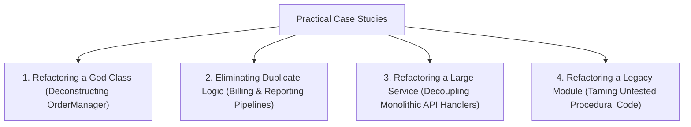

# Practical Refactoring Case Studies 🏭

## Source Reference
* **Core Philosophy:** *Working Effectively with Legacy Code* (Michael Feathers), *Dive Into Refactoring* (Alexander Shvets)
* **Target Environment:** Modern Python 3 (Python 3.10+) with `pytest` and characterization test suites.

---

## Overview

Individual refactoring techniques teach the micro-mechanics (how to safely move a method or extract a variable). However, real-world software engineering demands **engineering judgment**: how to diagnose a tangle of 5 interrelated code smells simultaneously, choose the correct sequence of transformations, and deconstruct monolithic systems without breaking production.

The case studies in this section walk through end-to-end, multi-technique refactoring journeys on realistic codebases.

---

## The 4 End-to-End Case Studies

| Case Study | Smells Present | Techniques Applied | Architectural Result |
| :--- | :--- | :--- | :--- |
| [**Refactoring a God Class**](refactor-a-god-class.md) | Large Class, Long Method, Divergent Change, Primitive Obsession | Extract Class, Move Method, Parameter Object, Extract Method | Cohesive Domain Model + Dedicated Repository |
| [**Eliminating Duplicate Logic**](eliminate-duplicate-logic.md) | Duplicate Code, Shotgun Surgery, Inconsistent Logic Drift | Form Template Method, Strategy Pattern, Extract Superclass | Unified Template Method with custom formatters |
| [**Refactoring a Large Service**](refactor-a-large-service.md) | Feature Envy, Inappropriate Intimacy, Long Parameter List | Separate Query from Modifier, Extract Protocol, Dependency Injection | Ports & Adapters (Hexagonal Architecture) |
| [**Refactoring a Legacy Module**](refactor-a-legacy-module.md) | Dead Code, Global State, Lack of Tests, Procedural Flags | Characterization Tests, Seams, Sprout Method, Guard Clauses | Fully unit-tested, thread-safe, modular Python engine |
