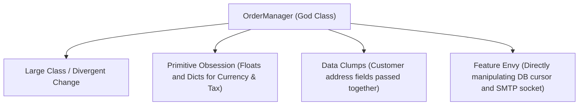

# Case Study: Refactoring a God Class 🗿

## Source Reference
* **Book:** *Dive Into Refactoring* (Alexander Shvets), Chapters: *Large Class*, *Divergent Change*, *Extract Class*, *Move Method*
* **Target Language:** Modern Python 3 (Python 3.10+) with `pytest`.

---

## 1. The Scenario: The `OrderManager` Monster

In an e-commerce platform, the `OrderManager` class has grown unchecked for 4 years. It contains 800 lines of code and is responsible for:
1. Validating incoming cart items.
2. Computing subtotal, tax rates by US state, shipping fees, and discount coupon codes.
3. Managing customer payment authorizations and database persistence.
4. Generating HTML invoice emails and sending them via an SMTP connection.

Whenever the finance team modifies tax rules, or the marketing team changes discount codes, or the infrastructure team migrates the database, **they all edit this single class**.

---

## 2. Diagnosis: Code Smells Identified



---

## 3. Step-by-Step Refactoring Plan

1. **Step 1: Write Characterization Baseline Tests** — Pin down existing calculations and output formats before touching production code.
2. **Step 2: Extract Value Objects** — Create `@dataclass(frozen=True)` for `Address` and `OrderItem`.
3. **Step 3: Extract Domain Calculator** — Pull pricing, tax, and discount math into a dedicated `OrderPricingEngine`.
4. **Step 4: Extract Email Presenter** — Separate HTML email rendering into `InvoiceEmailPresenter`.
5. **Step 5: Extract Persistence Repository** — Move raw SQL operations into `OrderRepository`.

---

## 4. Code Evolution

### A. Smelly Legacy Code
```python
# order_manager_smelly.py
import smtplib


class OrderManager:

  def __init__(self, db_conn) -> None:
    self.db = db_conn

  def process_order(
      self,
      customer_email: str,
      street: str,
      city: str,
      state: str,
      zip_code: str,
      items: list[dict],
      coupon_code: str | None,
  ) -> dict:
    # 1. Validation
    if not items:
      raise ValueError("Order must contain at least one item")

    # 2. Subtotal & Pricing
    subtotal = sum(i["price"] * i["qty"] for i in items)

    # 3. Tax by state
    if state == "CA":
      tax_rate = 0.095
    elif state == "NY":
      tax_rate = 0.088
    else:
      tax_rate = 0.05
    tax_amount = round(subtotal * tax_rate, 2)

    # 4. Coupon Discount
    discount = 0.0
    if coupon_code == "SAVE10":
      discount = round(subtotal * 0.10, 2)

    total = subtotal + tax_amount - discount

    # 5. Database Persistence
    order_id = self.db.execute(
        "INSERT INTO orders (email, total) VALUES (%s, %s)",
        (customer_email, total),
    )

    # 6. Email Generation & Dispatch
    email_body = f"Thank you for your order {order_id}!\nTotal: ${total:.2f}"
    # Simulated smtplib send...

    return {
        "order_id": order_id,
        "total": total,
        "tax": tax_amount,
        "discount": discount,
    }
```

### B. Pytest Baseline Contract
```python
# test_order_manager.py
from unittest.mock import MagicMock
from order_manager_smelly import OrderManager


def test_order_manager_baseline_contract():
  mock_db = MagicMock()
  mock_db.execute.return_value = "ORD-999"

  manager = OrderManager(mock_db)
  items = [
      {"name": "Book", "price": 50.0, "qty": 2},  # 100
      {"name": "Pen", "price": 10.0, "qty": 1},  # 10
  ]
  res = manager.process_order(
      "user@example.com",
      "123 Main St",
      "New York",
      "NY",
      "10001",
      items,
      "SAVE10",
  )

  # Subtotal = 110.0, NY Tax (8.8%) = 9.68, Discount (10%) = 11.0 -> Total = 108.68
  assert res["order_id"] == "ORD-999"
  assert res["tax"] == 9.68
  assert res["discount"] == 11.0
  assert res["total"] == 108.68
```

### C. Refactored Clean Architecture
```python
# order_manager_clean.py
from dataclasses import dataclass
from typing import Protocol


# 1. Extracted Value Objects:
@dataclass(frozen=True)
class Address:
  street: str
  city: str
  state: str
  zip_code: str


@dataclass(frozen=True)
class OrderItem:
  name: str
  price: float
  qty: int

  @property
  def line_total(self) -> float:
    return self.price * self.qty


# 2. Extracted Pricing Engine:
class TaxPolicy:

  @staticmethod
  def get_tax_rate(state: str) -> float:
    match state.upper():
      case "CA":
        return 0.095
      case "NY":
        return 0.088
      case _:
        return 0.05


class OrderPricingEngine:
  """Dedicated Single-Responsibility Engine for financial calculations."""

  def calculate_pricing(
      self,
      items: list[OrderItem],
      state: str,
      coupon_code: str | None = None,
  ) -> dict[str, float]:
    subtotal = sum(item.line_total for item in items)
    tax_rate = TaxPolicy.get_tax_rate(state)
    tax_amount = round(subtotal * tax_rate, 2)

    discount = 0.0
    if coupon_code == "SAVE10":
      discount = round(subtotal * 0.10, 2)

    total = subtotal + tax_amount - discount
    return {
        "subtotal": subtotal,
        "tax": tax_amount,
        "discount": discount,
        "total": round(total, 2),
    }


# 3. Extracted Repository Protocol:
class OrderRepository(Protocol):

  def save_order(self, customer_email: str, total_amount: float) -> str:
    ...


# 4. Clean Orchestrator Service:
class OrderService:
  """Clean, decoupled service: coordinates domain models with zero feature envy."""

  def __init__(
      self,
      repo: OrderRepository,
      pricing_engine: OrderPricingEngine | None = None,
  ) -> None:
    self.repo = repo
    self.pricing = pricing_engine or OrderPricingEngine()

  def place_order(
      self,
      customer_email: str,
      destination: Address,
      items: list[OrderItem],
      coupon_code: str | None = None,
  ) -> dict:
    if not items:
      raise ValueError("Order must contain at least one item")

    pricing = self.pricing.calculate_pricing(
        items, destination.state, coupon_code
    )
    order_id = self.repo.save_order(customer_email, pricing["total"])

    return {"order_id": order_id, **pricing}
```

---

## 5. Architectural Comparison

| Dimension | Legacy Monolith (`OrderManager`) | Refactored Clean Design (`OrderService`) |
| :--- | :--- | :--- |
| **Lines per Class** | 800+ lines in one file | 20–40 lines across cohesive, focused classes |
| **Reasons to Change** | 5 distinct reasons (DB, Tax, Email, Items, Auth) | Exactly 1 reason to change per class (SRP) |
| **Unit Test Speed** | Slow; requires mocking database queries & SMTP sockets | Sub-millisecond; `OrderPricingEngine` has zero mocks |
| **Reusability** | Impossible to reuse tax math for Cart previews | `TaxPolicy` and `OrderPricingEngine` reused everywhere |
