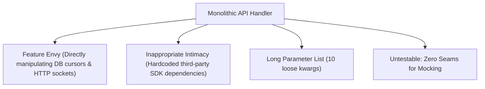

# Case Study: Refactoring a Large API Service 🌐

## Source Reference
* **Architecture Style:** *Hexagonal Architecture (Ports and Adapters)*, *Clean Architecture* (Robert C. Martin)
* **Refactoring Techniques:** *Extract Class*, *Separate Query from Modifier*, *Extract Interface / Protocol*, *Dependency Injection*
* **Target Language:** Modern Python 3 (Python 3.10+) with `pytest`.

---

## 1. The Scenario: The Monolithic Web Service Handler

In a web application built with FastAPI/Flask, an API endpoint `POST /users/onboard` was originally written as a quick 20-line handler. Over 2 years, it accumulated:
1. Direct extraction of raw parameters from JSON dicts.
2. Direct raw SQL cursor operations.
3. Stripe API credit card tokenization calls.
4. Sending Slack alerts to the sales team channel.
5. In-memory caching mutations.

Because the handler directly imports external client SDKs and database pools, **it is impossible to write unit tests for this service without spinning up Docker containers with real databases and external network access**.

---

## 2. Diagnosis: Code Smells Identified



---

## 3. Step-by-Step Refactoring Plan

1. **Step 1: Define Clean Domain Entities & DTOs** — Group request parameters into an immutable `@dataclass` (`OnboardingRequest`).
2. **Step 2: Define Secondary Ports (Protocols)** — Define `UserRepositoryProtocol`, `PaymentGatewayProtocol`, and `NotificationGatewayProtocol`.
3. **Step 3: Extract Domain Use Case** — Extract all business orchestration into a pure, framework-agnostic `UserOnboardingUseCase`.
4. **Step 4: Implement Adapters** — Wrap external SDKs into concrete classes satisfying the protocols.
5. **Step 5: Thin the Web Controller** — The web endpoint becomes a 3-line forwarder: parse JSON $\rightarrow$ invoke use case $\rightarrow$ return response.

---

## 4. Code Evolution

### A. Smelly Legacy Code (Tightly Coupled Controller)
```python
# controller_smelly.py
import requests  # Directly coupled to network!
import sqlite3  # Directly coupled to local SQL!


def onboard_user_endpoint(request_payload: dict) -> dict:
  # 1. Validation
  email = request_payload.get("email")
  if not email or "@" not in email:
    return {"error": "Invalid email"}

  # 2. Database check
  conn = sqlite3.connect("prod.db")
  cursor = conn.cursor()
  cursor.execute("SELECT id FROM users WHERE email = ?", (email,))
  if cursor.fetchone():
    return {"error": "User already exists"}

  # 3. Third-party HTTP call to Stripe
  resp = requests.post(
      "https://api.stripe.com/v1/customers",
      data={"email": email},
      auth=("sk_live", ""),
  )
  stripe_id = resp.json().get("id", "cust_mock")

  # 4. Insert into database
  cursor.execute(
      "INSERT INTO users (email, stripe_id) VALUES (?, ?)", (email, stripe_id)
  )
  conn.commit()

  # 5. Third-party Slack alert
  requests.post(
      "https://hooks.slack.com/services/...",
      json={"text": f"New user onboarded: {email}"},
  )

  return {"status": "SUCCESS", "email": email, "stripe_id": stripe_id}
```

### B. Refactored Clean Hexagonal Architecture
```python
# service_clean.py
from dataclasses import dataclass
from typing import Protocol


# --- Domain Models & DTOs ---
@dataclass(frozen=True)
class OnboardingRequest:
  email: str

  def __post_init__(self) -> None:
    if not self.email or "@" not in self.email:
      raise ValueError(f"Invalid email address: {self.email}")


@dataclass(frozen=True)
class OnboardingResult:
  email: str
  stripe_id: str


# --- Ports (Protocols) ---
class UserRepository(Protocol):

  def exists(self, email: str) -> bool:
    ...

  def save(self, email: str, stripe_id: str) -> None:
    ...


class PaymentGateway(Protocol):

  def create_customer(self, email: str) -> str:
    ...


class NotificationGateway(Protocol):

  def notify_staff(self, message: str) -> None:
    ...


# --- Core Domain Use Case (Pure Python, Zero Framework Dependencies) ---
class UserOnboardingUseCase:
  """Pure business orchestrator: testable in microseconds with in-memory mocks."""

  def __init__(
      self,
      user_repo: UserRepository,
      payments: PaymentGateway,
      notifications: NotificationGateway,
  ) -> None:
    self.repo = user_repo
    self.payments = payments
    self.notifications = notifications

  def execute(self, request: OnboardingRequest) -> OnboardingResult:
    if self.repo.exists(request.email):
      raise ValueError("User already registered")

    stripe_id = self.payments.create_customer(request.email)
    self.repo.save(request.email, stripe_id)
    self.notifications.notify_staff(
        f"New user onboarded: {request.email}"
    )

    return OnboardingResult(email=request.email, stripe_id=stripe_id)
```

### C. Lightning-Fast In-Memory Unit Test Contract
```python
# test_onboarding.py
import pytest
from service_clean import OnboardingRequest, UserOnboardingUseCase


class MockUserRepository:

  def __init__(self) -> None:
    self.saved = {}

  def exists(self, email: str) -> bool:
    return email in self.saved

  def save(self, email: str, stripe_id: str) -> None:
    self.saved[email] = stripe_id


class MockPaymentGateway:

  def create_customer(self, email: str) -> str:
    return f"mock_stripe_{email}"


class MockNotificationGateway:

  def __init__(self) -> None:
    self.messages = []

  def notify_staff(self, message: str) -> None:
    self.messages.append(message)


def test_successful_onboarding():
  repo = MockUserRepository()
  use_case = UserOnboardingUseCase(
      repo, MockPaymentGateway(), MockNotificationGateway()
  )

  req = OnboardingRequest("test@example.com")
  res = use_case.execute(req)

  assert res.email == "test@example.com"
  assert res.stripe_id == "mock_stripe_test@example.com"
  assert repo.exists("test@example.com")


def test_duplicate_user_raises_error():
  repo = MockUserRepository()
  repo.save("existing@example.com", "stripe_123")
  use_case = UserOnboardingUseCase(
      repo, MockPaymentGateway(), MockNotificationGateway()
  )

  with pytest.raises(ValueError, match="User already registered"):
    use_case.execute(OnboardingRequest("existing@example.com"))
```

---

## 5. Architectural Payoff
* **Separation of Concerns:** Business logic knows nothing about SQLite, HTTP, or Slack.
* **Test Speed:** Tests run in 2 milliseconds without starting external databases or hitting external rate-limited APIs.
* **Vendor Flexibility:** Swapping Stripe for Adyen or swapping SQLite for Postgres requires editing only the concrete adapter, leaving business rules completely untouched.
