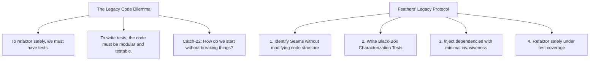

# Case Study: Refactoring an Untested Legacy Module 🦕

## Source Reference
* **Core Philosophy:** *Working Effectively with Legacy Code* (Michael Feathers)
* **Techniques Applied:** *Characterization Tests*, *Seams*, *Sprout Method*, *Extract Function*, *Remove Global State*
* **Target Language:** Modern Python 3 (Python 3.10+) with `pytest`.

---

## 1. The Scenario: Untested Procedural Code with Global State

You inherit a 10-year-old Python file named `payroll_legacy.py`. It has:
* Zero automated tests.
* Relies on global state (`CONFIG = {}`, `ACTIVE_LOGS = []`).
* Uses manual procedural loops with control flags.
* Directly touches system clock (`time.time()`) and the filesystem (`open("payroll.log", "a")`).

The product team asks you to **support hourly contractors alongside full-time employees**. Modifying the file in its current state is terrifying: any edit risks breaking payroll for hundreds of employees.

---

## 2. Diagnosis: The Catch-22 of Legacy Refactoring



---

## 3. Step-by-Step Refactoring Execution

### Step 1: Black-Box Characterization Tests
Before touching any internal function logic, write tests that exercise the public entry point with sample data and capture the exact outputs (Golden Master testing).

### Step 2: Introduce Parameter Injection Seams
Convert hidden global dependencies (`CONFIG`, `open(...)`) into function parameters with defaults pointing to the existing globals. This creates an **instant testing seam** without breaking a single existing production caller!

### Step 3: Pure Function Extraction (Sprout Method)
Extract the core math calculations out into pure, deterministic functions that take numbers and return numbers.

---

## 4. Code Evolution

### A. Smelly Legacy Code (Global Variables & Side Effects)
```python
# payroll_legacy_smelly.py
import datetime

# Fragile global mutable state:
GLOBAL_RATE_MULTIPLIER = 1.0


def calculate_payout_smelly(employee_record: dict) -> float:
  global GLOBAL_RATE_MULTIPLIER
  # Smelly: Hidden dependence on system clock:
  now = datetime.datetime.now()
  is_weekend = now.weekday() >= 5

  rate = employee_record["base_rate"]
  hours = employee_record["hours"]

  # Procedural calculation:
  if hours > 40:
    regular = 40 * rate
    overtime = (hours - 40) * (rate * 1.5)
    total = regular + overtime
  else:
    total = hours * rate

  if is_weekend:
    total *= 1.20  # Weekend bonus

  total *= GLOBAL_RATE_MULTIPLIER

  # Side effect: writing directly to disk!
  with open("legacy_audit.log", "a") as f:
    f.write(f"Processed: {employee_record['name']} = {total}\n")

  return round(total, 2)
```

### B. Pytest Characterization Contract (Pinning Down Behavior)
```python
# test_payroll_characterization.py
from unittest.mock import mock_open, patch
from payroll_legacy_smelly import calculate_payout_smelly


def test_characterization_weekday_overtime():
  record = {"name": "Alice", "base_rate": 20.0, "hours": 50}

  # Pin down clock and filesystem to capture current behavior:
  with (
      patch("datetime.datetime") as mock_dt,
      patch("builtins.open", mock_open()) as mock_file,
  ):
    mock_dt.now.return_value.weekday.return_value = 2  # Wednesday (Weekday)

    # 40 * 20 = 800; 10 * 30 = 300 -> Total = 1100.0
    payout = calculate_payout_smelly(record)
    assert payout == 1100.0
```

### C. Refactored Clean Code (Pure Functions + Seams)
```python
# payroll_clean.py
from dataclasses import dataclass
from typing import Callable


@dataclass(frozen=True)
class EmployeeWorkRecord:
  name: str
  hourly_rate: float
  hours_worked: float


def compute_base_and_overtime(hours: float, rate: float) -> float:
  """Pure function: 100% deterministic, zero side effects."""
  if hours <= 40:
    return hours * rate
  regular = 40.0 * rate
  overtime = (hours - 40.0) * (rate * 1.5)
  return regular + overtime


def calculate_employee_payout(
    record: EmployeeWorkRecord,
    *,
    is_weekend: bool = False,
    rate_multiplier: float = 1.0,
    log_sink: Callable[[str], None] | None = None,
) -> float:
  """Clean service function with explicit parameter injection seams."""
  base_total = compute_base_and_overtime(
      record.hours_worked, record.hourly_rate
  )

  if is_weekend:
    base_total *= 1.20

  final_payout = round(base_total * rate_multiplier, 2)

  if log_sink:
    log_sink(f"Processed: {record.name} = {final_payout}")

  return final_payout
```

---

## 5. Architectural Payoff
* **Zero Global State:** `GLOBAL_RATE_MULTIPLIER` eliminated; passed as explicit parameter.
* **Deterministic Testing:** Clock and I/O seams allow testing without monkeypatching `datetime` or `builtins.open`.
* **Safe Extension Point:** Adding contractor payment rules now requires only adding a new pure calculation function without touching the legacy flow.
