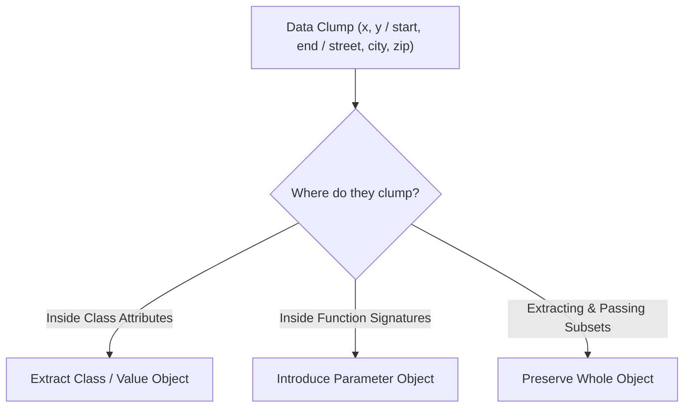

# Data Clumps 📦

## Source Reference
* **Book:** *Dive Into Refactoring* (Alexander Shvets), Chapter: *Code Smells / Bloaters / Data Clumps*
* **Design Pattern Bridge:** [Composite Pattern](../../../design-patterns/structural/composite.md), [Builder Pattern](../../../design-patterns/creational/builder.md)
* **Target Language:** Modern Python 3 (Python 3.10+) with `pytest`.

---

## 1. Signs and Symptoms

Different parts of the code contain the **exact same group of variables** (e.g., coordinates `x, y, z`, address components `street, city, zip_code`, or date ranges `start_date, end_date`). These variables always appear together in function signatures, class attributes, or database queries.

### Detection Checklist:
- [ ] You see the same 3+ parameters passed together into multiple unrelated functions.
- [ ] If you delete one of these parameters, the remaining ones become completely meaningless without it (e.g., `start_date` without `end_date`).
- [ ] Multiple classes define identical subsets of fields (`street`, `city`, `state`, `postal_code`).
- [ ] You find yourself writing duplicate validation logic across multiple call sites for this group of fields.

---

## 2. Reasons for the Problem

Data clumps typically arise from evolutionary feature growth:
1. **Convenience over Abstraction:** A developer adds `start_date` and `end_date` to a function. Later, another developer copies those parameters to a second function, then to a third, instead of creating a `DateRange` abstraction.
2. **Poor Domain Modeling:** The concept exists in the problem domain (e.g., "Mailing Address", "Geo Point", "Date Range"), but nobody took the time to create a formal class for it in the codebase.

---

## 3. Why It's Bad

* **Duplicated Validation:** Every function accepting `street, city, zip_code` must independently validate that `zip_code` is formatted correctly.
* **Shotgun Maintenance:** Adding a field (e.g., `country_code` or `timezone`) forces you to modify dozens of function signatures across multiple modules.
* **Obscured Domain Vocabulary:** Without a unified class, domain concepts are invisible in code reviews and architecture diagrams.

---

## 4. Recommended Treatment



1. **Extract Class:** If the clump appears across class fields, extract them into a separate class (typically a frozen `@dataclass` or Value Object).
2. **Introduce Parameter Object:** If the clump appears in method parameters, package them into a single parameter object.
3. **Preserve Whole Object:** If you are extracting 3 fields from an existing object just to pass them into a method, pass the existing whole object instead.

---

## 5. Python Before & After Demonstration

### A. Smelly Code (Scattered Address Fields)
```python
# customer_service_smelly.py
class CustomerService:

  def register_customer(
      self,
      name: str,
      email: str,
      street: str,
      city: str,
      postal_code: str,
      country: str,
  ) -> dict:
    if not postal_code.strip():
      raise ValueError("Postal code cannot be empty.")
    return {
        "customer": name,
        "email": email,
        "address": f"{street}, {city}, {postal_code}, {country}",
    }

  def calculate_shipping_rate(
      self,
      package_weight_kg: float,
      street: str,
      city: str,
      postal_code: str,
      country: str,
  ) -> float:
    # Notice: street and city are unused here, but passed along anyway!
    if country == "US":
      return 5.0 + (package_weight_kg * 1.5)
    return 15.0 + (package_weight_kg * 4.0)
```

### B. The Pytest Baseline Contract
```python
# test_customer_service.py
import pytest
from customer_service_smelly import CustomerService


def test_customer_registration_and_shipping():
  service = CustomerService()
  result = service.register_customer(
      "Ada Lovelace",
      "ada@example.com",
      "123 Algorithm Way",
      "London",
      "EC1A 1BB",
      "UK",
  )
  assert (
      result["address"] == "123 Algorithm Way, London, EC1A 1BB, UK"
  )

  rate = service.calculate_shipping_rate(
      2.5, "123 Algorithm Way", "London", "EC1A 1BB", "UK"
  )
  assert rate == 25.0  # 15 + (2.5 * 4)


def test_invalid_postal_code():
  service = CustomerService()
  with pytest.raises(ValueError, match="Postal code cannot be empty."):
    service.register_customer(
        "Ada", "ada@example.com", "Main St", "London", "   ", "UK"
    )
```

### C. Refactored Clean Code (Extracting `Address` Value Object)
```python
# customer_service_clean.py
from dataclasses import dataclass


@dataclass(frozen=True)
class Address:
  """Extracted Value Object encapsulating all address behaviors and validations."""

  street: str
  city: str
  postal_code: str
  country: str

  def __post_init__(self) -> None:
    if not self.postal_code.strip():
      raise ValueError("Postal code cannot be empty.")

  @property
  def formatted(self) -> str:
    return f"{self.street}, {self.city}, {self.postal_code}, {self.country}"

  @property
  def is_domestic_us(self) -> bool:
    return self.country.strip().upper() == "US"


class CustomerService:
  """Clean service with decoupled, self-validating parameter objects."""

  def register_customer(
      self, name: str, email: str, address: Address
  ) -> dict:
    return {
        "customer": name,
        "email": email,
        "address": address.formatted,
    }

  def calculate_shipping_rate(
      self, package_weight_kg: float, destination: Address
  ) -> float:
    if destination.is_domestic_us:
      return 5.0 + (package_weight_kg * 1.5)
    return 15.0 + (package_weight_kg * 4.0)
```

---

## 6. Payoff and Performance

| Dimension | Before Refactoring | After Refactoring |
| :--- | :--- | :--- |
| **Parameter Count** | 6 parameters per method | 2 to 3 self-documenting parameters |
| **Validation Reuse** | Duplicated across registration, billing, shipping | Centralized in `Address.__post_init__` |
| **Domain Meaning** | Raw primitives scattered everywhere | Explicit, rich `Address` domain entity |
| **API Evolution** | Adding `state` breaks all function signatures | Adding `state: str = ""` to `Address` is backward-compatible |

---

## 7. When to Ignore

* **Spike / Exploratory Scripts:** If you are drafting a fast proof-of-concept script with 2 functions that will be discarded within 24 hours.
* **Coincidental Grouping:** If two parameters (`min_threshold`, `max_threshold`) appear together in one mathematical function, but represent distinct boundaries with no domain identity or shared validation elsewhere in the system.
