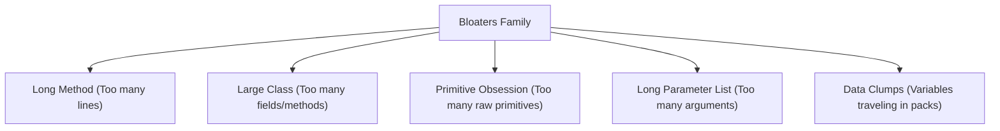

# Bloaters 🐘

> *"Bloaters are code, methods, and classes that have increased proportions to such an extent that they are hard to work with. Usually these smells do not crop up immediately, rather they accumulate over time as the program evolves."* — Alexander Shvets, *Dive Into Refactoring*

Bloaters represent the most common code smells in growing software projects. They start small and innocent, but incrementally expand as developers append "just one more feature" without restructuring.

---

## 🧭 The 5 Bloater Smells

| Smell | Description | Typical Remedy |
| :--- | :--- | :--- |
| **[Long Method](long-method.md)** | A method containing more than 10-15 lines of code. | Extract Method, Replace Temp with Query, Decompose Conditional |
| **[Large Class](large-class.md)** | A God class holding dozens of fields, methods, and responsibilities. | Extract Class, Extract Subclass, Extract Interface |
| **[Primitive Obsession](primitive-obsession.md)** | Using raw primitives (`str`, `dict`, `int`) instead of rich domain objects. | Replace Data Value with Object, Introduce Parameter Object, Replace Type Code with Class |
| **[Long Parameter List](long-parameter-list.md)** | More than 3 or 4 parameters passed into a function. | Introduce Parameter Object, Preserve Whole Object, Replace Parameter with Method Call |
| **[Data Clumps](data-clumps.md)** | The same cluster of 3-4 variables appearing together across multiple classes/functions. | Extract Class, Introduce Parameter Object, Preserve Whole Object |

