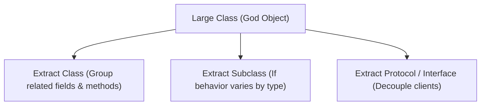

# Large Class (God Class) 🐘

## Source Reference
* **Book:** *Dive Into Refactoring* (Alexander Shvets), Chapter: *Code Smells / Bloaters / Large Class*
* **Architectural Principle:** [Single Responsibility Principle (SOLID)](../../../design-patterns/foundations/solid-principles.md)
* **Target Language:** Modern Python 3 (Python 3.10+) with `pytest`.

---

## 1. Signs and Symptoms

A single class contains dozens of methods, manages hundreds of lines of code, and maintains an excessive number of instance variables (`self.foo`, `self.bar`, `self.baz`).

### Detection Checklist:
- [ ] The class has more than 10-15 instance attributes initialized in `__init__`.
- [ ] Methods in the class operate on disjoint subsets of attributes (e.g., methods A, B, C use fields 1-3, while methods D, E, F use fields 4-7).
- [ ] The class name contains vague suffixes like `Manager`, `Controller`, `Processor`, or `Engine`.
- [ ] Multiple developers are constantly generating merge conflicts in the exact same class file.

---

## 2. Reasons for the Problem

Classes usually start small and focused. But as a project evolves, it is always easier to tack "one more method" and "one more attribute" onto an existing class that already has the required database connection or customer reference, rather than designing a new class.

---

## 3. Why It's Bad

* **High Fragility:** Modifying one method risks breaking seemingly unrelated methods because all methods share the same massive `self` state.
* **Low Cohesion:** The class violates the Single Responsibility Principle, accumulating multiple disparate reasons to change.
* **Poor Testability:** Setting up a unit test requires constructing a massive object with 20 dummy mock parameters.

---

## 4. Recommended Treatment



1. **Extract Class:** Identify subsets of fields and methods that belong together conceptually (e.g., shipping data vs. billing data) and move them into a separate class.
2. **Extract Subclass:** If certain methods and fields are only used in specific operational modes, extract them into specialized subclasses.
3. **Architectural Bridge:** Extracting classes directly enforces the **Single Responsibility Principle (SRP)** and sets up the **[Facade Pattern](../../../design-patterns/structural/facade.md)**.

---

## 5. Python Before & After Demonstration

### A. Smelly Code (The "God Class" Employee)
```python
# employee_smelly.py
class Employee:

  def __init__(
      self,
      name: str,
      email: str,
      street: str,
      city: str,
      zip_code: str,
      hourly_rate: float,
      bank_account: str,
      routing_number: str,
  ):
    # Personal info
    self.name = name
    self.email = email
    # Address data clump
    self.street = street
    self.city = city
    self.zip_code = zip_code
    # Payroll data
    self.hourly_rate = hourly_rate
    self.bank_account = bank_account
    self.routing_number = routing_number

  def calculate_monthly_pay(self, hours_worked: float) -> float:
    return self.hourly_rate * hours_worked

  def execute_direct_deposit(self, amount: float) -> str:
    # Direct dependency on banking wire logic
    return (
        f"Transferred ${amount:.2f} to Acct {self.bank_account} via Route"
        f" {self.routing_number}"
    )

  def format_shipping_label(self) -> str:
    return f"{self.name}\n{self.street}\n{self.city}, {self.zip_code}"
```

### B. The Pytest Baseline Contract
```python
# test_employee.py
from employee import Employee


def test_employee_contract():
  emp = Employee(
      name="Bob Vance",
      email="bob@vance.com",
      street="100 Industrial Pkwy",
      city="Scranton",
      zip_code="18504",
      hourly_rate=45.0,
      bank_account="987654321",
      routing_number="123456789",
  )

  # Verify pay
  assert emp.calculate_monthly_pay(160.0) == 7200.0

  # Verify deposit
  msg = emp.execute_direct_deposit(7200.0)
  assert "Transferred $7200.00 to Acct 987654321" in msg

  # Verify label
  label = emp.format_shipping_label()
  assert "100 Industrial Pkwy\nScranton, 18504" in label
```

### C. Refactored Clean Code (Extracted Cohesive Classes)
```python
# employee_clean.py
from dataclasses import dataclass


@dataclass(frozen=True)
class Address:
  street: str
  city: str
  zip_code: str

  def format_label(self, recipient_name: str) -> str:
    return f"{recipient_name}\n{self.street}\n{self.city}, {self.zip_code}"


@dataclass(frozen=True)
class BankAccount:
  account_number: str
  routing_number: str

  def deposit(self, amount: float) -> str:
    return (
        f"Transferred ${amount:.2f} to Acct {self.account_number} via Route"
        f" {self.routing_number}"
    )


class Employee:

  def __init__(
      self,
      name: str,
      email: str,
      address: Address,
      bank_account: BankAccount,
      hourly_rate: float,
  ):
    self.name = name
    self.email = email
    self.address = address
    self.bank_account = bank_account
    self.hourly_rate = hourly_rate

  def calculate_monthly_pay(self, hours_worked: float) -> float:
    return self.hourly_rate * hours_worked

  def execute_direct_deposit(self, amount: float) -> str:
    return self.bank_account.deposit(amount)

  def format_shipping_label(self) -> str:
    return self.address.format_label(self.name)
```

---

## 6. Payoff and Performance

* **Single Responsibility:** `Address` handles formatting addresses, `BankAccount` handles transaction wiring, and `Employee` coordinates employment logic.
* **Reusability:** The new `Address` and `BankAccount` dataclasses can be reused across `Customer`, `Vendor`, and `Contractor` classes without duplicating code.
* **Isolated Testing:** You can test bank deposit logic without having to supply employee addresses.

---

## 7. When to Ignore

* **Small, internal DTOs (Data Transfer Objects):** If a class is strictly an immutable configuration carrier or API response model with 15 fields and zero business methods, extracting nested sub-objects may introduce needless indirection.
