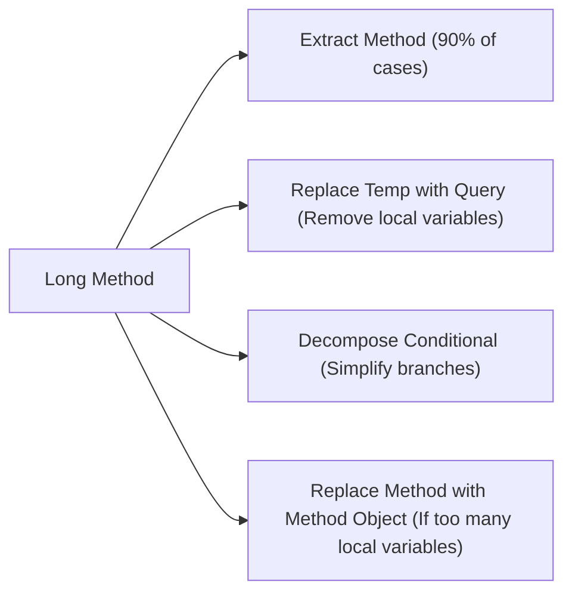

# Long Method 🐘

## Source Reference
* **Book:** *Dive Into Refactoring* (Alexander Shvets), Chapter: *Code Smells / Bloaters / Long Method*
* **Original Fowler Refactoring:** *Long Method*
* **Target Language:** Modern Python 3 (Python 3.10+) with `pytest` verification.

---

## 1. Signs and Symptoms

A method contains more than **10 to 15 lines of code** or tries to execute multiple steps of a business workflow simultaneously.

### Detection Checklist:
- [ ] You have to scroll down more than one screen to read the entire method.
- [ ] The method contains inline comments explaining what blocks of code do (e.g. `# Step 1: parse CSV`, `# Step 2: validate tax`, `# Step 3: save to DB`).
- [ ] The method contains dozens of local variables whose scopes overlap throughout the body.
- [ ] You cannot describe what the method does in a single sentence without using the word "and".

---

## 2. Reasons for the Problem

> *"Like the Hotel California, something is always being added to a method, but nothing is ever taken out."* — Alexander Shvets

It is always mentally easier to append two new lines of code to an existing function than to create a separate function and wire up parameters. Over months of development and multiple feature requests, a concise 8-line method quietly expands into a 200-line monstrosity.

---

## 3. Why It's Bad

* **High Cognitive Load:** A developer reading the method must hold all local variables and conditional branches in their working memory simultaneously.
* **Hidden Duplication:** Logic buried inside a 100-line method cannot be reused by other functions. Other engineers will inevitably rewrite that same logic elsewhere.
* **Testing Nightmare:** You cannot unit test intermediate business steps in isolation; you must invoke the entire monolithic function with massive setup dictionaries.

---

## 4. Recommended Treatment



1. **Extract Method:** If you feel the need to comment on something inside a method, take that code and extract it into a new function whose name describes its intent.
2. **Replace Temp with Query:** If local variables prevent clean extraction, replace them with queries to helper methods.
3. **Decompose Conditional:** If the method contains massive `if/elif/else` blocks, extract the condition and the branches into separate functions.

---

## 5. Python Before & After Demonstration

### A. Smelly Code (Monolithic Long Method)
```python
# order_service_smelly.py
import datetime


class OrderService:

  def print_order_receipt(self, order: dict, customer: dict) -> str:
    # 1. Print Header
    receipt = "====================================\n"
    receipt += "          COMPANY RECEIPT           \n"
    receipt += "====================================\n"

    # 2. Calculate Subtotal, Discounts, and Taxes
    subtotal = 0.0
    for item in order["items"]:
      subtotal += item["price"] * item["qty"]

    discount = 0.0
    if customer["is_member"]:
      discount = subtotal * 0.10

    tax = (subtotal - discount) * 0.08
    grand_total = subtotal - discount + tax

    # 3. Format Details
    receipt += f"Customer: {customer['name']}\n"
    receipt += (
        f"Date: {datetime.datetime.now().strftime('%Y-%m-%d %H:%M')}\n"
    )
    receipt += "------------------------------------\n"
    for item in order["items"]:
      receipt += (
          f"{item['name'][:15]:<15} x{item['qty']}  ${item['price'] * item['qty']:.2f}\n"
      )
    receipt += "------------------------------------\n"
    receipt += f"Subtotal:   ${subtotal:.2f}\n"
    receipt += f"Discount:  -${discount:.2f}\n"
    receipt += f"Tax (8%):   ${tax:.2f}\n"
    receipt += f"TOTAL:      ${grand_total:.2f}\n"
    receipt += "====================================\n"
    return receipt
```

### B. The Pytest Baseline Contract
```python
# test_order_service.py
from order_service import OrderService


def test_order_receipt_calculation_contract():
  service = OrderService()
  order = {
      "items": [
          {"name": "Mechanical Keyboard", "price": 100.0, "qty": 1},
          {"name": "Keycap Set", "price": 20.0, "qty": 2},
      ]  # subtotal = 140.0
  }
  customer = {"name": "Alice Smith", "is_member": True}

  # subtotal: 140.0, discount: 14.0, taxable: 126.0, tax: 10.08, total: 136.08
  receipt = service.print_order_receipt(order, customer)
  assert "Subtotal:   $140.00" in receipt
  assert "Discount:  -$14.00" in receipt
  assert "Tax (8%):   $10.08" in receipt
  assert "TOTAL:      $136.08" in receipt
```

### C. Refactored Clean Code (Composed Short Methods)
```python
# order_service_clean.py
from dataclasses import dataclass
import datetime
from typing import Any

TAX_RATE = 0.08
MEMBER_DISCOUNT_RATE = 0.10


@dataclass(frozen=True)
class OrderFinancials:
  subtotal: float
  discount: float
  tax: float
  grand_total: float


class OrderService:

  def print_order_receipt(
      self, order: dict[str, Any], customer: dict[str, Any]
  ) -> str:
    financials = self._calculate_financials(
        order["items"], customer["is_member"]
    )
    return "".join([
        self._format_header(),
        self._format_customer_info(customer["name"]),
        self._format_line_items(order["items"]),
        self._format_totals(financials),
        "====================================\n",
    ])

  def _calculate_financials(
      self, items: list[dict[str, Any]], is_member: bool
  ) -> OrderFinancials:
    subtotal = sum(item["price"] * item["qty"] for item in items)
    discount = (subtotal * MEMBER_DISCOUNT_RATE) if is_member else 0.0
    tax = (subtotal - discount) * TAX_RATE
    grand_total = subtotal - discount + tax
    return OrderFinancials(subtotal, discount, tax, grand_total)

  def _format_header(self) -> str:
    return (
        "====================================\n"
        "          COMPANY RECEIPT           \n"
        "====================================\n"
    )

  def _format_customer_info(self, name: str) -> str:
    timestamp = datetime.datetime.now().strftime("%Y-%m-%d %H:%M")
    return (
        f"Customer: {name}\n"
        f"Date: {timestamp}\n"
        "------------------------------------\n"
    )

  def _format_line_items(self, items: list[dict[str, Any]]) -> str:
    lines = []
    for item in items:
      item_cost = item["price"] * item["qty"]
      lines.append(f"{item['name'][:15]:<15} x{item['qty']}  ${item_cost:.2f}\n")
    return "".join(lines) + "------------------------------------\n"

  def _format_totals(self, f: OrderFinancials) -> str:
    return (
        f"Subtotal:   ${f.subtotal:.2f}\n"
        f"Discount:  -${f.discount:.2f}\n"
        f"Tax (8%):   ${f.tax:.2f}\n"
        f"TOTAL:      ${f.grand_total:.2f}\n"
    )
```

---

## 6. Payoff and Performance

* **Readability:** The top-level `print_order_receipt()` now reads like a table of contents. Anyone can understand the workflow in 5 seconds.
* **Isolated Testing:** You can test `_calculate_financials()` independently without checking text string formatting.
* **Performance Impact:** Zero. Modern Python function call overhead is nanoseconds; readable code is far easier to cache and optimize.

---

## 7. When to Ignore

* **Simple sequential configuration scripts or data migrations:** If a script merely sets up 20 sequential constants or seed records, extracting them into 20 one-line functions adds needless indirection.
* **Performance-critical inner loops:** In tight numerical loops (e.g. processing image pixels with NumPy/Cython), function call overhead in pure Python can matter. Use a profiler before optimizing!
