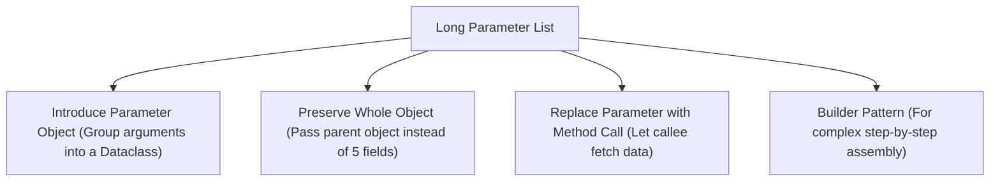

# Long Parameter List 🐘

## Source Reference
* **Book:** *Dive Into Refactoring* (Alexander Shvets), Chapter: *Code Smells / Bloaters / Long Parameter List*
* **Design Pattern Bridge:** [Builder Pattern](../../../design-patterns/creational/builder.md)
* **Target Language:** Modern Python 3 (Python 3.10+) with `pytest`.

---

## 1. Signs and Symptoms

A function or method accepts more than **three or four parameters**.

### Detection Checklist:
- [ ] A method call wraps across 4 or 5 lines in your editor.
- [ ] Multiple boolean flags are passed side-by-side (`def configure(cache=True, async_mode=False, verbose=True)`), leading to accidental parameter inversion.
- [ ] Developers constantly refer to the function signature to remember the order of arguments.
- [ ] Adding a new optional configuration parameter forces you to update dozens of test call sites.

---

## 2. Reasons for the Problem

Long parameter lists frequently emerge after an effort to eliminate coupling between classes. Instead of allowing a class to fetch what it needs from a collaborator object, developers extract every single piece of data and pass them all individually as raw parameters.

---

## 3. Why It's Bad

* **Incomprehensible Call Sites:** Reading `create_user("John", "Doe", True, False, 18, 0, None, True)` conveys zero meaning without looking up the definition.
* **Parameter Inversion Bugs:** Passing two parameters of the same type (`start_date`, `end_date`) in reverse order produces silent logical errors that compilers and linters cannot detect.
* **Fragile API Surfaces:** Any change to the parameter list breaks backwards compatibility for every caller.

---

## 4. Recommended Treatment



1. **Introduce Parameter Object:** Group related parameters into a dedicated Python `@dataclass`.
2. **Preserve Whole Object:** Instead of extracting 4 fields from an object and passing them individually, pass the entire object.
3. **Keyword-Only Arguments:** In Python, use the `*` syntax to force callers to name their arguments: `def search(*, query: str, limit: int = 10):`.

---

## 5. Python Before & After Demonstration

### A. Smelly Code (8 Positional Parameters)
```python
# report_generator_smelly.py
def generate_pdf_report(
    title: str,
    author: str,
    department: str,
    include_summary: bool,
    include_charts: bool,
    page_size: str,
    orientation: str,
    margin_mm: int,
) -> dict:
  # Caller can easily invert booleans or strings!
  return {
      "metadata": f"{title} by {author} ({department})",
      "layout": f"{page_size}-{orientation} with {margin_mm}mm margins",
      "summary": include_summary,
      "charts": include_charts,
  }
```

### B. The Pytest Baseline Contract
```python
# test_report_generator.py
from report_generator import generate_pdf_report


def test_generate_pdf_report_contract():
  report = generate_pdf_report(
      "Q4 Financials",
      "Finance Team",
      "Accounting",
      True,
      False,
      "A4",
      "PORTRAIT",
      20,
  )
  assert report["metadata"] == "Q4 Financials by Finance Team (Accounting)"
  assert report["layout"] == "A4-PORTRAIT with 20mm margins"
  assert report["summary"] is True
```

### C. Refactored Clean Code (Parameter Objects + Kwargs)
```python
# report_generator_clean.py
from dataclasses import dataclass
from enum import Enum


class PageOrientation(Enum):
  PORTRAIT = "PORTRAIT"
  LANDSCAPE = "LANDSCAPE"


@dataclass(frozen=True)
class PageLayout:
  size: str = "A4"
  orientation: PageOrientation = PageOrientation.PORTRAIT
  margin_mm: int = 20


@dataclass(frozen=True)
class ReportMetadata:
  title: str
  author: str
  department: str


@dataclass(frozen=True)
class ReportOptions:
  include_summary: bool = True
  include_charts: bool = False


def generate_pdf_report(
    metadata: ReportMetadata,
    layout: PageLayout = PageLayout(),
    options: ReportOptions = ReportOptions(),
) -> dict:
  # Clean, self-documenting, and defaults handle 90% of use-cases!
  return {
      "metadata": (
          f"{metadata.title} by {metadata.author} ({metadata.department})"
      ),
      "layout": (
          f"{layout.size}-{layout.orientation.value} with"
          f" {layout.margin_mm}mm margins"
      ),
      "summary": options.include_summary,
      "charts": options.include_charts,
  }
```

---

## 6. Payoff and Performance

* **Readable Call Sites:** Calling `generate_pdf_report(metadata, layout=custom_layout)` is intuitive and self-explanatory.
* **Extensibility:** Adding a new option (e.g. `watermark: str = ""`) to `ReportOptions` requires zero changes to existing call sites!
* **Type Safety:** Python IDEs provide accurate autocompletion for parameter object attributes.

---

## 7. When to Ignore

* **Decorators and Function Wrappers (`*args, **kwargs`):** Generic meta-programming utilities that forward arbitrary arguments to wrapped functions.
