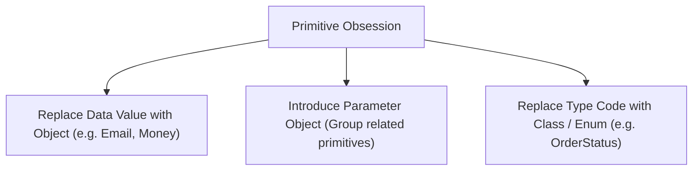

# Primitive Obsession 🐘

## Source Reference
* **Book:** *Dive Into Refactoring* (Alexander Shvets), Chapter: *Code Smells / Bloaters / Primitive Obsession*
* **Architectural Concept:** Value Objects (Domain-Driven Design), Python Dataclasses
* **Target Language:** Modern Python 3 (Python 3.10+) with `pytest`.

---

## 1. Signs and Symptoms

Using raw primitive data types (`str`, `int`, `float`, `dict`, `tuple`) to represent domain entities that have their own rules, boundaries, and validation behaviors.

### Detection Checklist:
- [ ] You are passing strings to represent phone numbers, currency amounts, zip codes, IP addresses, or email addresses.
- [ ] You find validation logic (`if "@" not in email`, `if len(phone) < 10`) copy-pasted across multiple functions.
- [ ] You pass raw floats to represent monetary values and suffer from floating-point rounding errors (`0.1 + 0.2 != 0.3`).
- [ ] Functions pass untyped dictionaries (`dict[str, Any]`) around as universal carriers where keys can be misspelled silently (`user["usr_nme"]` raises `KeyError` at runtime).

---

## 2. Reasons for the Problem

> *"Like most other smells, primitive obsessions are born in moments of weakness."* — Alexander Shvets

A developer needs to store an amount of money or an email address. Creating a full class feels like overkill for "just one string." So they use a raw `str` or `float`. Over time, business rules regarding that string (formatting, domain validation, currency conversion) multiply across the codebase, resulting in procedural sprawl.

---

## 3. Why It's Bad

* **Zero Type Safety:** A function expecting `def transfer_funds(source_acct: str, dest_acct: str, amount: float)` can easily receive parameters in the wrong order without any warning from static type checkers (`mypy`).
* **Scattered Validation:** If an email validation rule changes, you have to find and update 8 different API endpoints.
* **Primitive Intimidation:** Primitives cannot hold behavior. You cannot ask a raw `float` to round itself using banker's rounding or convert from USD to EUR.

---

## 4. Recommended Treatment



1. **Replace Data Value with Object:** Wrap primitive fields into cohesive **Value Objects** (`Money`, `EmailAddress`, `PhoneNumber`).
2. **Introduce Parameter Object:** Group ranges (like `start_date`, `end_date`) into a single `DateRange` object.
3. **Use Python Enums:** Replace string status flags (`"PENDING"`, `"SHIPPED"`) with standard `enum.Enum`.

---

## 5. Python Before & After Demonstration

### A. Smelly Code (Primitives everywhere)
```python
# payment_service_smelly.py
def process_checkout(
    user_email: str,
    amount: float,
    currency: str,
    range_start_hour: int,
    range_end_hour: int,
) -> str:
  # Primitive Obsession: Repetitive, manual validation logic
  if "@" not in user_email or "." not in user_email:
    raise ValueError("Invalid email format")

  if amount <= 0:
    raise ValueError("Amount must be positive")

  if currency not in ["USD", "EUR", "GBP"]:
    raise ValueError(f"Unsupported currency: {currency}")

  if not (0 <= range_start_hour < range_end_hour <= 24):
    raise ValueError("Invalid delivery window")

  return (
      f"Charged {currency} {amount:.2f} to {user_email}. Delivery between"
      f" {range_start_hour}:00 and {range_end_hour}:00"
  )
```

### B. The Pytest Baseline Contract
```python
# test_payment_service.py
from payment_service import process_checkout
import pytest


def test_process_checkout_contract():
  result = process_checkout("alice@example.com", 150.00, "USD", 9, 17)
  assert (
      result
      == "Charged USD 150.00 to alice@example.com. Delivery between 9:00 and"
      " 17:00"
  )


def test_invalid_email_raises():
  with pytest.raises(ValueError, match="Invalid email"):
    process_checkout("not-an-email", 100.0, "USD", 9, 17)
```

### C. Refactored Clean Code (Domain Value Objects)
```python
# payment_service_clean.py
from dataclasses import dataclass
from decimal import Decimal
from enum import Enum
import re


class Currency(Enum):
  USD = "USD"
  EUR = "EUR"
  GBP = "GBP"


@dataclass(frozen=True)
class EmailAddress:
  value: str

  def __post_init__(self):
    if not re.match(r"^[^@]+@[^@]+\.[^@]+$", self.value):
      raise ValueError(f"Invalid email format: {self.value}")


@dataclass(frozen=True)
class Money:
  amount: Decimal
  currency: Currency

  def __post_init__(self):
    if self.amount <= 0:
      raise ValueError("Amount must be positive")

  def format(self) -> str:
    return f"{self.currency.value} {self.amount:.2f}"


@dataclass(frozen=True)
class DeliveryWindow:
  start_hour: int
  end_hour: int

  def __post_init__(self):
    if not (0 <= self.start_hour < self.end_hour <= 24):
      raise ValueError("Invalid delivery window")

  def format(self) -> str:
    return f"between {self.start_hour}:00 and {self.end_hour}:00"


def process_checkout(
    email: EmailAddress, money: Money, window: DeliveryWindow
) -> str:
  # Clean, self-documenting, 100% type-safe!
  return f"Charged {money.format()} to {email.value}. Delivery {window.format()}"
```

---

## 6. Payoff and Performance

* **Self-Validating Domain:** You cannot instantiate an invalid `EmailAddress` or negative `Money`. Downstream methods are completely freed from defensive validation checks.
* **Immutability:** `@dataclass(frozen=True)` guarantees Value Objects are safe from side effects and can be used as dictionary keys or set elements.
* **Elimination of Parameter Confusion:** You cannot accidentally pass `EmailAddress` where `Money` was expected—`mypy` will catch it instantly at build time.

---

## 7. When to Ignore

* **Scripting and Glue Code:** In simple data migration scripts or one-off automation scripts where life expectancy is under 2 days, wrapping every string into a class adds unnecessary ceremony.
