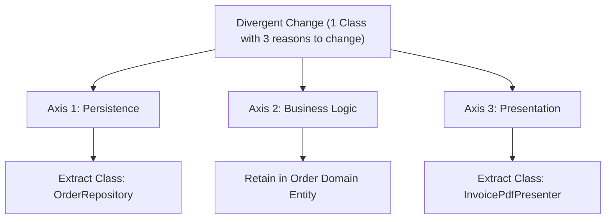

# Divergent Change 🔀

## Source Reference
* **Book:** *Dive Into Refactoring* (Alexander Shvets), Chapter: *Code Smells / Change Preventers / Divergent Change*
* **Design Pattern Bridge:** [Strategy Pattern](../../../design-patterns/behavioral/strategy.md), [Repository / DAO Pattern](../../../design-patterns/creational/factory-method.md)
* **Target Language:** Modern Python 3 (Python 3.10+) with `pytest`.

---

## 1. Signs and Symptoms

You find yourself having to change the **same class** in different ways for **different reasons**. For example, when adding a new database field, you change `Order`; when modifying the tax algorithm, you change `Order`; when tweaking the PDF invoice format, you change `Order`.

### Detection Checklist:
- [ ] Looking at git log, a single file appears in almost every pull request regardless of the business feature being developed.
- [ ] The class has multiple distinct axes of change: data persistence, business calculations, presentation rendering, and external communication.
- [ ] A developer working on billing keeps conflicting with a developer working on export formats in the same file.
- [ ] The class violates the Single Responsibility Principle (SRP).

---

## 2. Reasons for the Problem

Divergent Change occurs when a class starts small (e.g., an `Account` entity) and developers gradually bolt on related requirements directly into that class for convenience. Over time, it absorbs database serialization, validation, financial calculation, and serialization logic.

---

## 3. Why It's Bad

* **High Risk of Unintended Regressions:** Modifying the PDF output layout might accidentally alter an internal calculation variable used by the financial ledger.
* **Severe Git Merge Conflicts:** Because multiple developers modify this single "god file" for different user stories, PR merges become constant minefields.
* **Impaired Reusability:** You cannot reuse the business math without pulling in heavy database dependencies and rendering templates.

---

## 4. Recommended Treatment



1. **Extract Class:** Identify the distinct reasons for change and extract each into its own focused class.
2. **Extract Superclass / Interface:** If the different behaviors represent variations of the same abstraction, extract a superclass.

---

## 5. Python Before & After Demonstration

### A. Smelly Code (Order Doing Accounting, DB, and Presentation)
```python
# order_smelly.py
import json


class Order:

  def __init__(
      self, order_id: str, items: list[dict], customer_email: str
  ) -> None:
    self.order_id = order_id
    self.items = items
    self.customer_email = customer_email

  # Reason 1 to change: Financial Calculation
  def calculate_total(self, tax_rate: float) -> float:
    subtotal = sum(i["price"] * i["qty"] for i in self.items)
    return round(subtotal * (1.0 + tax_rate), 2)

  # Reason 2 to change: Database Persistence schema
  def save_to_database(self, connection) -> None:
    sql = (
        "INSERT INTO orders (id, payload, email) VALUES (%s, %s, %s)"
    )
    payload = json.dumps(self.items)
    connection.execute(sql, (self.order_id, payload, self.customer_email))

  # Reason 3 to change: Email Notification Template
  def format_email_body(self) -> str:
    lines = [f"Order: {self.order_id}", "Items:"]
    for i in self.items:
      lines.append(f"- {i['name']} x{i['qty']}: ${i['price']}")
    return "\n".join(lines)
```

### B. The Pytest Baseline Contract
```python
# test_order.py
from order_smelly import Order


def test_order_responsibilities():
  items = [
      {"name": "Keyboard", "price": 100.0, "qty": 1},
      {"name": "Mouse", "price": 50.0, "qty": 2},
  ]
  order = Order("ORD-1", items, "user@example.com")

  assert order.calculate_total(0.10) == 220.0
  assert "Keyboard x1" in order.format_email_body()
```

### C. Refactored Clean Code (Extracting SRP Collaborators)
```python
# order_clean.py
from dataclasses import dataclass


@dataclass(frozen=True)
class OrderItem:
  name: str
  price: float
  qty: int

  @property
  def total(self) -> float:
    return self.price * self.qty


class Order:
  """Pure Domain Entity: Changes ONLY when business order rules change."""

  def __init__(self, order_id: str, customer_email: str) -> None:
    self.order_id = order_id
    self.customer_email = customer_email
    self.items: list[OrderItem] = []

  def add_item(self, item: OrderItem) -> None:
    self.items.append(item)

  def calculate_total(self, tax_rate: float) -> float:
    subtotal = sum(item.total for item in self.items)
    return round(subtotal * (1.0 + tax_rate), 2)


class OrderRepository:
  """Changes ONLY when database schema or persistence technology changes."""

  def save(self, order: Order, connection) -> None:
    import json

    payload = json.dumps(
        [{"name": i.name, "price": i.price, "qty": i.qty} for i in order.items]
    )
    connection.execute(
        "INSERT INTO orders (id, payload, email) VALUES (%s, %s, %s)",
        (order.order_id, payload, order.customer_email),
    )


class OrderEmailPresenter:
  """Changes ONLY when presentation formatting or email styling changes."""

  @staticmethod
  def format_text(order: Order) -> str:
    lines = [f"Order: {order.order_id}", "Items:"]
    for item in order.items:
      lines.append(f"- {item.name} x{item.qty}: ${item.price}")
    return "\n".join(lines)
```

---

## 6. Payoff and Performance

| Dimension | Before Refactoring | After Refactoring |
| :--- | :--- | :--- |
| **Separation of Concerns** | Mixed domain logic, SQL queries, and email templates | Each class has 1 clear reason to change (SRP) |
| **Testing** | Must mock database connection just to test math | Domain math is tested with zero mocks |
| **Team Velocity** | Backend, frontend, and DB engineers collide in 1 file | Independent PRs across distinct specialized modules |

---

## 7. When to Ignore

* **Tiny Microservices or Spikes:** If an entity has a single 3-line persistence method and the entire project is under 150 lines of code, premature extraction introduces unnecessary abstraction overhead.
