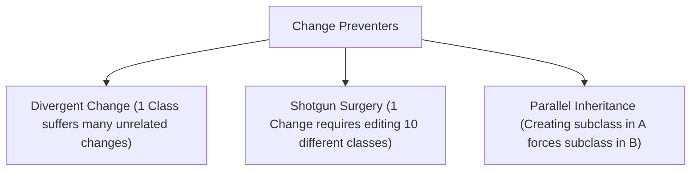

# Change Preventers 🚧

## Source Reference
* **Book:** *Dive Into Refactoring* (Alexander Shvets), Chapter: *Code Smells / Change Preventers*
* **Design Pattern Links:** [Bridge Pattern](../../../design-patterns/structural/bridge.md), [Observer Pattern](../../../design-patterns/behavioral/observer.md), [Strategy Pattern](../../../design-patterns/behavioral/strategy.md)

---

## Overview

**Change Preventers** are smells that make code modification slow, difficult, and hazardous. They violate the fundamental software engineering principle of **cohesion**: things that change together should live together, and things that change for different reasons should live apart.

---

## The 3 Code Smells in this Group

| Code Smell | Core Symptom | Primary Refactoring Technique | Pattern Solution |
| :--- | :--- | :--- | :--- |
| [**Divergent Change**](divergent-change.md) | One class is frequently modified in different ways for completely different reasons | Extract Class | Single Responsibility Principle |
| [**Shotgun Surgery**](shotgun-surgery.md) | Making any single modification requires making dozens of small edits scattered across many classes | Move Method, Move Field, Inline Class | Facade / Single Aggregation Point |
| [**Parallel Inheritance Hierarchies**](parallel-inheritance.md) | Creating a subclass of class A forces you to create a corresponding subclass of class B | Move Method, Move Field | [Bridge](../../../design-patterns/structural/bridge.md) |

---

## Architectural Comparison: Divergent Change vs Shotgun Surgery

| Dimension | Divergent Change | Shotgun Surgery |
| :--- | :--- | :--- |
| **Ratio** | **1 Class $\rightarrow$ Many Reasons to Change** | **1 Reason to Change $\rightarrow$ Many Classes** |
| **Root Cause** | Class has too many unrelated responsibilities | A single responsibility is fragmented across multiple classes |
| **Remedy** | **Extract Class** to split responsibilities apart | **Move Method / Move Field** to consolidate the responsibility in one place |
