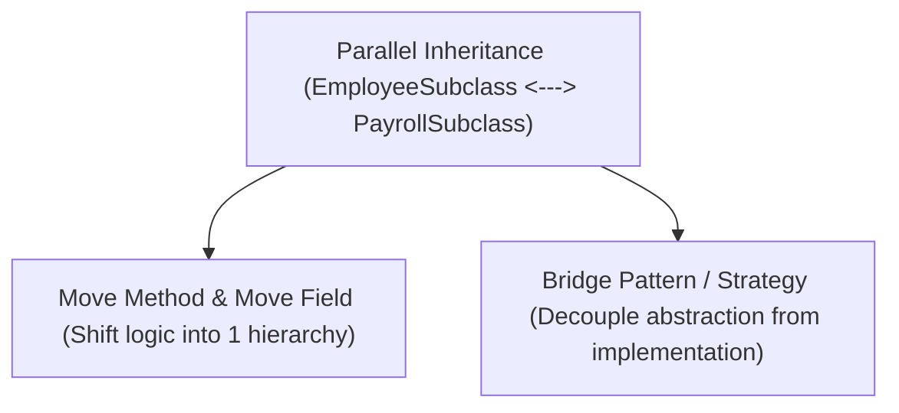

# Parallel Inheritance Hierarchies 🪜

## Source Reference
* **Book:** *Dive Into Refactoring* (Alexander Shvets), Chapter: *Code Smells / Change Preventers / Parallel Inheritance Hierarchies*
* **Design Pattern Bridge:** [Bridge Pattern](../../../design-patterns/structural/bridge.md), [Strategy Pattern](../../../design-patterns/behavioral/strategy.md)
* **Target Language:** Modern Python 3 (Python 3.10+) with `pytest`.

---

## 1. Signs and Symptoms

Every time you create a subclass in one class hierarchy (e.g., adding `ContractEmployee` under `Employee`), you find yourself **forced to create a matching subclass in another hierarchy** (e.g., adding `ContractPayroll` under `PayrollCalculator`).

### Detection Checklist:
- [ ] You notice two hierarchies with mirroring class prefixes:
  - `Engineer` $\rightarrow$ `EngineerMilestoneTracker`
  - `Manager` $\rightarrow$ `ManagerMilestoneTracker`
  - `Executive` $\rightarrow$ `ExecutiveMilestoneTracker`
- [ ] Adding a new business variant requires adding two or more new classes across separate directory trees.
- [ ] Classes in one hierarchy maintain 1-to-1 references to corresponding classes in the sibling hierarchy.

---

## 2. Reasons for the Problem

Parallel inheritance happens when two separate concepts are tightly coupled across inheritance trees rather than composed. Developers model both concepts as subclasses instead of letting one class vary independently via composition or strategy injection.

---

## 3. Why It's Bad

* **Combinatorial Class Explosion:** If you have 5 employee types and 4 payroll calculation strategies, parallel hierarchies can explode into 20 classes.
* **Duplicated Architecture:** Changes to base class signatures in one tree force updates in the parallel tree.
* **Maintenance Friction:** Developers easily forget to implement the corresponding subclass in the secondary tree, causing runtime attribute errors.

---

## 4. Recommended Treatment



1. **Move Method & Move Field:** Make instances of one hierarchy refer to instances of the other, then move the methods so the secondary hierarchy disappears.
2. **Strategy / Bridge Pattern:** Instead of subclassing both sides, inject a single configurable strategy or parameter object.

---

## 5. Python Before & After Demonstration

### A. Smelly Code (Mirrored Employee & Payroll Hierarchies)
```python
# payroll_smelly.py
# Hierarchy 1: Employees
class Employee:

  def __init__(self, name: str, base_rate: float) -> None:
    self.name = name
    self.base_rate = base_rate


class SalariedEmployee(Employee):
  pass


class HourlyEmployee(Employee):
  pass


# Hierarchy 2: Mirrored Payroll Calculators!
class PayrollCalculator:

  def calculate(self, emp: Employee, units: float) -> float:
    raise NotImplementedError


class SalariedPayrollCalculator(PayrollCalculator):

  def calculate(self, emp: Employee, units: float) -> float:
    return emp.base_rate * units  # units = months


class HourlyPayrollCalculator(PayrollCalculator):

  def calculate(self, emp: Employee, units: float) -> float:
    return emp.base_rate * units  # units = hours
```

### B. The Pytest Baseline Contract
```python
# test_payroll.py
from payroll_smelly import (
    HourlyEmployee,
    HourlyPayrollCalculator,
    SalariedEmployee,
    SalariedPayrollCalculator,
)


def test_mirrored_payroll_calculation():
  salaried = SalariedEmployee("Alice", 5000.0)
  calc_sal = SalariedPayrollCalculator()
  assert calc_sal.calculate(salaried, 1.0) == 5000.0

  hourly = HourlyEmployee("Bob", 40.0)
  calc_hour = HourlyPayrollCalculator()
  assert calc_hour.calculate(hourly, 40.0) == 1600.0
```

### C. Refactored Clean Code (Composition with Strategy / Bridge)
```python
# payroll_clean.py
from dataclasses import dataclass
from typing import Callable


@dataclass(frozen=True)
class CompensationModel:
  """Clean Strategy / Bridge eliminating the parallel hierarchy entirely."""

  unit_label: str
  calculate: Callable[[float, float], float]


# Standard reusable compensation strategies:
SALARIED_PLAN = CompensationModel(
    unit_label="months", calculate=lambda rate, units: rate * units
)

HOURLY_PLAN = CompensationModel(
    unit_label="hours",
    calculate=lambda rate, hours: (
        (rate * hours) if hours <= 40 else (rate * 40 + (hours - 40) * rate * 1.5)
    ),
)


class Employee:
  """Single clean entity: Composes with CompensationModel instead of parallel subclasses."""

  def __init__(
      self, name: str, base_rate: float, compensation: CompensationModel
  ) -> None:
    self.name = name
    self.base_rate = base_rate
    self.compensation = compensation

  def calculate_pay(self, units: float) -> float:
    return self.compensation.calculate(self.base_rate, units)
```

---

## 6. Payoff and Performance

| Dimension | Before Refactoring | After Refactoring |
| :--- | :--- | :--- |
| **Number of Classes** | $2 \times N$ classes (mirrored trees) | $1$ class + reusable composable strategies |
| **Adding New Pay Plan** | Requires creating new Employee subclass + new Payroll subclass | Simply define a new `CompensationModel` instance |
| **Runtime Flexibility** | Employee cannot change pay plan without re-instantiation | Change `emp.compensation = NEW_PLAN` at runtime |

---

## 7. When to Ignore

* **Abstract Factory Implementations:** In classical GUI toolkits (e.g., `MacButton`/`WindowsButton` paired with `MacWindow`/`WindowsWindow`), parallel hierarchies are sometimes a deliberate design pattern decision to enforce strict platform theme consistency.
