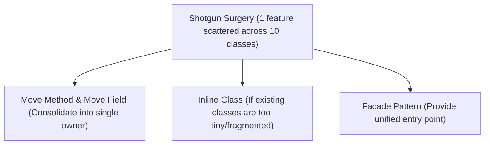

# Shotgun Surgery 💥

## Source Reference
* **Book:** *Dive Into Refactoring* (Alexander Shvets), Chapter: *Code Smells / Change Preventers / Shotgun Surgery*
* **Design Pattern Bridge:** [Facade Pattern](../../../design-patterns/structural/facade.md), [Mediator Pattern](../../../design-patterns/behavioral/mediator.md)
* **Target Language:** Modern Python 3 (Python 3.10+) with `pytest`.

---

## 1. Signs and Symptoms

Whenever you make a single conceptual change (e.g., adding a new field to user accounts or altering the logging format), you must make **dozens of tiny edits scattered across many different files and classes**.

### Detection Checklist:
- [ ] A minor business requirement change touches 12 different files across 5 directories in a single git commit.
- [ ] You frequently miss one or two update locations during a change, resulting in subtle production bugs or inconsistent states.
- [ ] Grepping the codebase reveals identical snippets of data handling logic repeated across multiple controllers and services.
- [ ] The responsibility for a single feature is smeared thinly across the entire system.

---

## 2. Reasons for the Problem

Shotgun Surgery occurs when a responsibility or piece of data is not properly encapsulated. Instead of placing the logic inside a single authoritative class, multiple classes directly inspect and manipulate the raw data themselves.

---

## 3. Why It's Bad

* **High Likelihood of Incomplete Changes:** Missing even one file out of 15 leaves the system in an inconsistent, broken state.
* **Tedious Code Reviews:** Reviewers must verify 15 files with 2-line diffs each, making it hard to see the big architectural picture.
* **Brittle Codebase:** Any simple upgrade or schema change becomes an intimidating engineering ordeal.

---

## 4. Recommended Treatment



1. **Move Method & Move Field:** Move all scattered operations and data into a single, cohesive owner class.
2. **Inline Class:** If the existing classes have become almost empty after moving their methods, merge them into the consolidated class.

---

## 5. Python Before & After Demonstration

### A. Smelly Code (Scattered User Permission Verification)
```python
# permission_smelly.py
# 1 single rule: "Admins or users with valid tokens and active status can access"
# Scattered across 3 different controllers!


class AccountController:

  def view_account(self, user: dict) -> bool:
    # Manual check 1
    return user.get("role") == "admin" or (
        user.get("is_active") and user.get("token_valid")
    )


class BillingController:

  def view_invoices(self, user: dict) -> bool:
    # Manual check 2: slightly out of sync!
    return user.get("role") == "admin" or user.get("is_active")


class SettingsController:

  def update_settings(self, user: dict) -> bool:
    # Manual check 3
    return user.get("role") == "admin" or (
        user.get("is_active") and user.get("token_valid")
    )
```

### B. The Pytest Baseline Contract
```python
# test_permissions.py
from permission_smelly import (
    AccountController,
    BillingController,
    SettingsController,
)


def test_permission_consistency():
  user = {"role": "member", "is_active": True, "token_valid": True}
  assert AccountController().view_account(user) is True
  assert BillingController().view_invoices(user) is True
  assert SettingsController().update_settings(user) is True
```

### C. Refactored Clean Code (Centralized Domain Policy)
```python
# permission_clean.py
from dataclasses import dataclass


@dataclass(frozen=True)
class UserContext:
  role: str
  is_active: bool
  token_valid: bool

  @property
  def can_access_secure_features(self) -> bool:
    """Consolidated Single Source of Truth for feature access rules.

    Modifying permission requirements touches ONLY this single method.
    """
    if self.role == "admin":
      return True
    return self.is_active and self.token_valid


class AccountController:

  def view_account(self, user: UserContext) -> bool:
    return user.can_access_secure_features


class BillingController:

  def view_invoices(self, user: UserContext) -> bool:
    return user.can_access_secure_features


class SettingsController:

  def update_settings(self, user: UserContext) -> bool:
    return user.can_access_secure_features
```

---

## 6. Payoff and Performance

| Dimension | Before Refactoring | After Refactoring |
| :--- | :--- | :--- |
| **Commit Blast Radius** | Updating permission logic touches 3+ controllers | Modifies exactly 1 method in `UserContext` |
| **Logic Drift & Bugs** | `BillingController` had an accidental bug omitting `token_valid` | Zero drift; all consumers invoke the identical consolidated method |
| **Maintainability** | High cognitive overhead searching for all call sites | Low overhead; single cohesive domain rule |

---

## 7. When to Ignore

* **Cross-Cutting Concerns Handled by Middleware:** If an aspect (like request tracing or Prometheus metrics) naturally observes many endpoints, prefer using Python decorators or ASGI middleware rather than prematurely forcing everything into a single class.
