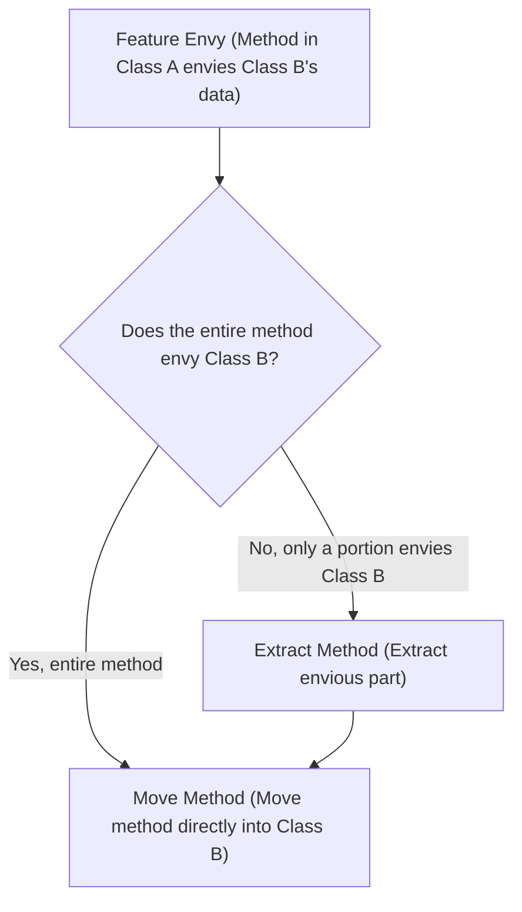

# Feature Envy 👀

## Source Reference
* **Book:** *Dive Into Refactoring* (Alexander Shvets), Chapter: *Code Smells / Couplers / Feature Envy*
* **Design Principle Bridge:** *Information Expert*, *Tell, Don't Ask*
* **Target Language:** Modern Python 3 (Python 3.10+) with `pytest`.

---

## 1. Signs and Symptoms

A method in Class A spends most of its time **accessing the data, fields, and helper methods of Class B** rather than using its own instance data. It seems more "envious" of another object than satisfied with its own.

### Detection Checklist:
- [ ] A method takes another object as a parameter and calls 4 or 5 different getters or reads multiple attributes on it: `order.customer.address.city`, `order.discount_rate`, `order.tax_exempt`.
- [ ] The method barely references `self`.
- [ ] If the data structure of the target object changes, this method in the foreign class immediately breaks.
- [ ] The method violates the **Information Expert** principle: behavior is separated from the data it operates on.

---

## 2. Reasons for the Problem

Feature Envy usually occurs after fields were grouped into a data class or value object, but the associated calculations were left behind in an external service or utility class. The external service is doing work that the data object should be doing for itself.

---

## 3. Why It's Bad

* **Weak Cohesion:** Logic is located in the wrong place, forcing readers to jump across multiple files to understand how data is processed.
* **Leaky Encapsulation:** The foreign class must have intimate knowledge of the target class's internal fields and structures.
* **Duplication:** Other classes that need the same calculation will either re-implement it or couple themselves to this misplaced service method.

---

## 4. Recommended Treatment



1. **Move Method:** If the entire method is interested in the other object's data, move the method onto that object.
2. **Extract Method + Move Method:** If only part of the method suffers from envy, extract that portion into a separate method first, then move that extracted method to the target object.

---

## 5. Python Before & After Demonstration

### A. Smelly Code (Printer Class Envious of Customer and Address Data)
```python
# label_smelly.py
class Address:

  def __init__(self, street: str, city: str, zip_code: str) -> None:
    self.street = street
    self.city = city
    self.zip_code = zip_code


class Customer:

  def __init__(self, name: str, address: Address) -> None:
    self.name = name
    self.address = address


class ShippingLabelPrinter:
  """Smelly: Completely envious of Customer and Address attributes."""

  def print_label(self, customer: Customer) -> str:
    # Method uses 0 attributes of ShippingLabelPrinter, and 4 from customer/address!
    lines = [
        customer.name.upper(),
        customer.address.street,
        f"{customer.address.city}, {customer.address.zip_code}",
    ]
    return "\n".join(lines)
```

### B. The Pytest Baseline Contract
```python
# test_label.py
from label_smelly import Address, Customer, ShippingLabelPrinter


def test_shipping_label_formatting():
  addr = Address("10 Downing St", "London", "SW1A 2AA")
  cust = Customer("Prime Minister", addr)
  printer = ShippingLabelPrinter()

  expected = "PRIME MINISTER\n10 Downing St\nLondon, SW1A 2AA"
  assert printer.print_label(cust) == expected
```

### C. Refactored Clean Code (Moving Behavior to Information Experts)
```python
# label_clean.py
from dataclasses import dataclass


@dataclass(frozen=True)
class Address:
  street: str
  city: str
  zip_code: str

  @property
  def formatted_lines(self) -> list[str]:
    """Address formats its own internal lines."""
    return [self.street, f"{self.city}, {self.zip_code}"]


@dataclass(frozen=True)
class Customer:
  name: str
  address: Address

  @property
  def formatted_shipping_label(self) -> str:
    """Customer is the Information Expert for customer delivery presentation."""
    lines = [self.name.upper(), *self.address.formatted_lines]
    return "\n".join(lines)


class ShippingLabelPrinter:
  """Clean service: simply tells the customer to provide its formatted label."""

  def print_label(self, customer: Customer) -> str:
    return customer.formatted_shipping_label
```

---

## 6. Payoff and Performance

| Dimension | Before Refactoring | After Refactoring |
| :--- | :--- | :--- |
| **Encapsulation** | `ShippingLabelPrinter` knew internal layout of `Address` | Internal fields of `Address` are encapsulated |
| **Reusability** | Address formatting was trapped inside the printer | Any component (invoice, PDF, email) can reuse `formatted_lines` |
| **Law of Demeter** | Violated: `customer.address.city` chain | Compliant: `customer.formatted_shipping_label` |

---

## 7. When to Ignore

* **Strategy & Visitor Patterns:** In the Strategy or Visitor patterns, behavior is intentionally extracted out of the data class to allow independent runtime polymorphism. As long as this is a deliberate architectural pattern choice, it is acceptable.
