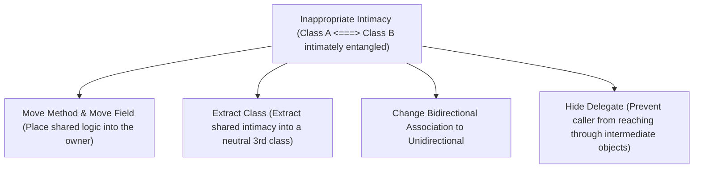

# Inappropriate Intimacy 🤫

## Source Reference
* **Book:** *Dive Into Refactoring* (Alexander Shvets), Chapter: *Code Smells / Couplers / Inappropriate Intimacy*
* **Design Principle Bridge:** *Information Hiding*, *Encapsulation*
* **Target Language:** Modern Python 3 (Python 3.10+) with `pytest`.

---

## 1. Signs and Symptoms

Two classes spend far too much time **digging into each other's private fields, internal structures, or protected attributes** (`_private_var`). They know far too much about each other's inner workings.

### Detection Checklist:
- [ ] Class A directly accesses or modifies Class B's private attributes (e.g., accessing variables prefixed with `_` in Python).
- [ ] Class A and Class B have bidirectional pointers to each other and pass internal state back and forth in complex cycles.
- [ ] A subclass accesses internal implementation details of its parent instead of interacting through the official public interface.
- [ ] You cannot change the internal data structure of one class without breaking the other.

---

## 2. Reasons for the Problem

Classes often start out with clean, separated responsibilities. But under deadline pressure, developers bypass public interfaces and reach directly into another class's internals to get a job done quickly. Over time, the boundary between the two classes blurs and dissolves.

---

## 3. Why It's Bad

* **Shattered Encapsulation:** When private details leak out, you lose the ability to refactor or optimize a class's internal data structure without breaking outside callers.
* **Tangled Circular Coupling:** Bidirectional intimacy prevents either class from being tested, reused, or deployed independently.
* **Fragile Base Class Syndrome:** Subclasses that couple intimately to parent private internals break unexpectedly when the parent class is updated.

---

## 4. Recommended Treatment



1. **Move Method & Move Field:** If Class A is manipulating Class B's internals, move the offending methods or fields into Class B.
2. **Change Bidirectional Association to Unidirectional:** If the two classes hold mutual references, break the cycle so that only one class depends on the other.
3. **Extract Class:** If both classes are intimately sharing a common subset of state, extract that state into a separate independent class.

---

## 5. Python Before & After Demonstration

### A. Smelly Code (Department Directly Manipulates Employee Private State)
```python
# company_smelly.py
class Employee:

  def __init__(self, name: str, base_salary: float) -> None:
    self.name = name
    self._base_salary = base_salary
    # Intimate back-pointer
    self.department = None


class Department:

  def __init__(self, name: str) -> None:
    self.name = name
    self.staff: list[Employee] = []

  def add_staff(self, emp: Employee) -> None:
    self.staff.append(emp)
    emp.department = self

  def give_staff_raise(self, emp: Employee, percentage: float) -> None:
    # Inappropriate intimacy: reaching directly into employee's private state!
    emp._base_salary += emp._base_salary * (percentage / 100.0)

  def get_total_payroll(self) -> float:
    # Digging into private attribute _base_salary of all employees
    return sum(emp._base_salary for emp in self.staff)
```

### B. The Pytest Baseline Contract
```python
# test_company.py
from company_smelly import Department, Employee


def test_department_payroll():
  dept = Department("Engineering")
  alice = Employee("Alice", 100_000.0)
  dept.add_staff(alice)

  dept.give_staff_raise(alice, 10.0)
  assert dept.get_total_payroll() == 110_000.0
```

### C. Refactored Clean Code (Strict Encapsulation & Unidirectional Flow)
```python
# company_clean.py
class Employee:
  """Employee strictly manages its own salary invariants."""

  def __init__(self, name: str, initial_salary: float) -> None:
    self.name = name
    self._salary = initial_salary

  @property
  def salary(self) -> float:
    """Read-only property."""
    return self._salary

  def apply_raise(self, percentage: float) -> None:
    """Employee encapsulates its own state modification logic."""
    if percentage < 0:
      raise ValueError("Raise percentage cannot be negative")
    self._salary += self._salary * (percentage / 100.0)


class Department:
  """Department interacts strictly through Employee's public contract."""

  def __init__(self, name: str) -> None:
    self.name = name
    self.staff: list[Employee] = []

  def add_staff(self, emp: Employee) -> None:
    self.staff.append(emp)

  def give_staff_raise(self, emp: Employee, percentage: float) -> None:
    emp.apply_raise(percentage)

  def get_total_payroll(self) -> float:
    return sum(emp.salary for emp in self.staff)
```

---

## 6. Payoff and Performance

| Dimension | Before Refactoring | After Refactoring |
| :--- | :--- | :--- |
| **Encapsulation** | `Department` mutated `_base_salary` directly, bypassing validation | `Employee` guards its salary invariants completely |
| **Coupling Cycle** | Bidirectional (`Employee.department` $\leftrightarrow$ `Department.staff`) | Clean unidirectional composition |
| **Modifiability** | Changing Employee's salary representation broke `Department` | Employee can change internal representation freely |

---

## 7. When to Ignore

* **Internal Nested Helpers:** In languages with inner classes, or in Python where a private helper class (e.g., `_Node` in a `LinkedList`) exists solely inside a module to support an outer container, close intimacy is natural and self-contained within that single file.
