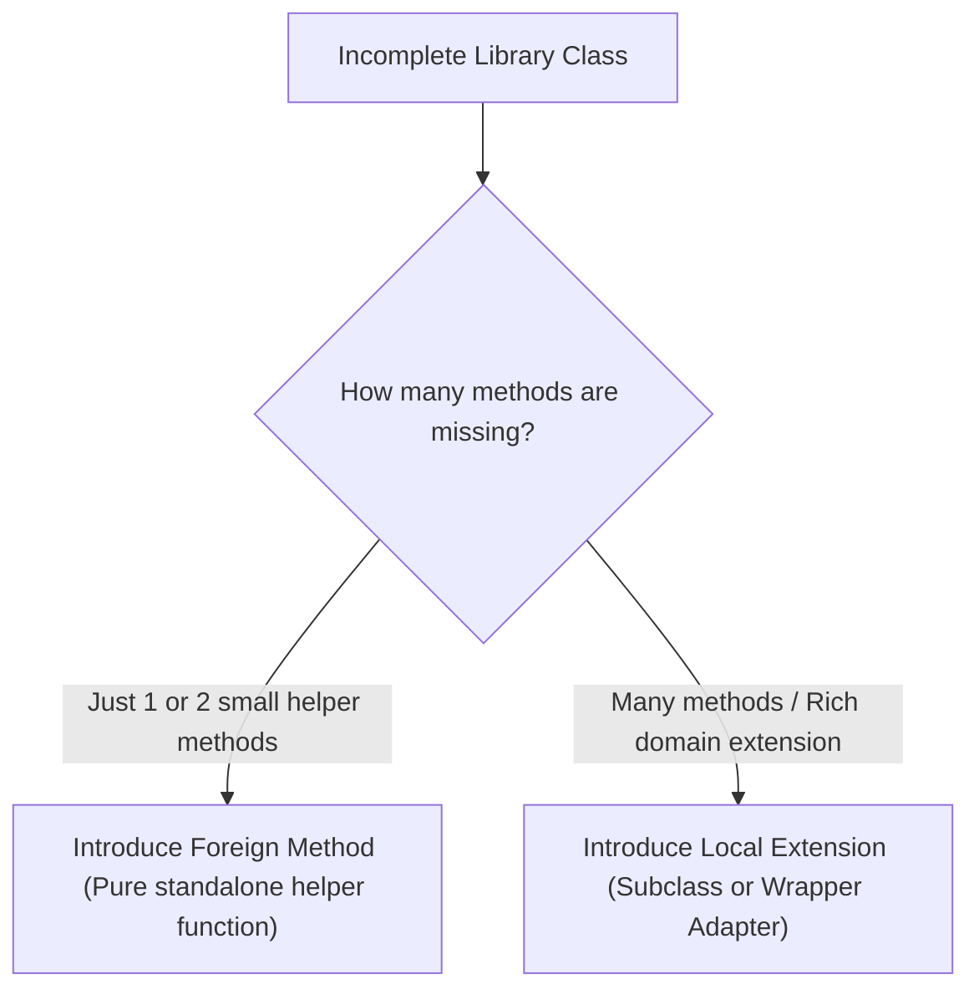

# Incomplete Library Class 📦

## Source Reference
* **Book:** *Dive Into Refactoring* (Alexander Shvets), Chapter: *Code Smells / Couplers / Incomplete Library Class*
* **Design Pattern Bridge:** [Adapter Pattern](../../../design-patterns/structural/adapter.md), [Decorator Pattern](../../../design-patterns/structural/decorator.md)
* **Target Language:** Modern Python 3 (Python 3.10+) with `pytest`.

---

## 1. Signs and Symptoms

A third-party vendor library or standard library class **lacks a crucial method or feature** that your application desperately needs. Because the library is packaged in a read-only dependency (`site-packages`), you cannot directly edit its source code.

### Detection Checklist:
- [ ] You see multiple developers re-implementing identical helper logic across the codebase to work around a missing method in an external SDK.
- [ ] You find yourself monkey-patching external library classes at runtime in an ad-hoc, untracked manner.
- [ ] An external class does 90% of what you need, but the missing 10% causes awkward procedural code at every call site.

---

## 2. Reasons for the Problem

Library authors cannot anticipate every consumer's niche use cases. Eventually, your application's domain demands operations that the library vendor never envisioned or chose not to support.

---

## 3. Why It's Bad

* **Duplicated Ad-Hoc Fixes:** If 4 engineers need a `next_business_day()` method on `datetime.date`, you will end up with 4 divergent implementations scattered across different files.
* **Fragile Monkeypatching:** Directly monkeypatching third-party classes (`datetime.date.next_workday = ...`) risks colliding with future library updates or third-party plugins.
* **Tight Vendor Coupling:** Scattering calls to the vendor library across your application makes it nearly impossible to upgrade or replace the library later.

---

## 4. Recommended Treatment



1. **Introduce Foreign Method:** If you only need one or two helper methods, create a pure function that accepts the library object as its first argument.
2. **Introduce Local Extension (Subclass or Wrapper):** If you need many methods or want to maintain custom state, create a subclass (or an Adapter wrapper that delegates to the library class).

---

## 5. Python Before & After Demonstration

### A. Smelly Code (Scattered Ad-Hoc Workarounds for `datetime.date`)
```python
# scheduler_smelly.py
import datetime


class PayrollTask:

  def schedule(self, start_date: datetime.date) -> datetime.date:
    # Ad-hoc calculation of next business day
    next_day = start_date + datetime.timedelta(days=1)
    if next_day.weekday() == 5:  # Saturday
      next_day += datetime.timedelta(days=2)
    elif next_day.weekday() == 6:  # Sunday
      next_day += datetime.timedelta(days=1)
    return next_day


class InvoiceTask:

  def schedule_due_date(self, invoice_date: datetime.date) -> datetime.date:
    # Duplicated and slightly inconsistent calculation!
    d = invoice_date + datetime.timedelta(days=1)
    while d.weekday() >= 5:
      d += datetime.timedelta(days=1)
    return d
```

### B. The Pytest Baseline Contract
```python
# test_scheduler.py
import datetime
from scheduler_smelly import InvoiceTask, PayrollTask


def test_business_day_scheduling():
  friday = datetime.date(2026, 11, 6)  # Friday
  expected_monday = datetime.date(2026, 11, 9)  # Monday

  assert PayrollTask().schedule(friday) == expected_monday
  assert InvoiceTask().schedule_due_date(friday) == expected_monday
```

### C. Refactored Clean Code (Introduce Local Extension - Custom Date Wrapper)
```python
# scheduler_clean.py
import datetime


class BusinessDate:
  """Local Extension (Wrapper Adapter) adding domain-specific behaviors to datetime.date."""

  def __init__(self, date: datetime.date) -> None:
    self._date = date

  @property
  def raw_date(self) -> datetime.date:
    return self._date

  @property
  def is_weekend(self) -> bool:
    return self._date.weekday() >= 5

  def next_business_day(self) -> "BusinessDate":
    """Centralized, robust business logic missing from the original standard library."""
    candidate = self._date + datetime.timedelta(days=1)
    while candidate.weekday() >= 5:  # 5 = Saturday, 6 = Sunday
      candidate += datetime.timedelta(days=1)
    return BusinessDate(candidate)


class PayrollTask:

  def schedule(self, start_date: datetime.date) -> datetime.date:
    return BusinessDate(start_date).next_business_day().raw_date


class InvoiceTask:

  def schedule_due_date(self, invoice_date: datetime.date) -> datetime.date:
    return BusinessDate(invoice_date).next_business_day().raw_date
```

---

## 6. Payoff and Performance

| Dimension | Before Refactoring | After Refactoring |
| :--- | :--- | :--- |
| **Logic Duplication** | Weekend math repeated across tasks with varying loops/ifs | Single tested implementation in `BusinessDate` |
| **Readability** | Obscure weekday integer arithmetic inside tasks | Self-explanatory `next_business_day()` API |
| **Upgrade Safety** | Zero risk of monkeypatch collision; standard object composition | 100% standard Python composition |

---

## 7. When to Ignore

* **One-Time Scripts:** In a one-off migration script where a library is used only once and never imported into production code.
