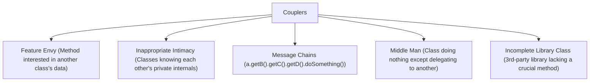

# Couplers 🔗

## Source Reference
* **Book:** *Dive Into Refactoring* (Alexander Shvets), Chapter: *Code Smells / Couplers*
* **Design Pattern Links:** [Facade Pattern](../../../design-patterns/structural/facade.md), [Adapter Pattern](../../../design-patterns/structural/adapter.md), [Mediator Pattern](../../../design-patterns/behavioral/mediator.md)

---

## Overview

**Couplers** represent code smells where classes are excessively bound to each other, or where the coupling is managed through awkward, excessive indirection. High coupling creates fragile code: a small change in one class ripples unpredictably through all its tightly coupled partners.

---

## The 5 Code Smells in this Group

| Code Smell | Core Symptom | Primary Refactoring Technique | Pattern Solution |
| :--- | :--- | :--- | :--- |
| [**Feature Envy**](feature-envy.md) | A method accesses the data of another object more than its own | Move Method, Extract Method | Tell, Don't Ask |
| [**Inappropriate Intimacy**](inappropriate-intimacy.md) | Two classes spend too much time rummaging in each other's private internals | Move Method/Field, Change Bidirectional to Unidirectional | Encapsulation |
| [**Message Chains**](message-chains.md) | A client navigates a train of calls: `a.b.c.d.action()` | Hide Delegate, Extract Method | Law of Demeter |
| [**Middle Man**](middle-man.md) | A class does nothing but forward every call to another class | Remove Middle Man, Inline Class | Direct Communication |
| [**Incomplete Library Class**](incomplete-library.md) | A 3rd-party vendor library doesn't supply a method you desperately need | Introduce Foreign Method, Introduce Local Extension | [Adapter](../../../design-patterns/structural/adapter.md) / Extension |

---

## The Dynamic Tension: Message Chains vs Middle Man

Refactoring is a balance of trade-offs:
* If you eliminate **Message Chains** by hiding delegates everywhere, you risk turning that class into a bloated **Middle Man**.
* If you eliminate a **Middle Man** by having callers talk directly to delegates, you risk re-introducing **Message Chains** or leaking internal structure.

Refactoring allows you to calibrate between these two poles based on team needs and domain boundaries.
