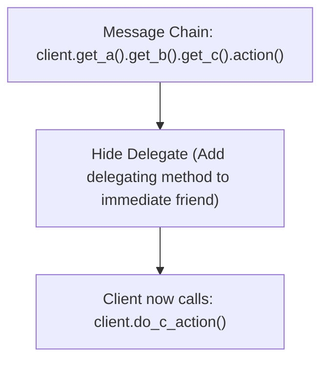

# Message Chains ⛓️

## Source Reference
* **Book:** *Dive Into Refactoring* (Alexander Shvets), Chapter: *Code Smells / Couplers / Message Chains*
* **Design Principle Bridge:** *Law of Demeter* ("Principle of Least Knowledge"), *Tell, Don't Ask*
* **Target Language:** Modern Python 3 (Python 3.10+) with `pytest`.

---

## 1. Signs and Symptoms

In code, you see a long series of calls navigating through an object graph: `a.get_b().get_c().get_d().do_something()`, or in Python: `user.profile.settings.notifications.email.is_enabled`.

### Detection Checklist:
- [ ] Code contains expressions with 3 or more consecutive dots (`.`): `order.customer.company.billing_address.country`.
- [ ] Any change in the navigation structure (e.g., placing `billing_address` under `finance_dept`) breaks unrelated controllers or presenters.
- [ ] Writing a mock for a unit test requires setting up 4 layers of dummy intermediate objects.
- [ ] The code violates the **Law of Demeter**: a method talks to strangers instead of its immediate friends.

---

## 2. Reasons for the Problem

Message chains appear when a client needs a piece of information or behavior that is deep within an object graph. Instead of asking the immediate collaborator to provide the result, the client navigates step-by-step through intermediate accessors.

---

## 3. Why It's Bad

* **Deep Structural Coupling:** The client becomes tightly coupled to the exact structural topology of the entire domain hierarchy.
* **Fragile Call Sites:** If any intermediate link in the chain is moved, renamed, or converted into an optional collection, every client navigation breaks.
* **`NoneType` Attribute Errors:** In Python, if any link in `a.b.c.d` returns `None`, the application crashes with `AttributeError: 'NoneType' object has no attribute 'd'`.

---

## 4. Recommended Treatment



1. **Hide Delegate:** Add a method to the immediate collaborator that handles the request and delegates it to the downstream object internally.
2. **Extract Method & Move Method:** If the client navigates the chain to perform a calculation on the final object, extract that calculation into a method and move it all the way down to the final object.

---

## 5. Python Before & After Demonstration

### A. Smelly Code (Navigating Deep Through Company Hierarchy)
```python
# demeter_smelly.py
class Manager:

  def __init__(self, name: str) -> None:
    self.name = name


class Department:

  def __init__(self, manager: Manager) -> None:
    self.manager = manager


class Employee:

  def __init__(self, department: Department) -> None:
    self.department = department


class ProjectReport:
  """Smelly: Client navigates 3 levels deep just to find a manager name!"""

  def generate_signature_line(self, employee: Employee) -> str:
    # Message chain: employee -> department -> manager -> name
    mgr_name = employee.department.manager.name
    return f"Approved by: {mgr_name}"
```

### B. The Pytest Baseline Contract
```python
# test_demeter.py
from demeter_smelly import Department, Employee, Manager, ProjectReport


def test_signature_line_generation():
  mgr = Manager("Alice Henderson")
  dept = Department(mgr)
  emp = Employee(dept)
  report = ProjectReport()

  assert (
      report.generate_signature_line(emp)
      == "Approved by: Alice Henderson"
  )
```

### C. Refactored Clean Code (Hide Delegate - Law of Demeter)
```python
# demeter_clean.py
class Manager:

  def __init__(self, name: str) -> None:
    self.name = name


class Department:

  def __init__(self, manager: Manager) -> None:
    self._manager = manager

  @property
  def manager_name(self) -> str:
    """Hides the Manager object from external callers."""
    return self._manager.name


class Employee:

  def __init__(self, department: Department) -> None:
    self._department = department

  @property
  def manager_name(self) -> str:
    """Hides the Department delegation: immediate friend answers directly."""
    return self._department.manager_name


class ProjectReport:
  """Clean: Client talks ONLY to its immediate collaborator (Employee)."""

  def generate_signature_line(self, employee: Employee) -> str:
    return f"Approved by: {employee.manager_name}"
```

---

## 6. Payoff and Performance

| Dimension | Before Refactoring | After Refactoring |
| :--- | :--- | :--- |
| **Coupling Depth** | `ProjectReport` coupled to `Employee`, `Department`, and `Manager` | `ProjectReport` coupled ONLY to `Employee` |
| **Testing Simplicity** | Test had to instantiate 3 classes just to test 1 string | Can mock `employee.manager_name` directly in 1 line |
| **Refactoring Freedom** | Renaming `Department.manager` broke report generation | Intermediate structure can change freely |

---

## 7. When to Ignore

* **Fluent Interfaces & Method Chaining:** Builder patterns, query builders (e.g., SQLAlchemy `session.query(User).filter(...).order_by(...).all()`), or pandas pipelines (`df.dropna().groupby(...).mean()`) are fluent APIs returning the same type or stream. These are not message chains through distinct domain layers.
