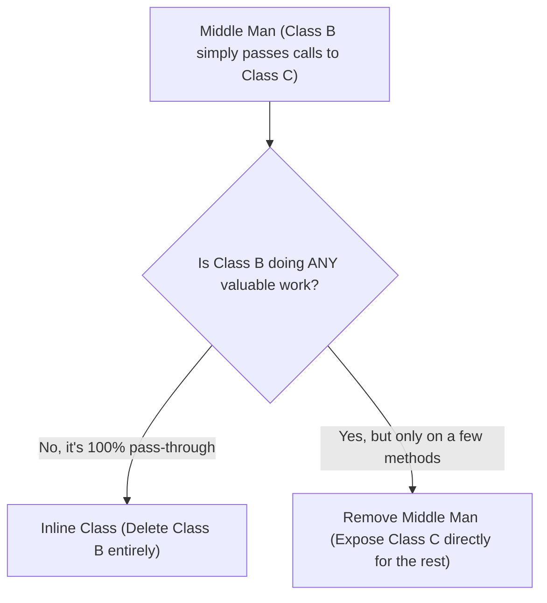

# Middle Man 🕴️

## Source Reference
* **Book:** *Dive Into Refactoring* (Alexander Shvets), Chapter: *Code Smells / Couplers / Middle Man*
* **Design Pattern Counterpart:** [Proxy Pattern](../../../design-patterns/structural/proxy.md), [Facade Pattern](../../../design-patterns/structural/facade.md)
* **Target Language:** Modern Python 3 (Python 3.10+) with `pytest`.

---

## 1. Signs and Symptoms

A class has **dozens of methods that do nothing except delegate calls to another object**. It contains no business logic, no validation, and no state transformation of its own. It is simply a hollow middleman.

### Detection Checklist:
- [ ] You open a class and see 10 methods in a row that look like: `def get_address(self): return self._person.get_address()`.
- [ ] Adding a new method to the delegate forces you to add an identical pass-through method to the middleman class.
- [ ] The class was created during an aggressive "Hide Delegate" refactoring that went too far.
- [ ] Debugging execution requires stepping through empty forwarding methods that add zero diagnostic value.

---

## 2. Reasons for the Problem

Middle Man is frequently the direct result of **overzealous encapsulation**. In an effort to obey the Law of Demeter and eliminate Message Chains, developers wrap every single method of an internal object with a forwarding method. Eventually, the wrapping class stops being an active entity and degenerates into an empty broker.

---

## 3. Why It's Bad

* **Boilerplate Duplication:** Every change or addition to the inner class must be mirrored in the middleman class.
* **Pointless Indirection:** Code execution and stack traces are cluttered with intermediate frames that perform zero work.
* **False Encapsulation:** If a class delegates 100% of its interface to an inner object, it isn't truly encapsulating anything—it is just duplicating the surface area.

---

## 4. Recommended Treatment



1. **Remove Middle Man:** Provide an accessor so clients can talk directly to the underlying delegate object, and delete the pass-through methods.
2. **Inline Class:** If the middleman has no reason to exist at all, merge it into the caller or inline the delegate directly.

---

## 5. Python Before & After Demonstration

### A. Smelly Code (Employee Class Acting as Hollow Middleman to Department)
```python
# middleman_smelly.py
class Department:

  def __init__(
      self, name: str, manager_name: str, office_code: str
  ) -> None:
    self.name = name
    self.manager_name = manager_name
    self.office_code = office_code

  def get_budget_code(self) -> str:
    return f"{self.office_code}-{self.name[:3].upper()}"


class Employee:
  """Smelly: Over-encapsulation turned Employee into an empty Middle Man."""

  def __init__(self, name: str, department: Department) -> None:
    self.name = name
    self._department = department

  # Pure pass-through methods that add zero value:
  def get_department_name(self) -> str:
    return self._department.name

  def get_manager_name(self) -> str:
    return self._department.manager_name

  def get_office_code(self) -> str:
    return self._department.office_code

  def get_budget_code(self) -> str:
    return self._department.get_budget_code()
```

### B. The Pytest Baseline Contract
```python
# test_middleman.py
from middleman_smelly import Department, Employee


def test_middleman_forwarding():
  dept = Department("Marketing", "Carol Danvers", "NYC-04")
  emp = Employee("Peter", dept)

  assert emp.get_manager_name() == "Carol Danvers"
  assert emp.get_budget_code() == "NYC-04-MAR"
```

### C. Refactored Clean Code (Remove Middle Man)
```python
# middleman_clean.py
class Department:

  def __init__(
      self, name: str, manager_name: str, office_code: str
  ) -> None:
    self.name = name
    self.manager_name = manager_name
    self.office_code = office_code

  def get_budget_code(self) -> str:
    return f"{self.office_code}-{self.name[:3].upper()}"


class Employee:
  """Clean: Employee maintains personal identity; Department is directly accessible."""

  def __init__(self, name: str, department: Department) -> None:
    self.name = name
    self.department = department  # Directly accessible!
```

---

## 6. Payoff and Performance

| Dimension | Before Refactoring | After Refactoring |
| :--- | :--- | :--- |
| **Pass-through Boilerplate** | 4 empty forwarding methods to write, test, and maintain | 0 forwarding methods |
| **Call Efficiency** | Extra stack frame for every single attribute access | Direct attribute lookup |
| **API Evolution** | Adding a method to `Department` required updating `Employee` | `Department` evolves independently |

---

## 7. When to Ignore

* **Security / Access Proxies:** When the middleman checks user authentication, authorization, or rate limiting before forwarding the call.
* **Remote RPC / Network Gateways:** In microservice architectures, an API Gateway or client stub passes calls over the wire to remote nodes.
