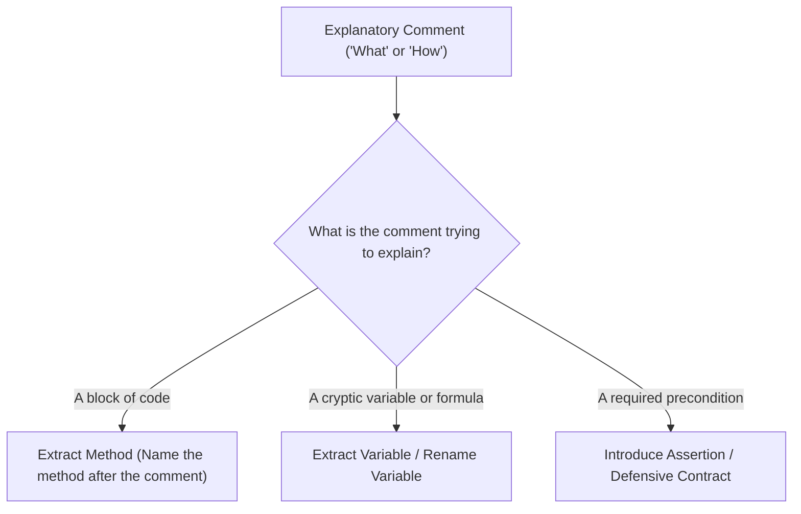

# Comments 💬

## Source Reference
* **Book:** *Dive Into Refactoring* (Alexander Shvets), Chapter: *Code Smells / Dispensables / Comments*
* **Target Language:** Modern Python 3 (Python 3.10+) with `pytest`.

---

## 1. Signs and Symptoms

A method is packed with inline comments explaining **what the code is doing step by step**. Comments are being used as "deodorant" to mask poorly named variables, convoluted loops, and nested conditional structures.

> *"When you feel the need to write a comment, first try to refactor the code so that any comment becomes superfluous."* — Martin Fowler

### Detection Checklist:
- [ ] Paragraphs of comments preface 20-line chunks of code explaining what the next block calculates.
- [ ] Comment explains the meaning of obscure variable names (e.g., `# x is the customer age in days`).
- [ ] Code has changed over time, but the comments were never updated, making them actively misleading or factually incorrect.
- [ ] The comment merely repeats what the syntax already says (`# increment i by 1`).

---

## 2. Reasons for the Problem

Developers often write comments with good intentions: they realize their code has become intricate or obscure, so they write an explanatory comment rather than cleaning up the structure. Comments do not undergo compilation or automated testing, so they inevitably rot over time.

---

## 3. Why It's Bad

* **The Lie of Stale Comments:** A comment that was true two years ago but false today is worse than no comment at all; it sends engineers on wild-goose chases during production outages.
* **Visual Clutter:** Noise comments dilute genuine warnings (e.g., explaining why a non-intuitive cryptographic or hardware workaround is strictly necessary).
* **Excuse for Laziness:** Writing a comment takes 5 seconds, whereas extracting a clean, descriptive method takes 20 seconds. Choosing comments leaves code smelly forever.

---

## 4. Recommended Treatment



1. **Extract Method:** If a comment explains what a block does, extract that block into a method whose name matches the comment's intent.
2. **Extract Variable:** If an expression is complex, assign it to a well-named intermediate variable.
3. **Rename Method / Parameter:** Replace obscure abbreviations (`usr_flg`) with clear domain terminology (`is_verified_subscriber`).

---

## 5. Python Before & After Demonstration

### A. Smelly Code (Comments Explaining Obscure Logic)
```python
# subscription_smelly.py
import datetime


def check_eligibility(user: dict) -> bool:
  # Check if user is active and registered more than 30 days ago
  now = datetime.datetime.now(datetime.timezone.utc)
  reg_date = user.get("created_at")
  diff = (now - reg_date).days

  # If days > 30 and tier is 2 (Gold) or points > 1000 and has no bans
  if (
      diff > 30
      and (user.get("tier") == 2 or user.get("pts", 0) > 1000)
      and not user.get("banned", False)
  ):
    # send notification email flag
    return True
  return False
```

### B. The Pytest Baseline Contract
```python
# test_subscription.py
import datetime
from subscription_smelly import check_eligibility


def test_subscription_eligibility():
  old_date = datetime.datetime.now(
      datetime.timezone.utc
  ) - datetime.timedelta(days=45)
  user = {
      "created_at": old_date,
      "tier": 2,
      "pts": 100,
      "banned": False,
  }
  assert check_eligibility(user) is True
```

### C. Refactored Clean Code (Self-Documenting Code)
```python
# subscription_clean.py
from dataclasses import dataclass
import datetime


@dataclass(frozen=True)
class UserProfile:
  created_at: datetime.datetime
  tier_code: int
  loyalty_points: int
  is_banned: bool

  @property
  def tenure_days(self) -> int:
    now = datetime.datetime.now(datetime.timezone.utc)
    return (now - self.created_at).days

  @property
  def is_senior_account(self) -> bool:
    return self.tenure_days > 30

  @property
  def has_vip_status(self) -> bool:
    return self.tier_code == 2 or self.loyalty_points > 1000

  @property
  def is_eligible_for_promo(self) -> bool:
    """Zero comments needed: the code reads like natural English."""
    return (
        self.is_senior_account
        and self.has_vip_status
        and not self.is_banned
    )
```

---

## 6. Payoff and Performance

| Dimension | Before Refactoring | After Refactoring |
| :--- | :--- | :--- |
| **Readability** | Reader must translate comments and decipher cryptic conditionals | Code reads directly as domain sentences |
| **Maintenance** | Logic and comments drift apart over time | Clean code cannot drift from itself |
| **Reusability** | Sub-checks (`is_senior_account`, `has_vip_status`) were locked inside one function | Sub-properties can be reused across the entire application |

---

## 7. When to Ignore

* **The "Why", Not the "What":** When code must do something unintuitive (e.g., `# Workaround for Safari iOS audio context unlocking issue: WebKit Bug #174288`), an explanatory comment is invaluable.
* **Complex Mathematical or Algorithmic Citations:** Pointing to an academic paper or RFC (e.g., `# Implements RFC 8446 Section 4.2 Key Exchange`) is appropriate and necessary.
* **Docstrings for Public APIs:** Python docstrings (`"""..."""`) describing public library contracts and parameter specifications are essential documentation, not code smells.
