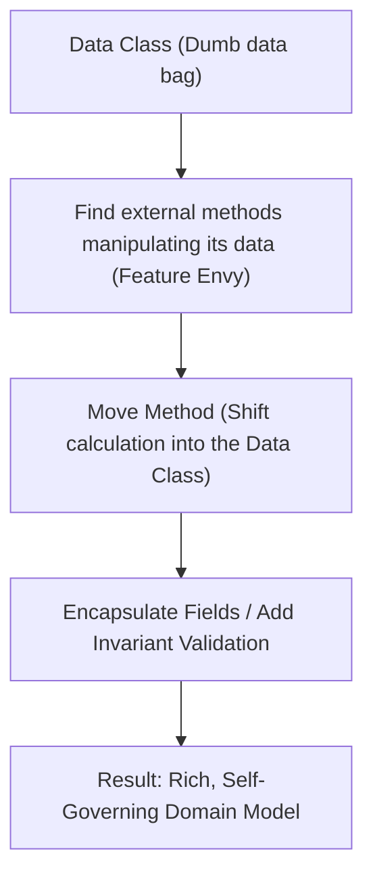

# Data Class (Anemic Domain Model) 📄

## Source Reference
* **Book:** *Dive Into Refactoring* (Alexander Shvets), Chapter: *Code Smells / Dispensables / Data Class*
* **Design Pattern Bridge:** [Rich Domain Model](../../../design-patterns/structural/composite.md)
* **Target Language:** Modern Python 3 (Python 3.10+) with `pytest`.

---

## 1. Signs and Symptoms

A class that contains **fields, getters, and setters, but almost zero behavior**. Other classes in the codebase constantly reach inside this class, read its raw data, perform business calculations on that data, and write the updated state back.

### Detection Checklist:
- [ ] The class has attributes and trivial accessors, but no domain methods.
- [ ] Multiple services contain methods taking `(data_obj: MyDataClass)` as a parameter to perform operations that should belong on the object itself.
- [ ] The class violates the **Tell, Don't Ask** principle: callers ask for data to make decisions instead of telling the object what to do.
- [ ] Business logic manipulating this data is duplicated across 3 or 4 caller modules.

---

## 2. Reasons for the Problem

1. **Procedural Habits:** Programmers accustomed to C structs or procedural databases treat objects merely as passive data records and place all behavior into separate "Manager" or "Service" classes.
2. **Premature Decoupling:** Developers artificially split data and behavior in an attempt to be "clean", inadvertently creating an Anemic Domain Model.

---

## 3. Why It's Bad

* **Violated Encapsulation:** When external classes manipulate internal fields directly, invariants cannot be enforced.
* **Feature Envy Proliferation:** External classes envy the data class's fields, causing severe architectural coupling.
* **Duplicated Business Logic:** If `OrderService`, `InvoiceService`, and `CartService` all compute discounts on `OrderItem`, any discount formula change requires hunting down all 3 services.

---

## 4. Recommended Treatment



1. **Move Method:** Locate methods in other classes that operate primarily on the data class's fields, and move those methods directly onto the data class.
2. **Encapsulate Field:** Hide raw mutable access behind clear, semantic domain operations.
3. **Distinguish DTOs vs Domain Entities:** Keep dumb `@dataclass` structures strictly at system boundaries (e.g., parsing raw incoming JSON/REST requests); convert them into Rich Domain Models immediately upon entering domain logic.

---

## 5. Python Before & After Demonstration

### A. Smelly Code (Anemic Account Manipulated by External Service)
```python
# account_smelly.py
from dataclasses import dataclass


@dataclass
class BankAccountData:
  """Smelly: Pure data bag with no rules or validation."""

  account_id: str
  balance: float
  is_frozen: bool


class AccountService:
  """External class violating Tell, Don't Ask by micromanaging BankAccountData."""

  def deposit(self, account: BankAccountData, amount: float) -> None:
    if account.is_frozen:
      raise ValueError("Cannot deposit to frozen account")
    if amount <= 0:
      raise ValueError("Deposit must be positive")
    account.balance += amount

  def withdraw(self, account: BankAccountData, amount: float) -> None:
    if account.is_frozen:
      raise ValueError("Cannot withdraw from frozen account")
    if amount > account.balance:
      raise ValueError("Insufficient funds")
    account.balance -= amount
```

### B. The Pytest Baseline Contract
```python
# test_account.py
import pytest
from account_smelly import AccountService, BankAccountData


def test_banking_operations():
  acc = BankAccountData(
      account_id="ACC-1", balance=100.0, is_frozen=False
  )
  service = AccountService()

  service.deposit(acc, 50.0)
  assert acc.balance == 150.0

  service.withdraw(acc, 30.0)
  assert acc.balance == 120.0

  with pytest.raises(ValueError, match="Insufficient funds"):
    service.withdraw(acc, 500.0)
```

### C. Refactored Clean Code (Rich Domain Model)
```python
# account_clean.py
class BankAccount:
  """Rich Domain Model: Encapsulates state and enforces all business invariants."""

  def __init__(
      self, account_id: str, initial_balance: float = 0.0
  ) -> None:
    if initial_balance < 0:
      raise ValueError("Initial balance cannot be negative")
    self._account_id = account_id
    self._balance = initial_balance
    self._is_frozen = False

  @property
  def balance(self) -> float:
    return self._balance

  @property
  def is_frozen(self) -> bool:
    return self._is_frozen

  def freeze(self) -> None:
    self._is_frozen = True

  def unfreeze(self) -> None:
    self._is_frozen = False

  def deposit(self, amount: float) -> None:
    if self._is_frozen:
      raise ValueError("Cannot deposit to frozen account")
    if amount <= 0:
      raise ValueError("Deposit must be positive")
    self._balance += amount

  def withdraw(self, amount: float) -> None:
    if self._is_frozen:
      raise ValueError("Cannot withdraw from frozen account")
    if amount <= 0:
      raise ValueError("Withdrawal must be positive")
    if amount > self._balance:
      raise ValueError("Insufficient funds")
    self._balance -= amount
```

---

## 6. Payoff and Performance

| Dimension | Before Refactoring | After Refactoring |
| :--- | :--- | :--- |
| **Encapsulation** | Anyone could execute `account.balance = -999999` directly | State mutations strictly guarded by invariant checks |
| **Object Orientation** | Procedural: Data and logic live in separate worlds | True OOP: Data and operations are unified |
| **Code Placement** | Operations scattered across multiple service modules | Single authoritative source for all account rules |

---

## 7. When to Ignore

* **Data Transfer Objects (DTOs):** Objects used solely to transfer data across network boundaries, database rows (e.g., Pydantic schemas or raw SQL cursor rows), or IPC messages should remain simple, behaviorless records.
