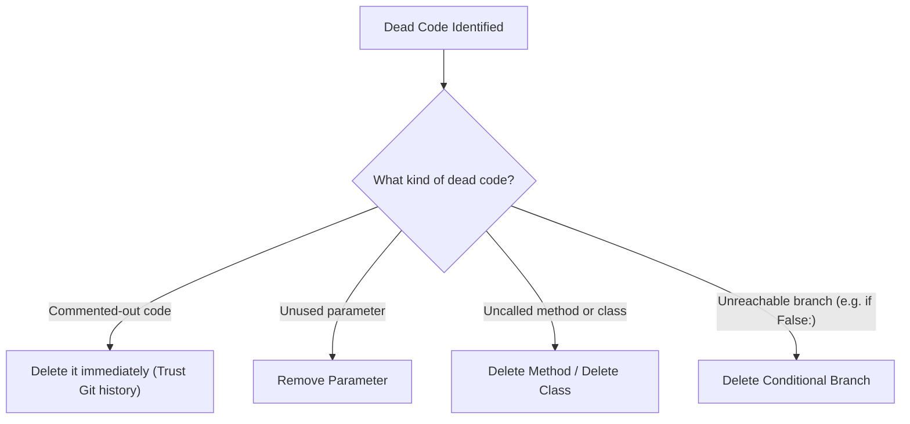

# Dead Code 💀

## Source Reference
* **Book:** *Dive Into Refactoring* (Alexander Shvets), Chapter: *Code Smells / Dispensables / Dead Code*
* **Target Language:** Modern Python 3 (Python 3.10+) with `pytest`.

---

## 1. Signs and Symptoms

A variable, parameter, class attribute, function, method, or entire class is **never used or executed anywhere** in the codebase. This includes commented-out blocks of code left behind from past experiments.

### Detection Checklist:
- [ ] Blocks of commented-out code span multiple lines with notes like `# Old logic - keeping just in case`.
- [ ] Static analysis tools (`vulture`, `ruff`, `flake8`) report unreachable code, unused variables, or unused private functions.
- [ ] Functions accept parameters that are never referenced inside the function body.
- [ ] A class or module exists that is never imported anywhere in the repository.

---

## 2. Reasons for the Problem

1. **Changing Requirements:** Requirements evolve, making an old branch or function obsolete. The developer deletes the call site but forgets to delete the function itself.
2. **Fear of Loss ("Just in Case"):** Developers comment out blocks of code instead of deleting them because they fear they might need them later, forgetting that Git preserves full history forever.

---

## 3. Why It's Bad

* **Misleading Mental Models:** Engineers spending hours reading and trying to understand complex code that isn't even executed in production.
* **Maintenance Tax:** Refactorings (like renaming an attribute or updating an import) waste time fixing dead code.
* **Bloated Test Suites:** Tests run against dead functions, slowing down CI pipelines for zero value.

---

## 4. Recommended Treatment



1. **Delete Dead Code:** Delete the unused function, method, or class without hesitation.
2. **Remove Parameter:** If a parameter is no longer used by the function body, eliminate it from the signature and update call sites.
3. **Automate Elimination:** Run `vulture` or `ruff check --select F401,F841` in your pre-commit hooks to prevent dead code from ever entering main.

---

## 5. Python Before & After Demonstration

### A. Smelly Code (Commented-out Code, Unused Params & Methods)
```python
# calculation_smelly.py
class PricingEngine:

  # Unused parameter 'user_ip'
  def calculate_price(
      self, base_price: float, quantity: int, user_ip: str
  ) -> float:
    # --- OLD FORMULA DEPRECATED IN 2023 ---
    # if quantity > 100:
    #     discount = 0.20
    # else:
    #     discount = 0.05
    # total = base_price * quantity * (1.0 - discount)
    # return total
    # -------------------------------------

    discount = 0.15 if quantity > 50 else 0.0
    return round(base_price * quantity * (1.0 - discount), 2)

  # Dead method: Never called anywhere in the codebase!
  def legacy_xml_serializer(self) -> str:
    return "<engine status='ready'/>"
```

### B. The Pytest Baseline Contract
```python
# test_pricing.py
from calculation_smelly import PricingEngine


def test_calculate_price():
  engine = PricingEngine()
  # Caller was forced to supply a useless IP parameter
  assert (
      engine.calculate_price(100.0, 10, "127.0.0.1") == 1000.0
  )
  assert engine.calculate_price(100.0, 60, "127.0.0.1") == 5100.0
```

### C. Refactored Clean Code (Ruthless Elimination)
```python
# calculation_clean.py
class PricingEngine:
  """Clean, focused calculation engine with zero dead baggage."""

  def calculate_price(self, base_price: float, quantity: int) -> float:
    discount = 0.15 if quantity > 50 else 0.0
    return round(base_price * quantity * (1.0 - discount), 2)
```

---

## 6. Payoff and Performance

| Dimension | Before Refactoring | After Refactoring |
| :--- | :--- | :--- |
| **Cognitive Noise** | 20 lines of commented-out junk and zombie functions | 6 lines of crisp, clear logic |
| **Signature Clarity** | Unused `user_ip` misled readers into thinking IP geo-pricing was active | Signature reflects only genuine inputs |
| **Tooling Cleanliness** | Linter emits warnings on unused variables | Zero linter warnings; clean CI |

---

## 7. When to Ignore

* **Public Library APIs:** If you maintain a public open-source Python library, an API method might not be called inside your repository because your external users are calling it. Use `@typing.deprecated` or semantic versioning deprecation cycles before deleting.
