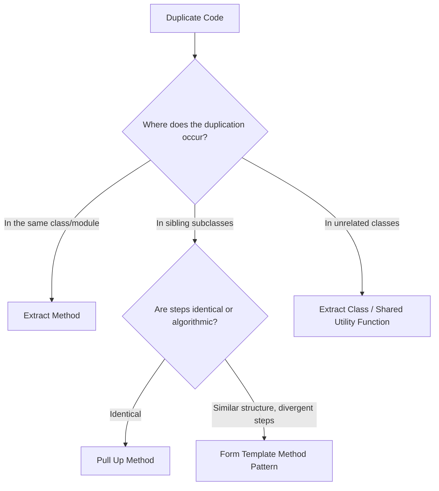

# Duplicate Code 👥

## Source Reference
* **Book:** *Dive Into Refactoring* (Alexander Shvets), Chapter: *Code Smells / Dispensables / Duplicate Code*
* **Design Pattern Bridge:** [Template Method Pattern](../../../design-patterns/behavioral/template-method.md), [Strategy Pattern](../../../design-patterns/behavioral/strategy.md)
* **Target Language:** Modern Python 3 (Python 3.10+) with `pytest`.

---

## 1. Signs and Symptoms

Two or more code fragments look **almost or completely identical**. They may exist in the same class, in sibling subclasses, or in entirely unrelated classes across the project.

### Detection Checklist:
- [ ] You catch yourself pressing `Ctrl+C` and `Ctrl+V` to copy a block of code into another function or file.
- [ ] Fixing a bug in one place leaves you wondering: *"Where else did we copy this logic?"*
- [ ] Two methods differ only by a single constant, variable name, or minor formula tweak.
- [ ] Sibling classes implement almost identical algorithms with only 1 or 2 divergent steps.

---

## 2. Reasons for the Problem

1. **Copy-Paste Velocity:** Copying an existing method feels faster in the moment than safely extracting an abstraction.
2. **Siloed Teams:** Multiple developers inadvertently solve the same problem independently without realizing someone else already wrote the code.
3. **Fear of Breaking Working Code:** A developer wants to add slightly modified behavior without touching a legacy function that has no test suite.

---

## 3. Why It's Bad

* **The Divergent Bug Trap:** When a bug is identified in the original code, only that single occurrence gets patched. The copy-pasted duplicates remain broken, waiting to detonate in production.
* **Bloated Surface Area:** Duplicated code doubles or triples the lines of code that must be read, tested, and maintained.
* **Inconsistent User Experience:** If one copy updates tax calculation to 2 decimals and another copy leaves it at 4, users see conflicting financial figures.

---

## 4. Recommended Treatment



1. **Extract Method:** If identical code exists in two methods of the same class, extract it into a private helper.
2. **Pull Up Method:** If sibling subclasses have identical methods, move the method into their common superclass.
3. **Form Template Method:** If sibling subclasses execute the same sequence of steps with different specific actions, apply Template Method.
4. **Extract Class / Function:** If unrelated classes share logic, create a dedicated collaborator or standalone function.

---

## 5. Python Before & After Demonstration

### A. Smelly Code (Duplicated Invoice Formatting Across Sibling Exporters)
```python
# export_smelly.py
class MarkdownInvoiceExporter:

  def export(self, invoice_id: str, items: list[dict], total: float) -> str:
    # Duplicated header logic
    header = f"=== INVOICE: {invoice_id} ===\n"
    # Divergent formatting
    body = "\n".join(
        [f"* {item['name']}: ${item['price']:.2f}" for item in items]
    )
    # Duplicated footer logic
    footer = f"\n-----------------------\nTotal: ${total:.2f}"
    return header + body + footer


class HtmlInvoiceExporter:

  def export(self, invoice_id: str, items: list[dict], total: float) -> str:
    # Duplicated header logic
    header = f"=== INVOICE: {invoice_id} ===\n"
    # Divergent formatting
    body = "\n".join(
        [f"<div>{item['name']} - ${item['price']:.2f}</div>" for item in items]
    )
    # Duplicated footer logic
    footer = f"\n-----------------------\nTotal: ${total:.2f}"
    return header + body + footer
```

### B. The Pytest Baseline Contract
```python
# test_export.py
from export_smelly import HtmlInvoiceExporter, MarkdownInvoiceExporter


def test_invoice_exporters():
  items = [{"name": "Item A", "price": 10.0}]
  md = MarkdownInvoiceExporter().export("INV-1", items, 10.0)
  html = HtmlInvoiceExporter().export("INV-1", items, 10.0)

  assert "=== INVOICE: INV-1 ===" in md
  assert "* Item A: $10.00" in md
  assert "<div>Item A - $10.00</div>" in html
  assert "Total: $10.00" in html
```

### C. Refactored Clean Code (Template Method Pattern)
```python
# export_clean.py
from abc import ABC, abstractmethod


class BaseInvoiceExporter(ABC):
  """Template Method: Defines the skeleton of the algorithm once."""

  def export(self, invoice_id: str, items: list[dict], total: float) -> str:
    header = f"=== INVOICE: {invoice_id} ===\n"
    body = self._format_items(items)
    footer = f"\n-----------------------\nTotal: ${total:.2f}"
    return header + body + footer

  @abstractmethod
  def _format_items(self, items: list[dict]) -> str:
    """Primitive step customized by subclasses."""
    ...


class MarkdownInvoiceExporter(BaseInvoiceExporter):

  def _format_items(self, items: list[dict]) -> str:
    return "\n".join(
        [f"* {item['name']}: ${item['price']:.2f}" for item in items]
    )


class HtmlInvoiceExporter(BaseInvoiceExporter):

  def _format_items(self, items: list[dict]) -> str:
    return "\n".join(
        [f"<div>{item['name']} - ${item['price']:.2f}</div>" for item in items]
    )
```

---

## 6. Payoff and Performance

| Dimension | Before Refactoring | After Refactoring |
| :--- | :--- | :--- |
| **Code Duplication** | Header and footer logic duplicated 100% | Header and footer written once in base class |
| **Bug Fix Blast Radius** | Fixing a typo in the footer requires edits in all exporter files | Modifies exactly 1 line in `BaseInvoiceExporter` |
| **Extensibility** | Creating a JSON exporter requires copying all boilerplate again | Implement only `_format_items()` |

---

## 7. When to Ignore

* **Incidental Duplication (Accidental Similarity):** When two chunks of code look syntactically similar today, but represent completely different domain concepts that will evolve in different directions tomorrow. Merging them prematurely creates unnatural coupling (Dry-coupling).
