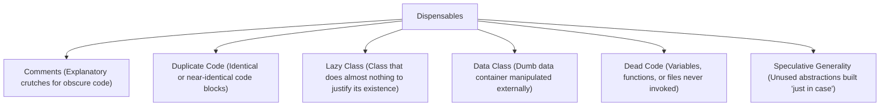

# Dispensables 🗑️

## Source Reference
* **Book:** *Dive Into Refactoring* (Alexander Shvets), Chapter: *Code Smells / Dispensables*
* **Design Pattern Links:** [Template Method](../../../design-patterns/behavioral/template-method.md), [Inline Class / Value Object](../../../design-patterns/structural/composite.md)

---

## Overview

A **Dispensable** is something pointless, redundant, or dead whose absence would make the codebase cleaner, smaller, and easier to understand. Dispensables add cognitive load, inflate line counts, and rot over time as the code evolves away from them.

---

## The 6 Code Smells in this Group

| Code Smell | Core Symptom | Primary Refactoring Technique | Treatment Goal |
| :--- | :--- | :--- | :--- |
| [**Comments**](comments.md) | Comments used as deodorant to explain cryptic code | Extract Method, Rename Variable | Self-documenting code |
| [**Duplicate Code**](duplicate-code.md) | Identical or similar logic pasted across multiple functions/classes | Extract Method, Pull Up Method | DRY (Don't Repeat Yourself) |
| [**Lazy Class**](lazy-class.md) | A class whose cost of maintenance exceeds its value | Inline Class, Collapse Hierarchy | Remove bloat |
| [**Data Class**](data-class.md) | A class with fields and getters/setters, but no behavior | Move Method, Encapsulate Field | Rich Domain Model |
| [**Dead Code**](dead-code.md) | Unreachable code, unused parameters, obsolete functions | Delete Code, Dead Code Elimination | Reduce codebase surface |
| [**Speculative Generality**](speculative-generality.md) | Unused hooks, abstract classes, and parameters built for hypothetical future needs | Collapse Hierarchy, Inline Class | YAGNI (You Aren't Gonna Need It) |

---

## Architectural Impact

Dispensables act like friction on a development team:
* **Mental Distraction:** Engineers waste time reading dead functions, obsolete comments, and empty pass-through classes.
* **Maintenance Burden:** Linting, type-checking, and CI pipelines still inspect and process dead code.
* **Misleading Mental Models:** Speculative abstractions lead new developers down false architectural paths.
