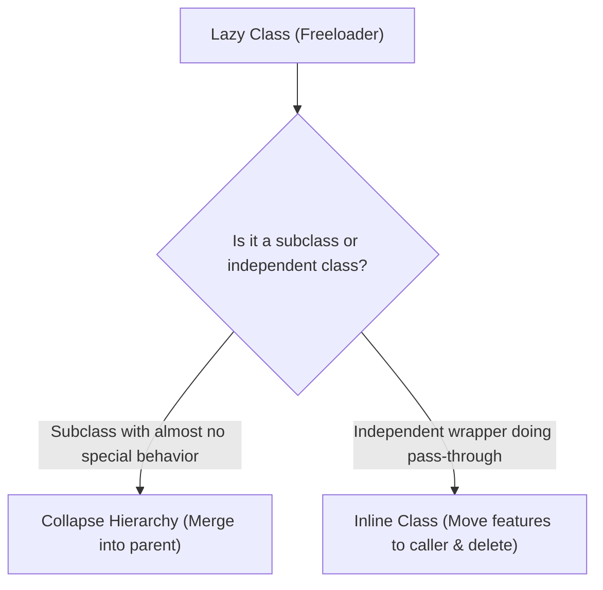

# Lazy Class (Freeloader) 🦥

## Source Reference
* **Book:** *Dive Into Refactoring* (Alexander Shvets), Chapter: *Code Smells / Dispensables / Lazy Class*
* **Target Language:** Modern Python 3 (Python 3.10+) with `pytest`.

---

## 1. Signs and Symptoms

A class that **does almost nothing** to justify its existence. It might have only one trivial method, or it simply acts as a redundant pass-through wrapper around another class without adding validation, transformation, or caching.

### Detection Checklist:
- [ ] A class has only 1 or 2 methods that simply forward arguments directly to another object: `def get_name(self): return self._person.get_name()`.
- [ ] A subclass overrides nothing and adds only one trivial trivial helper.
- [ ] The class was originally designed for a grand architecture that was abandoned, leaving an empty shell.
- [ ] Understanding the class takes longer than the actual code it contains.

---

## 2. Reasons for the Problem

1. **Downsizing After Refactoring:** A once-mighty class had most of its methods moved to other modules, leaving behind an anemic leftover.
2. **Premature Speculation:** A developer planned a multi-tier hierarchy for hypothetical requirements that never materialized.

---

## 3. Why It's Bad

* **Cognitive Overhead:** Every class in a project increases mental load for engineers navigating the file tree.
* **Indirection Without Benefit:** Jumping through layers of pass-through classes makes debugging and tracing execution frustrating.
* **Maintenance Taxes:** Linters, tests, and imports still have to process these ghost classes.

---

## 4. Recommended Treatment



1. **Inline Class:** Move the lazy class's remaining features directly into the class that uses it, then delete the lazy class.
2. **Collapse Hierarchy:** If the lazy class is a subclass or superclass that adds no meaningful distinction, merge it into its partner in the hierarchy.

---

## 5. Python Before & After Demonstration

### A. Smelly Code (A Redundant Wrapper Class)
```python
# report_smelly.py
class DocumentStyler:
  """Lazy class: simply wraps a string prefix without adding real value."""

  def __init__(self, theme_prefix: str) -> None:
    self.theme_prefix = theme_prefix

  def format_title(self, raw_title: str) -> str:
    return f"[{self.theme_prefix}] {raw_title}"


class ReportGenerator:

  def __init__(self, theme_prefix: str) -> None:
    # Pointless indirection to DocumentStyler
    self.styler = DocumentStyler(theme_prefix)

  def generate(self, title: str, content: str) -> str:
    formatted_title = self.styler.format_title(title)
    return f"{formatted_title}\n\n{content}"
```

### B. The Pytest Baseline Contract
```python
# test_report.py
from report_smelly import ReportGenerator


def test_report_generation():
  generator = ReportGenerator("CONFIDENTIAL")
  output = generator.generate("Q3 Review", "All targets met.")
  assert "[CONFIDENTIAL] Q3 Review" in output
```

### C. Refactored Clean Code (Inlining the Lazy Class)
```python
# report_clean.py
class ReportGenerator:
  """Clean class: inlined formatting logic directly, eliminating the freeloader."""

  def __init__(self, theme_prefix: str) -> None:
    self.theme_prefix = theme_prefix

  def format_title(self, raw_title: str) -> str:
    return f"[{self.theme_prefix}] {raw_title}"

  def generate(self, title: str, content: str) -> str:
    return f"{self.format_title(title)}\n\n{content}"
```

---

## 6. Payoff and Performance

| Dimension | Before Refactoring | After Refactoring |
| :--- | :--- | :--- |
| **Class Count** | 2 classes across multiple mental scopes | 1 cohesive class |
| **Call Chain Depth** | `ReportGenerator` $\rightarrow$ `DocumentStyler` $\rightarrow$ String formatting | Direct execution |
| **Maintenance Cost** | 2 classes to test, mock, and document | 1 simple class with zero pass-through indirection |

---

## 7. When to Ignore

* **Deliberate Extension Points:** A class created as a clear hook for impending features planned in the current active sprint.
* **Marker / Protocol Types:** Classes or Protocols with zero methods used strictly for static type differentiation (e.g., `class Serializable(Protocol): ...`).
