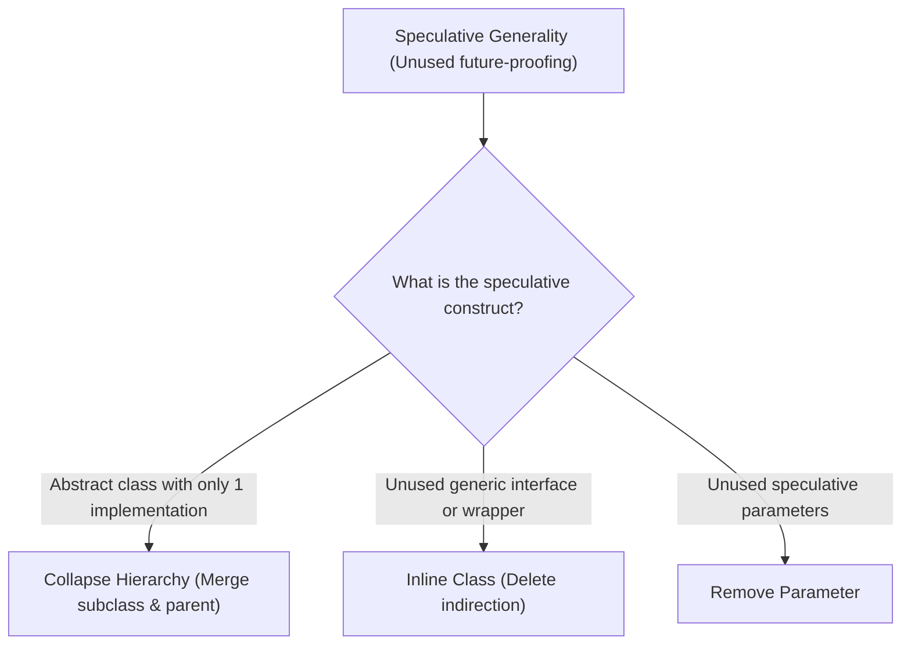

# Speculative Generality 🔮

## Source Reference
* **Book:** *Dive Into Refactoring* (Alexander Shvets), Chapter: *Code Smells / Dispensables / Speculative Generality*
* **Design Principle Bridge:** YAGNI (*You Aren't Gonna Need It*), KISS (*Keep It Simple, Stupid*)
* **Target Language:** Modern Python 3 (Python 3.10+) with `pytest`.

---

## 1. Signs and Symptoms

There is an unused abstract class, generic interface, plugin hook, or configuration parameter that was created **"just in case we need it in the future"**. The anticipated future feature was never built, leaving behind over-engineered scaffolding that solves a problem the software doesn't actually have.

### Detection Checklist:
- [ ] An abstract base class or Protocol exists with only one single concrete implementation in the entire application.
- [ ] Functions accept speculative parameters (`reserved_field_1=None`, `callback_hook=None`) that are never used.
- [ ] Deep, nested inheritance hierarchies or plugin frameworks exist for features that have only ever had a single requirement.
- [ ] Developers must navigate 4 layers of interfaces just to locate the 5 lines of code that actually execute work.

---

## 2. Reasons for the Problem

Speculative generality stems from good intentions: an engineer wants to anticipate every possible future requirement and design an "infinitely extensible" framework upfront. However, business requirements rarely evolve in the exact way engineers predict, leaving the speculative abstractions useless and burdensome.

---

## 3. Why It's Bad

* **Accidental Complexity:** Understanding and debugging simple features requires navigating abstract factories, visitor delegates, and lifecycle hooks.
* **Architecture Rigidity:** Ironically, speculative abstractions often lock the system into the *wrong* abstraction, making the *real* future changes harder to implement.
* **Testing Friction:** Every level of speculative indirection requires mock objects and interface tests.

---

## 4. Recommended Treatment



1. **Collapse Hierarchy:** Merge the unused abstract class into its single concrete implementation.
2. **Inline Class:** Remove intermediate forwarding classes and let callers access the target directly.
3. **Remove Parameter:** Delete unused parameters that were added for hypothetical future needs.

---

## 5. Python Before & After Demonstration

### A. Smelly Code (Over-Engineered Generic Pipeline for 1 Single File Task)
```python
# pipeline_smelly.py
from abc import ABC, abstractmethod
from typing import Any, Generic, TypeVar

T = TypeVar("T")
R = TypeVar("R")


# Speculative generic framework:
class DataTransformer(ABC, Generic[T, R]):

  @abstractmethod
  def transform(
      self, input_data: T, context_hooks: dict[str, Any] | None = None
  ) -> R:
    ...


class AbstractPipelineManager(ABC):

  @abstractmethod
  def execute_pipeline(self, transformer: DataTransformer) -> Any:
    ...


# The ONLY implementation that actually exists in production:
class StringToUpperTransformer(DataTransformer[str, str]):

  def transform(
      self, input_data: str, context_hooks: dict[str, Any] | None = None
  ) -> str:
    return input_data.strip().upper()
```

### B. The Pytest Baseline Contract
```python
# test_pipeline.py
from pipeline_smelly import StringToUpperTransformer


def test_transformation():
  transformer = StringToUpperTransformer()
  assert transformer.transform("  hello world  ") == "HELLO WORLD"
```

### C. Refactored Clean Code (Pragmatic Simplicity - YAGNI)
```python
# pipeline_clean.py
def normalize_text(text: str) -> str:
  """Clean, direct, and zero speculative overhead.

  If complex pipeline transformation is ever needed in 2 years,
  refactor it when that requirement genuinely arrives.
  """
  return text.strip().upper()
```

---

## 6. Payoff and Performance

| Dimension | Before Refactoring | After Refactoring |
| :--- | :--- | :--- |
| **Lines of Code** | 35 lines of abstract classes, type vars, and unused hooks | 2 lines of clear, self-explanatory code |
| **Mental Overhead** | Must understand Generics, Abstract Methods, and Context Hooks | Immediately understood by any junior developer |
| **Execution Speed** | Layered method resolution and dynamic dispatch | Fast, direct Python function execution |

---

## 7. When to Ignore

* **Frameworks & SDK Libraries:** If you are building a reusable library or framework (like FastAPI or Pytest plugins) intended for external third-party developers, public hook points and abstract interfaces are intentional architectural contracts.
