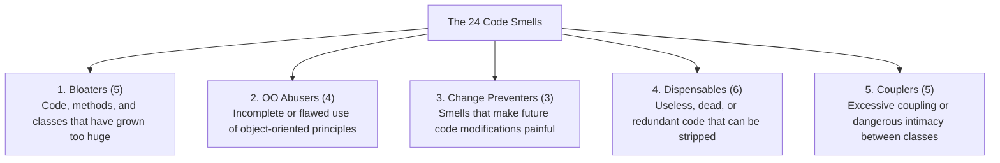

# The 24 Code Smells 👃

> *"If it stinks, change it."* — Kent Beck, grandmother's rule of code hygiene
>
> *"Code smells are key signs that refactoring is necessary. Smells don't always mean that code needs to be modified immediately; they are indicators of deeper architectural problems that demand inspection."* — Alexander Shvets, *Dive Into Refactoring*

Welcome to the **Code Smells Diagnostic Hub**. This catalog documents all 24 classic code smells categorized into five distinct architectural families.

---

## 🧭 The Five Code Smell Families

---

## 📋 The 24 Smells Catalog

### 1. [Bloaters](bloaters/)
Code, methods, and classes that have ballooned to such gigantic proportions that they are hard to understand and maintain:
* **[Long Method](bloaters/long-method.md)**: A method that contains too many lines of code (generally $> 10-15$ lines).
* **[Large Class](bloaters/large-class.md)**: A class that has grown too many fields, methods, and responsibilities (*God Class*).
* **[Primitive Obsession](bloaters/primitive-obsession.md)**: Using raw primitive types (`str`, `int`, `dict`) instead of small domain objects.
* **[Long Parameter List](bloaters/long-parameter-list.md)**: More than three or four parameters passed to a single function.
* **[Data Clumps](bloaters/data-clumps.md)**: Different groups of variables that repeatedly appear together across parameters or classes.

### 2. [Object-Orientation Abusers](oo-abusers/)
Incomplete or incorrect application of object-oriented polymorphism:
* **[Switch Statements](oo-abusers/switch-statements.md)**: Complex `if-elif-else` or `switch` blocks that should be polymorphic objects.
* **[Temporary Field](oo-abusers/temporary-field.md)**: Instance variables that only hold values under rare circumstances or specific algorithms.
* **[Refused Bequest](oo-abusers/refused-bequest.md)**: Subclasses that inherit superclass methods they do not want, often raising `NotImplementedError`.
* **[Alternative Classes with Different Interfaces](oo-abusers/alternative-classes.md)**: Two classes that perform the same role but expose different method names.

### 3. [Change Preventers](change-preventers/)
Smells that violate the Single Responsibility and Open-Closed principles, multiplying development cost:
* **[Divergent Change](change-preventers/divergent-change.md)**: A single class is repeatedly changed in different ways for completely separate business reasons.
* **[Shotgun Surgery](change-preventers/shotgun-surgery.md)**: Making a single business change requires making dozens of tiny edits across many separate files.
* **[Parallel Inheritance Hierarchies](change-preventers/parallel-inheritance.md)**: Adding a subclass to one hierarchy forces you to create a matching subclass in another.

### 4. [Dispensables](dispensables/)
Pointless code whose removal makes the codebase cleaner, lighter, and easier to understand:
* **[Comments](dispensables/comments.md)**: Explanatory comments used as "deodorant" to mask confusing, poorly named code.
* **[Duplicate Code](dispensables/duplicate-code.md)**: Identical or subtly similar code copy-pasted across modules.
* **[Lazy Class](dispensables/lazy-class.md)**: A class that does so little it does not justify the cost of maintaining it.
* **[Data Class](dispensables/data-class.md)**: A class that has only properties and getters/setters, but zero domain behavior.
* **[Dead Code](dispensables/dead-code.md)**: Functions, parameters, or variables that are never executed.
* **[Speculative Generality](dispensables/speculative-generality.md)**: Unused abstract base classes or parameters built for hypothetical future requirements (*YAGNI violation*).

### 5. [Couplers](couplers/)
Smells that contribute to excessive coupling between modules or excessive delegation:
* **[Feature Envy](couplers/feature-envy.md)**: A method that accesses the data of another object more than its own.
* **[Inappropriate Intimacy](couplers/inappropriate-intimacy.md)**: Two classes that probe deeply into each other's private or internal members.
* **[Message Chains](couplers/message-chains.md)**: A client navigating deeply nested method calls (`a.get_b().get_c().get_d().execute()`).
* **[Middle Man](couplers/middle-man.md)**: A class whose only job is delegating work to another class.
* **[Incomplete Library Class](couplers/incomplete-library.md)**: A third-party library class missing an essential domain operation.
